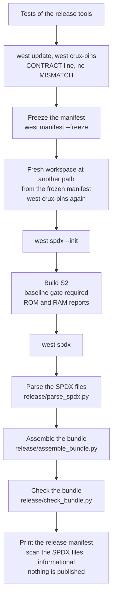

# Release

Status: no release exists and no tag has been made. The only release flow that runs is a dry run in
CI. It builds, assembles the bundle and checks it, and it publishes nothing.

The general rules for releasing a product on Crux are in the Crux composition guide, section
"Release": [`docs/product-composition.md` at the pinned revision `37c92b18`](https://github.com/wonny-labs/crux-pilot/blob/37c92b18b44b7dfb95c2109f036f23d00f05cb4c/docs/product-composition.md).
This page does not copy it. It says only what this repository does.

## The flow

The workflow is `.github/workflows/release.yml`. It runs by hand (`workflow_dispatch`) and on pull
requests that change the workflow, `release/` or `west.yml`.

| Step | Tool | What fails the run |
|---|---|---|
| Pins | `west crux-pins` | no `CONTRACT crux-pilot` line, or any `MISMATCH` |
| Freeze | `west manifest --freeze` | a manifest west cannot freeze |
| Fresh workspace | `west init --mf`, `west update` | a revision that cannot be fetched |
| Build | `west build` with `-DCRUX_REQUIRE_VERIFIED_ZEPHYR=ON` | a Zephyr that is not the verified baseline, or a build error |
| SPDX | `west spdx`, then `release/parse_spdx.py` | a file that does not parse as tag-value SPDX 2.3, or lacks a document header field |
| Bundle | `release/assemble_bundle.py`, `release/check_bundle.py` | see below |

A second workflow, `.github/workflows/rebuild.yml`, builds the same image twice in two fresh
workspaces at different paths and compares `zephyr.bin` and the `firmware_identity` of the build.

## What the bundle holds

The bundle holds hashes and identities and nothing else: `release-manifest.json` (schema in
`release/release-manifest.schema.json`), the frozen manifest `west.lock.yml` and the pin report
`pins-report.txt`. The manifest records the product version, the security counter, the release tag,
the SDK version, the runner image, the target, the hash of each bundle item, the SHA-256 of
`zephyr.bin` and the `firmware_identity`.

**The firmware image, `.elf` and `.map` files are never published**: not in the bundle, not as a
CI artefact, not on a release page. `release/check_bundle.py` refuses a bundle that holds an image, an
`.elf` or `.map` file, a file that starts like an ELF, an Intel HEX or S-record dump, or an archive,
and an item with an absolute path of a build machine. No workflow in this repository uploads an
artefact, and a test (`tests/tooling/test_s0_build.py`) fails if one starts to.

The full SBOM from `west spdx` is parsed in the dry run but is not in the bundle yet. Whether it can go
out as it is has not been decided.

## Tags

A tag needs the repository owner's approval, given for that tag. Nothing in this repository tags,
creates a GitHub Release or publishes on its own, and no workflow has the permission to: they run with
`contents: read`. The values of the dry run (`PRODUCT_VERSION`, `SECURITY_COUNTER`, `RELEASE_TAG`) are
placeholders for a tag that has not been approved.

## Support

No support period is promised. Only the latest release is supported. See `SECURITY.md` for reporting a
vulnerability.
