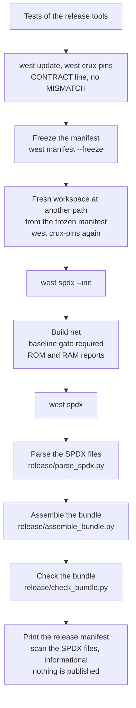

# Release

Status: no release exists and no tag has been made. The only release flow that runs is a dry run in
CI. It builds, assembles the bundle and checks it, and it publishes nothing.

The general rules for releasing a product on Crux are in the Crux composition guide, section
"Release": [`docs/product-composition.md` at the pinned revision `13301954`](https://github.com/wonny-labs/crux/blob/1330195487c34c8df6046d41ae030d3cdf8a5138/docs/product-composition.md).
This page does not copy it. It says only what this repository does.

## Versions

The rules for daily work, such as what `main` carries, are in [CONTRIBUTING.md](CONTRIBUTING.md#versions-releases-and-tags).
This section holds the release rules.

- `X.Y.Z-dev` is `main` between releases. `X.Y.Z-rc.N` is a release candidate. `X.Y.Z` is a release.
- A release is explicit. The owner approves it, and it is made in a release task: the release pull request
  drops the suffix in `CONTROLLER_VERSION_PRERELEASE` and `CONTROLLER_VERSION_STRING`, and moves the
  CHANGELOG entries under the release number.
- The owner approves the merge of the release pull request. The owner then tags that merge commit
  `vX.Y.Z` with an annotated tag. Tags are never moved.
- Right after a release, `main` moves to the next version in a pull request: `X.(Y+1).0-dev`.
- Only tags of the form `vX.Y.Z` exist. A release candidate is a version string, not a tag.
- Before 1.0.0 (versions `0.Y.Z`), every release from `main` raises the minor number, breaking changes
  included. A patch release `0.Y.(Z+1)` comes only from a release branch `v0.Y.x`, cut from the tag when it
  is needed.
- From 1.0.0, follow [Semantic Versioning 2.0.0](https://semver.org/spec/v2.0.0.html): a major number for an
  incompatible change, a minor number for a compatible addition, a patch number for a fix.
- Releases happen when they are needed, not on a calendar.

## The flow

The workflow is `.github/workflows/release.yml`; its steps are the checks of the job `release` in `scripts/ci/checks.toml`.
It runs by hand (`workflow_dispatch`), in the nightly CI tier and on pull requests that change the workflow, `release/`, `west.yml` or `scripts/ci/`.

| Step | Tool | What fails the run |
|---|---|---|
| Pins | `west crux-pins` | no `CONTRACT crux` line, or any `MISMATCH` |
| Freeze | `west manifest --freeze` | a manifest west cannot freeze |
| Fresh workspace | `west init --mf`, `west update` | a revision that cannot be fetched |
| Build | `west build` with `-DCRUX_REQUIRE_VERIFIED_ZEPHYR=ON` | a Zephyr that is not the verified baseline, or a build error |
| SPDX | `west spdx`, then `release/parse_spdx.py` | a file that does not parse as tag-value SPDX 2.3, or lacks a document header field |
| Bundle | `release/assemble_bundle.py`, `release/check_bundle.py` | see below |

A second workflow, `.github/workflows/rebuild.yml`, builds the same image twice in two fresh
workspaces at different paths and compares `zephyr.bin` and the `firmware_identity` of the build.

## What the bundle holds

The bundle holds hashes and identities and nothing else: `release-manifest.json` (schema in
`release/release-manifest.schema.json`), the frozen manifest `west.lock.yml` and the pin report
`pins-report.txt`. The manifest records the product version, the security counter, the release tag,
the SDK version, the runner image, the target, the hash of each bundle item, the SHA-256 of
`zephyr.bin` and the `firmware_identity`.

**The firmware image, `.elf` and `.map` files are never published**: not in the bundle, not as a
CI artefact, not on a release page. `release/check_bundle.py` refuses a bundle that holds an image, an
`.elf` or `.map` file, a file that starts like an ELF, an Intel HEX or S-record dump, or an archive,
and an item with an absolute path of a build machine. No workflow in this repository uploads an
artefact, and a test (`tests/tooling/test_base_build.py`) fails if one starts to.

The full SBOM from `west spdx` is parsed in the dry run but is not in the bundle yet. Whether it can go
out as it is has not been decided.

## Tags

A tag needs the repository owner's approval, given for that tag. Nothing in this repository tags,
creates a GitHub Release or publishes on its own, and no workflow has the permission to: they run with
`contents: read`. The values of the dry run (`PRODUCT_VERSION`, `SECURITY_COUNTER`, `RELEASE_TAG`) are
placeholders for a tag that has not been approved.

## Support

No support period is promised. Only the latest release is supported. See `SECURITY.md` for reporting a
vulnerability.
