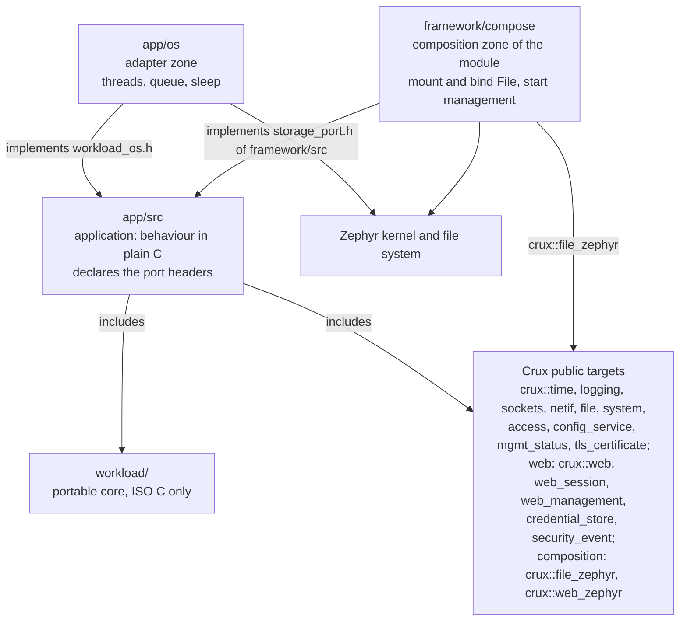

# Architecture

This page explains how the repository is built, for a reader who has not seen Crux or this
repository before. Terms in italics on first use, and the words "product", "platform" and "composition",
are used as the [glossary](glossary.md#product-platform-and-composition) explains. What exists is in the
[roadmap](roadmap.md), and the rules for a change are in [CONTRIBUTING.md](../CONTRIBUTING.md).

## What the controller is and does

Crux Controller (this repository, `crux-controller`) is a controller framework for products built on Crux,
an embedded software platform that lives in the repository [`crux`](https://github.com/wonny-labs/crux):
a Zephyr module that products import, with a base image that runs its services and no application. Its images are
built for one board, the NXP RT1060-EVKB Rev B, on the Zephyr RTOS. Crux
publishes components such as Time, Logging, a Sockets profile, File and System as public headers and
CMake targets (`crux::time`, `crux::logging` and so on). This repository takes those components the
way an outside product would, through public headers and public targets only, and it checks that rule
in CI. Where a product cannot reach something, the gap is written down as a *finding* instead of being
worked around. It is not a product (a product imports it), it adds no Crux interface, and it has no real
control logic.

What the firmware does is deliberately small. A synthetic *workload* runs on two Zephyr threads: a
producer counts cycles (every 100 ms by default) and queues one numbered message every tenth cycle,
and a consumer takes each message off a queue and writes it to the log on a UART. Each *build configuration* after
`workload` adds one capability, chosen at build time with a Kconfig option: send each message to a TCP peer (`net`), keep
the workload's configuration record in a file on a microSD volume (`file`), report the reset cause at
boot and feed a hardware watchdog (`system`), set the Crux Time realtime clock from an SNTP server over the `net`
network (`sntp`), and manage the device over HTTPS on the same network (`management`). Each configuration has its own build, its own tests and its own
resource budget. Nothing else runs on the board, and little of it has run on a board at all; see the
[roadmap](roadmap.md).

## Layers and zones

Source is split into the four trees below and the four trees of the framework module (see
[The controller framework](#the-controller-framework)). A script, `scripts/check_boundary.py`, reads every `#include` in each
tree and fails the CI job `Boundary check` when a tree includes something it may not. The exact lists
are in `scripts/check_boundary.py` and are explained in [composition-zone.md](composition-zone.md);
this table is a summary of the lists on `main`.

The arrows from `app/os` and `framework/compose` to `app/src` mean that the zone implements a port header that
the application uses: `app/os` implements `app/src/workload_os.h`, and `framework/compose` implements the port
headers of `framework/src`, which `app/src` includes. The application calls the port and the zone implements it; the two are joined by
the linker, and no `#include` crosses the line the other way. `management` adds a third directory that is not a
zone, `framework/management`, which holds build files and data for the web route table (see below).

| Tree | Role | May include | Fails on, among others |
|---|---|---|---|
| `workload/` | The portable core of the workload: configuration record, periodic cycle, message wire form. Built for the image and for the host tests. | ISO C and its own tree | any Crux, Sockets profile or Zephyr header |
| `app/src` | The application: composition, thread glue, and the code of each capability. Plain C. | ISO C, the Sockets profile headers, public `<crux/NAME.h>` headers except the frozen three, its own tree, `workload/include`, the headers of `framework/src`, `<controller/NAME.h>` | any Zephyr header, the *frozen headers*, `<crux/file_zephyr.h>`, `<crux/web_zephyr.h>`, `<crux/cli_zephyr.h>`, a quoted include of a header of a zone |
| `app/os` | The adapter zone. The one place that creates threads, queues messages and sleeps, with Zephyr kernel calls, for the configurations of the workload. `framework/os` is the adapter zone of the module: it queries the SNTP server and carries out the health supervision, with the supervision headers of [composition-zone.md](composition-zone.md#the-supervision-headers-of-frameworkos) on top of this list. | ISO C, public `<crux/NAME.h>` headers except the frozen three, `zephyr/kernel.h`, `zephyr/net/sntp.h`, its own tree, header files (`.h`) of `app/src` | the Sockets profile and other POSIX headers, any composition interface, every other Zephyr header, vendor headers, the frozen three |
| `framework/compose` | The composition zone of the module. The one place that mounts a file system and binds it to Crux File, the one place that starts HTTPS management with the Web composition interface and registers its TLS material (`management`, `base`), and the one place that starts the serial command line (`base`). `app/compose` keeps the same rule and holds no source. | ISO C, public `<crux/NAME.h>` headers, `<crux/file_zephyr.h>`, `<crux/web_zephyr.h>`, `<crux/cli_zephyr.h>`, `zephyr/fs/fs.h`, `zephyr/devicetree.h`, `zephyr/net/tls_credentials.h`, its own tree, header files (`.h`) of `framework/src` | the Sockets profile, Crux private or port headers, every other Zephyr header, vendor headers |

Points that the table cannot carry:

- **Why zones exist.** Application code should name no provider and no Zephyr facility, so that its
  behaviour stays plain C that a host test can run. Something has to call Zephyr, though. A zone is a
  directory where one narrow kind of Zephyr or composition use is allowed, with an exact allow-list
  and a reason for each entry. Without zones, either the application would grow Zephyr includes or a
  capability such as File could not be composed at all. There is no per-file exception.
- **The allow-lists are exact.** `OS_ADAPTER_ZEPHYR_HEADERS`, `FRAMEWORK_OS_ZEPHYR_HEADERS` and `COMPOSITION_ZEPHYR_HEADERS` in
  `scripts/check_boundary.py` are sets of names with no wildcards. Changing one is a change of the script,
  of `tests/tooling/test_boundary.py` and of [composition-zone.md](composition-zone.md) in one reviewed
  pull request.
- **`zephyr/net/sntp.h` is allowed in the adapter zones `app/os` and `framework/os`, and one source includes it:
  `framework/os/time_sync_zephyr.c` (`sntp`, `base`).** That file calls the Zephyr SNTP library's string-based
  `sntp_simple()` and nothing else of it, so it includes no socket header.
- **The frozen-header rule covers `app/src` and `app/os`.** `<crux/thread.h>`, `<crux/sync.h>` and
  `<crux/serial.h>` are public Crux headers, and the product does not use them: threads and queues come
  from Zephyr in `app/os`. The check keeps that from being undone silently. The rule is not applied to
  `workload/` (which may include no Crux header at all) or to `framework/compose`. Crux removed `<crux/queue.h>`
  at the pinned revision, so the check refuses it as a name that Crux does not publish, not as a frozen
  header.
- **The check reads includes only.** It cannot see include paths that CMake adds, so no build file here
  adds one, and `tests/tooling` checks that. An include whose operand is a macro fails, because it cannot
  be checked.
- **Inside the checked trees.** `app/os` holds `workload_os_zephyr.c` (every configuration of the workload), and
  `framework/os` holds `time_sync_zephyr.c` (added to the application target of `sntp` by
  `framework/configurations.cmake`, and built into the framework library for `base`) and the adapters of the
  health supervision (`base`). `framework/compose` is a static library, the only target that links `crux::file_zephyr`.

## The controller framework

The controller framework is a Zephyr module of this repository: `zephyr/module.yml`, `zephyr/Kconfig` and
`zephyr/CMakeLists.txt`. The Kconfig symbol `CRUX_CONTROLLER_FRAMEWORK` turns it on, and each service under it
(`CRUX_CONTROLLER_FRAMEWORK_MANAGEMENT`, `CRUX_CONTROLLER_FRAMEWORK_CLI_SERIAL`, `CRUX_CONTROLLER_FRAMEWORK_TIME_SYNC`,
`CRUX_CONTROLLER_FRAMEWORK_SUPERVISION`, `CRUX_CONTROLLER_FRAMEWORK_REBOOT`) is on by default when the Crux and Zephyr
symbols it needs are on. A product's `main()` calls `controller_framework_start()` of `<controller/framework.h>` once;
the start function runs a table of steps with the portable startup sequence of `framework/src/startup.c` and logs the
name and result of each:

1. clock: the Crux monotonic clock answers; a failure stops startup. With health supervision, the reset cause is read
   once and cleared, the retained region is read, and the boot counter decides normal boot or safe mode.
2. supervisor: the supervisor thread arms the Crux System watchdog with one timeout and supervises every later step.
3. web management: the storage mount, the credential store, Access, the configuration and status services, Crux
   Reboot, the TLS certificate, sessions, web management and the listener, in the order of
   `framework/src/management_port.h`; then the framework's reboot thread.
4. command line: the Crux serial console on the UART of the devicetree alias `crux-serial0`, with its login, its
   first-account setup and the framework's commands (`framework/src/cli_port.h`). It needs Access, so it runs only
   after step 3 succeeded.
5. time synchronisation: the SNTP thread of `framework/src/time_sync.c`; left out in safe mode.
6. application: no application is given yet, and startup supervision ends.

A failure of steps 3 to 5 is logged and the controller runs without that service. The framework creates no
application thread and takes no application yet.

Health supervision follows specification sections 4 and 5 of the controller framework. The supervisor feeds the
watchdog only while the current step is within its deadline and no task watchdog channel of a framework thread (time
synchronisation, reboot) has expired; a hang latches the fault, writes the last-fault record to the retained region
and ends in a reset. The framework's fatal error handler writes a minimal record and resets: in thread context
through Crux System, and in the fault exception of a Cortex-M by halting, so that the armed hardware watchdog
resets the device; with no armed watchdog the halt is final. Consecutive fault
resets lead to safe mode, which leaves out time synchronisation and the application, and the serial command
`recovery exit` leaves it through Crux Reboot with the operator reset marker. The rules are portable C with host
tests (`framework/src/boot_record.c`, `supervision.c`, `controller_state.c`, `reboot_policy.c`), the threads, the
task watchdog, the retained region and the fatal error handler are in `framework/os`, and the status items and
commands are in `framework/compose/supervision_start.c`. The status service shows the controller state, the boot
counter, the watchdog state, the last-fault record and the thread with the least unused stack. Which reset cause
the board reports and whether the retained region survives its resets are board facts that no board run has shown. The base image (`base`) is `app/` with `app/conf/base.conf`:
its `main()` calls the start function, and `app/CMakeLists.txt` links `controller::framework` and calls
`controller_framework_image()`, which adds the route table and the packaged page to the target `app`. The
configurations built on the workload do not combine with the framework, and `app/CMakeLists.txt` stops a build
that asks for both.

| Tree | Role |
|---|---|
| `include/` | The interface headers `<controller/framework.h>` and `<controller/version.h>` |
| `framework/src` | The portable core: startup sequence, start function, time synchronisation glue and policy, management policy, boot counter and reset rules, supervision decisions, controller and application states, port headers |
| `framework/compose` | The composition zone of the module: storage mount, web management start, serial command line start, the status items and commands of health supervision |
| `framework/os` | The adapter zone of the module: the SNTP query and its thread, the supervisor thread, the task watchdog, the retained region, the fatal error handler and the reboot thread |
| `framework/management/` | The build files and data of the web route table: the packaged page, the reviewed route list, `management.cmake` and `entropy.cmake` |

`<controller/version.h>` holds the framework version and is the only place it is kept. It follows
[Semantic Versioning 2.0.0](https://semver.org/spec/v2.0.0.html): `main` carries the next planned release with
`-dev`, and no release or tag exists yet. It is not an image's version: an application sets that in a Zephyr
`VERSION` file next to its `CMakeLists.txt` ([Application version management](https://docs.zephyrproject.org/latest/build/version/index.html)),
and the images of this repository have none.

The include rules of these trees are in [composition-zone.md](composition-zone.md#the-trees-of-the-framework-module).

A product imports the framework as a project of its own west workspace. The nightly check `product-integration`
shows that with a fixture product, `tests/product_integration`: its manifest lists `crux-controller` at the commit
under test and imports its manifest, so Crux comes at the pin of this repository; its CMake file names no path of
`crux-controller`, and west finds the module. `tests/product_integration/run.sh` makes the workspace, builds the
fixture for `native_sim` and runs it.

## How Crux is consumed

Crux states the general rules for a product in its own guides at the pinned revision:
[Choosing an API](https://github.com/wonny-labs/crux/blob/1330195487c34c8df6046d41ae030d3cdf8a5138/docs/choosing-an-api.md)
(Zephyr, Crux or product code) and
[Composition interfaces](https://github.com/wonny-labs/crux/blob/1330195487c34c8df6046d41ae030d3cdf8a5138/docs/composition-interfaces.md).
This section shows how this repository applies them.

- **Manifest.** `west.yml` makes this repository the west manifest repository. It imports `crux`
  at a pinned full commit (the `revision` in `west.yml`), never a branch or tag, and adds one
  test-only project, `picolibc`, for the `native_sim` scenario of `net`. Crux's own manifest brings Zephyr and
  the Zephyr modules, so this repository does not name them. The import blocks the three GPL or commercial
  projects (`wolfssl`, `wolfssh`, `wolfpsa`) by name; the optional Crux groups stay off. Details and
  licences are in [dependencies.md](dependencies.md).
- **Where the pinned revision is recorded.** `west.yml` is the source. The revision is repeated in
  `tests/tooling/test_manifest.py` (the approved commit), [dependencies.md](dependencies.md),
  [RELEASE.md](../RELEASE.md) and [CHANGELOG.md](../CHANGELOG.md), and a test (`tests/tooling/test_docs.py`)
  checks that the last three carry the short hash. The `West pins` job runs `west crux-pins`, which must
  print a `CONTRACT crux` line and no `MISMATCH`. Moving the *pin* is its own small pull request; the
  steps are in [CONTRIBUTING.md](../CONTRIBUTING.md). Notes under `docs/findings/` keep the revision they
  were read at and are not updated when the pin moves.
- **Crux pieces used, and in which configuration.** Each is a public target linked in `app/CMakeLists.txt`, plus
  the Kconfig symbol that a conf fragment turns on.

  | Crux piece | Header or target | Configuration | Used from |
  |---|---|---|---|
  | Time | `crux::time`, `<crux/time.h>`, `<crux/status.h>`; `sntp` also `<crux/time_authority.h>`, which `crux::time` provides | `minimal` and later; `sntp` sets the realtime clock | `app/src/composition.c`, `app/src/workload_thread.c`; `sntp`: `framework/src/time_sync.c`, the one file that calls the Time authority |
  | Logging | `crux::logging`, `<crux/logging.h>` | `workload` and later | `app/src/workload_thread.c` and the code of each capability |
  | Sockets profile and network interface | `crux::sockets`, `crux::netif`, POSIX socket headers | `net` | `app/src/net_client.c` |
  | File | `crux::file`, `<crux/file.h>` in the application; `crux::file_zephyr` and `<crux/file_zephyr.h>` in the composition zone only | `file` | `app/src/config_store.c`, `framework/compose/storage_mount.c` |
  | System | `crux::system`, `<crux/system.h>` | `system` | `app/src/health.c` |
  | Access, credential store, security events | `crux::access`, `crux::credential_store`, `crux::security_event`, `<crux/access.h>`, `<crux/credential_store.h>`, `<crux/security_event.h>` | `management` | `framework/compose/management_start.c` |
  | Configuration service, status service | `crux::config_service`, `crux::mgmt_status` | `management` | `framework/compose/management_start.c` |
  | TLS certificate | `crux::tls_certificate`, `<crux/tls_certificate_start.h>` | `management` | `framework/compose/management_start.c`, the one file that takes the key material |
  | Web server, sessions, management | `crux::web`, `crux::web_session`, `crux::web_management`; `crux::web_zephyr` and `<crux/web_zephyr.h>` in the composition zone only | `management` | `framework/compose/management_start.c`; the route sources are Crux's own, named in `framework/management/management.cmake` |

  Product code includes no Crux Thread, Sync, Queue or Serial header, in any configuration, and no fragment of this
  repository names their symbols. In `workload` to `sntp` nothing selects them. The Crux services of `management` need Thread and Sync
  and select them for themselves, so the `management` image has them on. This repository adds no Crux public interface.
- **Build and board.** Every CI build of the image is for `mimxrt1060_evk@B//qspi` with the *baseline
  gate* required. The `native_sim` scenarios are the exception: they run on the simulated board. CI is the reference for the Zephyr builds and Twister runs;
  the [Tutorial](tutorial.md) and [Set up without the Dev Container](native-setup.md) give the CI commands for a
  local `native_sim` run, and a local result does not replace CI.

## What runs in the image: threads and scheduling

`main()` calls `composition_start()` in `app/src/composition.c` and returns. What
`composition_start()` starts depends on the Kconfig options of the build. In this order:

1. `minimal`: reads the Crux monotonic clock once, and fails if it does not answer.
2. `workload`: builds the default workload configuration. With `file` on, it first mounts the volume, binds File and
   loads the saved record, or saves the default when none exists. A volume that does not mount leaves
   the default in use and is never formatted.
3. `system`: logs the reset cause and clears the flags, starts the watchdog with an interval of about ten
   workload cycles, and registers a cycle hook. It runs after the storage of `file` so that a slow mount
   cannot cost a reset.
4. `net`: registers a sink so that each logged message is also sent to the TCP peer.
5. `sntp`: calls `time_sync_start()`, which prepares the realtime provider of Crux Time and starts the
   time synchronisation thread through the port `framework/src/time_sync_port.h`. A failure is logged and the
   workload starts either way. `sntp` depends on `net` in Kconfig.
6. `management`: calls `management_port_start()`, which runs on this thread, in the order that
   `framework/src/management_port.h` documents, the Crux services and the web server, and returns. A refusal at any
   step is logged under the tag `mgmt` and leaves management off; the workload starts either way. The sequence
   makes a key and formats the RAM disk on the main thread, and the time that takes has not been measured.
7. `workload`: starts the two workload threads through the port `app/src/workload_os.h`.

| Thread | Created by | Zephyr priority | Stack | What it does |
|---|---|---|---|---|
| main | Zephyr | not set by this repository | 4096 bytes (`CONFIG_MAIN_STACK_SIZE` in `app/conf/workload.conf`), 16384 in `management` | Runs `composition_start()`, then ends. |
| producer | `app/os`, through `workload_os_start()` | 5 | `CONFIG_CRUX_CONTROLLER_WORKER_STACK`: 4096 bytes by default, 8192 in `net` | Counts cycles on the Crux monotonic clock, sleeping in slices of at most 50 ms. For each pass with cycles due it calls the cycle hook (`system` feeds the watchdog here), then queues a message for every `message_every`-th cycle. |
| consumer | `app/os` | 5 | the same size | Waits on the queue for up to 50 ms, logs `cycle=<n> value=<v>` under the tag `workload`, then calls the sink (`net` does its TCP exchange here, on this thread). |
| time synchronisation (`sntp`, `base`) | `framework/os`, through `time_sync_port_start()` | 10 | `CONFIG_CRUX_CONTROLLER_TIME_STACK`: 8192 bytes by default | Waits 5 seconds, then queries the SNTP server once and again after every `CONFIG_CRUX_CONTROLLER_TIME_INTERVAL_S` seconds (600 by default); the policy decides whether the answer sets the Crux Time realtime clock. |
| web session worker, web management worker, security event drain (`management`, `base`) | Crux services, started by the composition zone | 11 | `CRUX_THREAD_STACK_BYTES` of Crux, 8192 by default with the web session | Verify a login (password hashing), run a configuration save, write security events to Logging. Starting values, not measured. |
| HTTP server (`management`, `base`) | Zephyr | the lowest preemptive priority; Crux has no setting for it | `CONFIG_HTTP_SERVER_STACK_SIZE`: 16384 bytes | Accepts connections, runs each TLS handshake inside accept and serves requests. Not measured. |
| log processing | Zephyr, deferred logging | 14 | 2048 bytes | Writes the log lines to LPUART1 at 115200 baud. |

Priority numbers are Zephyr's, where a lower number is a higher priority, so the workload threads
preempt the log thread. The two workload threads have equal priority and are created with the consumer
first. The queue is a Zephyr `k_msgq` of 8 messages of 8 bytes. When it is full the producer logs a
warning and drops the message. The default configuration is a 100 ms period and a message every 10
cycles, so about one message per second. The watchdog is hardware (WDOG1 on this board), not a thread,
and only the producer feeds it. The numbers come from `app/os/workload_os_zephyr.c`,
`app/conf/workload.conf`, `app/src/workload_thread.c`, `workload/include/workload.h`, `framework/os/time_sync_zephyr.c`
and `app/Kconfig`. The stack sizes are declared values; stack use has not been measured, and the `sntp` thread's
priority and stack are starting values.

On `native_sim` the scenarios in `tests/native_sim` (and the `management` scenario in `tests/native_sim_mbed`) are Zephyr ztest applications that compile chosen
sources of `app/` and `workload/`. They do not boot the `app/` image.

## Why the evidence comes from CI

[CONTRIBUTING.md](../CONTRIBUTING.md) says that CI is the reference for the Zephyr builds and the Twister runs, that
[Set up without the Dev Container](native-setup.md) gives the CI commands for a local `native_sim` run, that a local result does not replace CI, and that a
change to `app/`, `conf`, overlays or `tests/native_sim` takes its evidence from CI, with the pull request saying so.
It states the rule and gives no reason. What the repository's own files show:

- CI is one environment with pinned versions: `ubuntu-24.04` on x86_64, Python 3.12, CMake 3.28.4, Ninja 1.11.1,
  west 1.4.0, the Zephyr SDK 1.0.1 and a fixed package list (`.github/workflows/ci.yml`). A reviewer can open the
  same job logs for every change, and a number in them (a size, a Twister count, an image hash) was produced under
  the same conditions as the one before it.
- A local environment differs in ways that matter. For example, GCC in CI rejected a comparison between constants of two
  anonymous enums (`-Werror=enum-compare`) that the Apple clang on a developer's machine had accepted
  ([adding-a-capability.md](adding-a-capability.md)). CI covers only x86_64 Ubuntu, and so does the job that runs the
  [Dev Container](getting-started.md#dev-container). Apart from the setup steps listed under
  the [setup checks record](history/setup-checks.md), arm64 and WSL2 are untested, and nobody has run the Dev Container
  on WSL2.
- A Zephyr workspace is large. `west update` and the SDK install take a long time and a lot of disk (see
  [What you need first](native-setup.md#what-you-need-first)), so a local build is optional.

GitHub Actions logs expire (the default retention is 90 days), so the run numbers in the Recorded rows of the
findings will stop resolving, and so will the logs behind the roadmap table; that is why the results themselves are
copied into those notes.

So the local commands of the [Tutorial](tutorial.md) and of [Set up without the Dev Container](native-setup.md) are a convenience for finding a failure before you push. A local pass does not replace the
CI result in a pull request, and a local failure that CI does not show is a difference in your host to look at, not
a reason to change a check.

## Source map

Top-level directories and files:

| Path | What it holds |
|---|---|
| `app/` | The Zephyr application, described below. |
| `workload/` | The portable workload core (`include/workload.h`, `src/config_record.c`, `src/cycle.c`, `src/message.c`) and its `CMakeLists.txt`. |
| `tests/` | `host/` (C tests that run on the build host), `native_sim/` (one Zephyr test application per configuration, `workload` to `sntp`), `native_sim_mbed/` (the `management` test application, which needs the Mbed TLS modules), `tooling/` (Python tests of the scripts, workflows, documents and build files). |
| `scripts/` | `check_boundary.py` (the include check), `check_mbed_only.py` (checks that the Crux import cannot activate the GPL stacks), `check-format.sh` (clang-format over every C file), `analyze_host.py` (clang-tidy over the host-built sources, then the list of sources it did not analyse), `analyze_zephyr.py` (clang-tidy over this repository's sources in a `native_sim` compile database), `check_spdx.py` (checks that the first-party C, CMake, Kconfig, Python and shell files start with the licence identifier line), `check-patch.sh` (Zephyr's checkpatch, rule BRACES, on the C lines of a Git range; a copy of the checkpatch wrapper that Crux publishes for product repositories), `check_include_domains.py` (runs the product include check and its wrapper from a local Crux checkout after checking their pinned SHA-256, which it reads from `ci.yml` or, without it, from `include-check-pins.json`; see [dependencies.md](dependencies.md#include-check-from-a-local-crux-checkout)), `crux-pin-hook` and `pin_evidence.py` (the quotes of the pin and the CI evidence of a pin pull request, see `CONTRIBUTING.md`), `crux-pin-requirements.txt` and `crux-pin-build-requirements.txt` (the hashed Python packages of the pin job and the setuptools that builds one of them), `bootstrap.sh` (the one entry that prepares a clone: the layout check and the workspace setup, run by the Dev Container after it is created), `build-board.sh` (the board build of one build configuration for the VS Code tasks and debug profiles, see [the board route](board-bring-up.md#vs-code-tasks-and-debug-profiles)), `dev-shell.sh` (runs a shell or one command in the Dev Container, see the [Dev Container reference](dev-container.md#without-vs-code)), which also passes the USB bus of the host for a J-Link probe (what has been run is listed on [the board page](board-bring-up.md#board-route-for-the-rt1060-evkb-rev-b)), and `run-native-sim.sh` (builds and runs the base image on `native_sim` for use by hand, see [Run the base image on your PC](native-sim-interactive.md)). |
| `budgets/` | `limits.json` (declared minimum free percent per memory region and configuration), `collect.py` (reads a build log into a measurement), `check.py` (compares a measurement with the limits). |
| `release/` | The release bundle tools: `assemble_bundle.py`, `check_bundle.py`, `rebuild_compare.py`, `parse_spdx.py` and `release-manifest.schema.json`. Hashes and identities only; no image is ever published. |
| `docs/` | This documentation: [architecture.md](architecture.md), [glossary.md](glossary.md), [adding-a-capability.md](adding-a-capability.md), [roadmap.md](roadmap.md), the [Tutorial](tutorial.md), [Getting started](getting-started.md), [board-bring-up.md](board-bring-up.md), [composition-zone.md](composition-zone.md), [dependencies.md](dependencies.md), `findings/` and `history/` (the project history). |
| `.github/workflows/` | `ci.yml` (tooling tests, west pins, host tests, the `minimal` to `base` builds, the boundary check and static analysis), `budget.yml`, `devcontainer.yml`, `rebuild.yml`, `release.yml`, `scheduled-main.yml` (the nightly jobs: the build against Crux `main` and the product integration check), `crux-pin-update.yml` (keeps the Crux pin pull request open, see `CONTRIBUTING.md`). |
| `west.yml` | The west manifest and the pin. |
| `README.md`, `CONTRIBUTING.md`, `CHANGELOG.md`, `RELEASE.md`, `SECURITY.md`, `LICENSE`, `CODEOWNERS`, `Jenkinsfile.example` | Role and status, contribution rules, changes, release flow, vulnerability reporting, licence, ownership, an example Jenkins pipeline for the pin pull request. |

Inside `app/`:

| Path | What it holds |
|---|---|
| `CMakeLists.txt`, `Kconfig`, `prj.conf` | The build, the product's Kconfig options (`CRUX_CONTROLLER_WORKLOAD` to `CRUX_CONTROLLER_MANAGEMENT`, the peer address and port, the `CRUX_CONTROLLER_TIME_*` settings of `sntp`, the worker stack size) and the base configuration shared by every configuration. |
| `conf/workload.conf` to `management.conf` | One Kconfig fragment per configuration. `net`, `file` and `system` are each built on top of `workload.conf`, and `sntp` and `management` on `workload.conf` and `net.conf` (CI never combines `net`, `file` and `system` with each other, and `management` excludes `file` and `system` in Kconfig). |
| `boards/` | Devicetree overlays. `mimxrt1060_evk_mimxrt1062_qspi.overlay` sets LPUART1 as the log UART and is not passed on any CI command line (Zephyr applies a board-named overlay automatically); `net.overlay`, `file.overlay`, `system.overlay` and `management.overlay` are passed by CI for their configuration. |
| `src/main.c`, `composition.[ch]` | `main()` and the code that starts what the build selected. |
| `src/workload_thread.[ch]` | The two workload threads' logic, the sink and the cycle hook. |
| `src/workload_os.h` | The port to the adapter zone. |
| `src/net_client.[ch]` | `net`: one TCP exchange over the Sockets profile. |
| `src/config_store.[ch]`, `src/storage_port.h` | `file`: the configuration record in the file `config.rec`, and the port to the composition zone. |
| `src/health.[ch]`, `src/health_policy.[ch]` | `system`: the glue that calls Crux System and Logging, and the policy as plain C. |
| `src/time_sync.[ch]`, `src/time_sync_policy.[ch]`, `src/time_sync_port.h` | `sntp`: the glue that reads a Crux Time snapshot and calls the Time authority, the policy as plain C, and the port to the adapter zone. |
| `os/` | The adapter zone: `workload_os_zephyr.c`, `time_sync_zephyr.c` (`sntp`) and their `CMakeLists.txt`. |
| `src/management_policy.[ch]`, `src/management_port.h` | `management`: the roles, the session limits, the address and version checks as plain C, and the port to the composition zone. |
| `compose/` | The composition zone: `storage_mount.c`, `management_start.c` (`management`) and their `CMakeLists.txt`. |
| `management/` | `management`: `management.cmake` (names Crux's route sources and packages the page), `entropy.cmake` (the entropy rules of the board image), `reviewed-routes.txt` and `site/` (the page). Included by `app/CMakeLists.txt`, not a subdirectory, because the route table belongs to the target `app`. |

The documents under `docs/findings/` record what building each capability or asking a question taught. Each statement in them
is labelled as measured, inferred or open, and they are kept as written.
