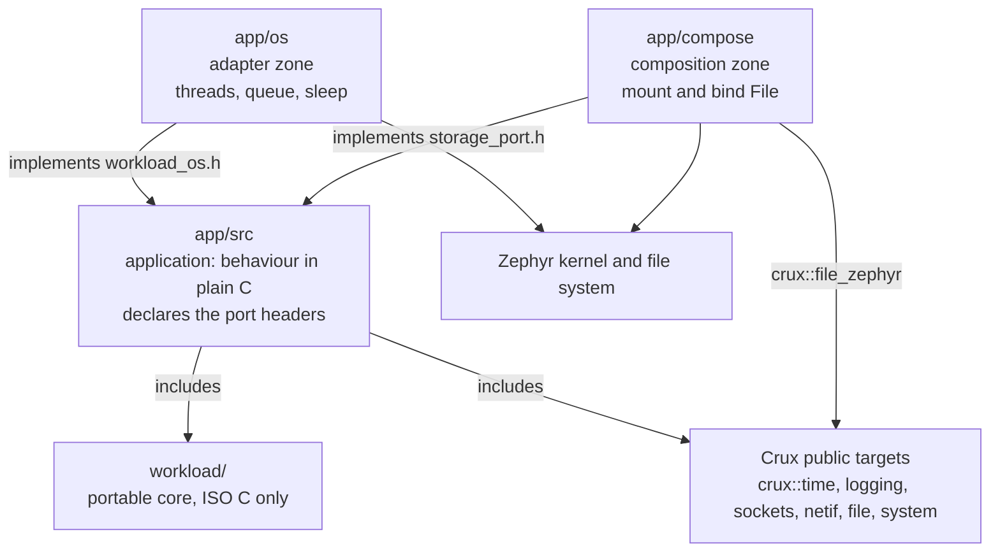

# Architecture

This page explains how the repository is built, for a reader who has not seen Crux or this
repository before. Terms in italics on first use are defined in the [glossary](glossary.md). What
exists and what does not is in the [roadmap](roadmap.md). The rules for changing things are in
[CONTRIBUTING.md](../CONTRIBUTING.md).

## What the controller is and does

Crux Controller (this repository, `crux-controller`) is firmware for one board, the NXP RT1060-EVKB
Rev B, built on the Zephyr RTOS. It is the reference consumer firmware of Crux, an embedded software
platform that lives in the repository [`crux-pilot`](https://github.com/wonny-labs/crux-pilot). Crux
publishes components such as Time, Logging, a Sockets profile, File and System as public headers and
CMake targets (`crux::time`, `crux::logging` and so on). This repository takes those components the
way an outside product would, through public headers and public targets only, and it checks that rule
in CI. Where a product cannot reach something, the gap is written down as a *finding* instead of being
worked around. It is not a product, it adds no Crux interface, and it has no real control logic.

What the firmware does is deliberately small. A synthetic *workload* runs on two Zephyr threads: a
producer counts cycles (every 100 ms by default) and queues one numbered message every tenth cycle,
and a consumer takes each message off a queue and writes it to the log on a UART. Later *steps* add one
capability each, chosen at build time with a Kconfig option: send each message to a TCP peer (S2), keep
the workload's configuration record in a file on a microSD volume (S3), report the reset cause at
boot and feed a hardware watchdog (S4). Each step has its own build, its own tests and its own
resource budget. Nothing else runs on the board, and little of it has run on a board at all; see the
[roadmap](roadmap.md).

## Layers and zones

Source is split into four trees. A script, `scripts/check_boundary.py`, reads every `#include` in each
tree and fails the CI job `Boundary check` when a tree includes something it may not. The exact lists
are in `scripts/check_boundary.py` and are explained in [composition-zone.md](composition-zone.md);
this table is a summary of the lists on `main`.

The arrows from `app/os` and `app/compose` to `app/src` mean that the zone implements a port header that
`app/src` declares. The application calls the port and the zone implements it; the two are joined by
the linker, and no `#include` crosses the line the other way.

| Tree | Role | May include | Fails on, among others |
|---|---|---|---|
| `workload/` | The portable core of the workload: configuration record, periodic cycle, message wire form. Built for the image and for the host tests. | ISO C and its own tree | any Crux, Sockets profile or Zephyr header |
| `app/src` | The application: composition, thread glue, and the code of each step. Plain C. | ISO C, the Sockets profile headers, public `<crux/NAME.h>` headers except the frozen four, its own tree, `workload/include` | any Zephyr header, the *frozen headers*, `<crux/file_zephyr.h>`, a quoted include of a header of a zone |
| `app/os` | The adapter zone. The one place that creates threads, queues messages and sleeps, with Zephyr kernel calls. | ISO C, public `<crux/NAME.h>` headers except the frozen four, `zephyr/kernel.h`, `zephyr/net/sntp.h`, its own tree, header files (`.h`) of `app/src` | the Sockets profile and other POSIX headers, any composition interface, every other Zephyr header, vendor headers, the frozen four |
| `app/compose` | The composition zone. The one place that mounts a file system and binds it to Crux File. | ISO C, public `<crux/NAME.h>` headers, `<crux/file_zephyr.h>`, `zephyr/fs/fs.h`, `zephyr/devicetree.h`, its own tree, header files (`.h`) of `app/src` | the Sockets profile, Crux private or port headers, every other Zephyr header, vendor headers |

Points that the table cannot carry:

- **Why zones exist.** Application code should name no provider and no Zephyr facility, so that its
  behaviour stays plain C that a host test can run. Something has to call Zephyr, though. A zone is a
  directory where one narrow kind of Zephyr or composition use is allowed, with an exact allow-list
  and a reason for each entry. Without zones, either the application would grow Zephyr includes or a
  capability such as File could not be composed at all. There is no per-file exception.
- **The allow-lists are exact.** `OS_ADAPTER_ZEPHYR_HEADERS` and `COMPOSITION_ZEPHYR_HEADERS` in
  `scripts/check_boundary.py` are sets of names with no wildcards. Changing one is a change of the script,
  of `tests/tooling/test_boundary.py` and of [composition-zone.md](composition-zone.md) in one reviewed
  pull request.
- **`zephyr/net/sntp.h` is allowed in `app/os` on `main`, and no source includes it yet.** The entry
  was added ahead of the code that needs it. See the roadmap for the pull request that would use it.
- **The frozen-header rule covers `app/src` and `app/os`.** `<crux/thread.h>`, `<crux/sync.h>`,
  `<crux/queue.h>` and `<crux/serial.h>` are public Crux headers, and the product still does not use them:
  threads and queues come from Zephyr in `app/os`. The check keeps that from being undone silently. The
  rule is not applied to `workload/` (which may include no Crux header at all) or to `app/compose`.
- **The check reads includes only.** It cannot see include paths that CMake adds, so no build file here
  adds one, and `tests/tooling` checks that. An include whose operand is a macro fails, because it cannot
  be checked.
- **Inside the checked trees.** `app/os` holds one source, `workload_os_zephyr.c`, that is part of the
  application target and not a library of its own. `app/compose` is a static library, the only target
  that links `crux::file_zephyr`.

## How Crux is consumed

- **Manifest.** `west.yml` makes this repository the west manifest repository. It imports `crux-pilot`
  at a pinned full commit, `37c92b18b44b7dfb95c2109f036f23d00f05cb4c`, never a branch or tag, and adds one
  test-only project, `picolibc`, for the `native_sim` scenario of S2. Crux's own manifest brings Zephyr and
  the Zephyr modules, so this repository does not name them. The import blocks the three GPL or commercial
  projects (`wolfssl`, `wolfssh`, `wolfpsa`) by name; the optional Crux groups stay off. Details and
  licences are in [dependencies.md](dependencies.md).
- **Where the pinned revision is recorded.** `west.yml` is the source. The revision is repeated in
  `tests/tooling/test_manifest.py` (the approved commit), [dependencies.md](dependencies.md),
  [RELEASE.md](../RELEASE.md) and [CHANGELOG.md](../CHANGELOG.md), and a test (`tests/tooling/test_docs.py`)
  checks that the last three carry the short hash. The `West pins` job runs `west crux-pins`, which must
  print a `CONTRACT crux-pilot` line and no `MISMATCH`. Moving the *pin* is its own small pull request; the
  steps are in [CONTRIBUTING.md](../CONTRIBUTING.md). Notes under `docs/findings/` keep the revision they
  were read at and are not updated when the pin moves.
- **Crux pieces used, and in which step.** Each is a public target linked in `app/CMakeLists.txt`, plus
  the Kconfig symbol that a conf fragment turns on.

  | Crux piece | Header or target | Step | Used from |
  |---|---|---|---|
  | Time | `crux::time`, `<crux/time.h>`, `<crux/status.h>` | S0 and later | `app/src/composition.c`, `app/src/workload_thread.c` |
  | Logging | `crux::logging`, `<crux/logging.h>` | S1 and later | `app/src/workload_thread.c` and the step code |
  | Sockets profile and network interface | `crux::sockets`, `crux::netif`, POSIX socket headers | S2 | `app/src/net_client.c` |
  | File | `crux::file`, `<crux/file.h>` in the application; `crux::file_zephyr` and `<crux/file_zephyr.h>` in the composition zone only | S3 | `app/src/config_store.c`, `app/compose/storage_mount.c` |
  | System | `crux::system`, `<crux/system.h>` | S4 | `app/src/health.c` |

  Thread, Sync, Queue and Serial are not used. This repository adds no Crux public interface.
- **Build and board.** Every CI build of the image is for `mimxrt1060_evk@B//qspi` with the *baseline
  gate* required. The `native_sim` scenarios are the exception: they run on the simulated board. The Zephyr builds and Twister runs happen in CI only; this repository documents no local
  Zephyr build.

## What runs in the image: threads and scheduling

`main()` calls `composition_start()` in `app/src/composition.c` and returns. What
`composition_start()` starts depends on the Kconfig options of the build. In this order:

1. S0: reads the Crux monotonic clock once, and fails if it does not answer.
2. S1: builds the default workload configuration. With S3 on, it first mounts the volume, binds File and
   loads the saved record, or saves the default when none exists. A volume that does not mount leaves
   the default in use and is never formatted.
3. S4: logs the reset cause and clears the flags, starts the watchdog with an interval of about ten
   workload cycles, and registers a cycle hook. It runs after the storage step so that a slow mount
   cannot cost a reset.
4. S2: registers a sink so that each logged message is also sent to the TCP peer.
5. S1: starts the two workload threads through the port `app/src/workload_os.h`.

| Thread | Created by | Zephyr priority | Stack | What it does |
|---|---|---|---|---|
| main | Zephyr | not set by this repository | 4096 bytes (`CONFIG_MAIN_STACK_SIZE` in `app/conf/s1.conf`) | Runs `composition_start()`, then ends. |
| producer | `app/os`, through `workload_os_start()` | 5 | `CONFIG_CRUX_CONTROLLER_WORKER_STACK`: 4096 bytes by default, 8192 in S2 | Counts cycles on the Crux monotonic clock, sleeping in slices of at most 50 ms. For each pass with cycles due it calls the cycle hook (S4 feeds the watchdog here), then queues a message for every `message_every`-th cycle. |
| consumer | `app/os` | 5 | the same size | Waits on the queue for up to 50 ms, logs `cycle=<n> value=<v>` under the tag `workload`, then calls the sink (S2 does its TCP exchange here, on this thread). |
| log processing | Zephyr, deferred logging | 14 | 2048 bytes | Writes the log lines to LPUART1 at 115200 baud. |

Priority numbers are Zephyr's, where a lower number is a higher priority, so the workload threads
preempt the log thread. The two workload threads have equal priority and are created with the consumer
first. The queue is a Zephyr `k_msgq` of 8 messages of 8 bytes. When it is full the producer logs a
warning and drops the message. The default configuration is a 100 ms period and a message every 10
cycles, so about one message per second. The watchdog is hardware (WDOG1 on this board), not a thread,
and only the producer feeds it. The numbers come from `app/os/workload_os_zephyr.c`,
`app/conf/s1.conf`, `app/src/workload_thread.c` and `workload/include/workload.h`. The stack sizes are
declared values; stack use has not been measured.

On `native_sim` the scenarios in `tests/native_sim` are Zephyr ztest applications that compile chosen
sources of `app/` and `workload/`. They do not boot the `app/` image.

## Source map

Top-level directories and files:

| Path | What it holds |
|---|---|
| `app/` | The Zephyr application, described below. |
| `workload/` | The portable workload core (`include/workload.h`, `src/config_record.c`, `src/cycle.c`, `src/message.c`) and its `CMakeLists.txt`. |
| `tests/` | `host/` (C tests that run on the build host), `native_sim/` (one Zephyr test application per step, S1 to S4), `tooling/` (Python tests of the scripts, workflows, documents and build files). |
| `scripts/` | `check_boundary.py` (the include check) and `check_mbed_only.py` (checks that the Crux import cannot activate the GPL stacks). |
| `budgets/` | `limits.json` (declared minimum free percent per memory region and step), `collect.py` (reads a build log into a measurement), `check.py` (compares a measurement with the limits). |
| `release/` | The release bundle tools: `assemble_bundle.py`, `check_bundle.py`, `rebuild_compare.py`, `parse_spdx.py` and `release-manifest.schema.json`. Hashes and identities only; no image is ever published. |
| `docs/` | This documentation: [architecture.md](architecture.md), [glossary.md](glossary.md), [adding-a-step.md](adding-a-step.md), [roadmap.md](roadmap.md), [composition-zone.md](composition-zone.md), [dependencies.md](dependencies.md) and `findings/`. |
| `.github/workflows/` | `ci.yml` (tooling tests, west pins, host tests, the step builds and the boundary check), `budget.yml`, `rebuild.yml`, `release.yml`, `scheduled-main.yml`. |
| `west.yml` | The west manifest and the pin. |
| `README.md`, `CONTRIBUTING.md`, `CHANGELOG.md`, `RELEASE.md`, `SECURITY.md`, `LICENSE`, `CODEOWNERS` | Role and status, contribution rules, changes, release flow, vulnerability reporting, licence, ownership. |

Inside `app/`:

| Path | What it holds |
|---|---|
| `CMakeLists.txt`, `Kconfig`, `prj.conf` | The build, the product's Kconfig options (`CRUX_CONTROLLER_S1` to `S4`, the peer address and port, the worker stack size) and the base configuration shared by every step. |
| `conf/s1.conf` to `s4.conf` | One Kconfig fragment per step. S2, S3 and S4 are each built on top of `s1.conf` (CI never combines two of them). |
| `boards/` | Devicetree overlays. `mimxrt1060_evk_mimxrt1062_qspi.overlay` sets LPUART1 as the log UART and is not passed on any CI command line; `s2.overlay`, `s3.overlay`, `s4.overlay` are passed by CI for their step. |
| `src/main.c`, `composition.[ch]` | `main()` and the code that starts what the build selected. |
| `src/workload_thread.[ch]` | The two workload threads' logic, the sink and the cycle hook. |
| `src/workload_os.h` | The port to the adapter zone. |
| `src/net_client.[ch]` | S2: one TCP exchange over the Sockets profile. |
| `src/config_store.[ch]`, `src/storage_port.h` | S3: the configuration record in the file `config.rec`, and the port to the composition zone. |
| `src/health.[ch]`, `src/health_policy.[ch]` | S4: the glue that calls Crux System and Logging, and the policy as plain C. |
| `os/` | The adapter zone: `workload_os_zephyr.c` and its `CMakeLists.txt`. |
| `compose/` | The composition zone: `storage_mount.c` and its `CMakeLists.txt`. |

The documents under `docs/findings/` record what each step or question taught. Each statement in them
is labelled as measured, inferred or open, and they are kept as written.
