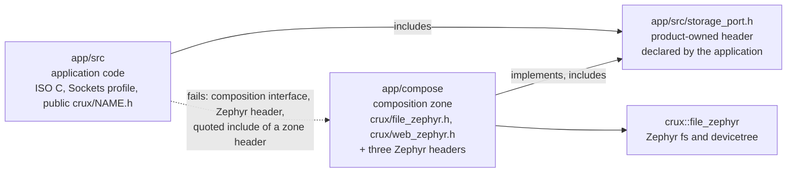
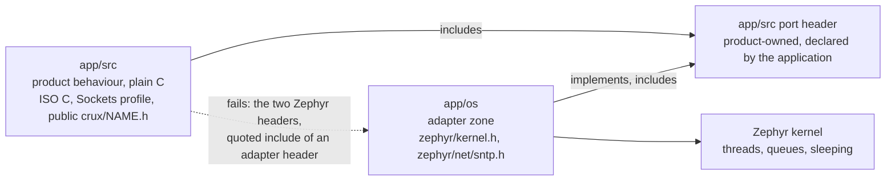

# The composition zone

Status: a rule of the boundary check. "Composition" has four meanings; see the
[glossary](glossary.md#product-platform-and-composition). `file` (Crux File) uses it: `app/compose/storage_mount.c`
implements the port `app/src/storage_port.h`. The check skips each absent tree, as long as at least one of the four exists, so an image
without the zone has no zone to check. It fails when none exists, which means
that it was run from the wrong directory (see [Running the check](#running-the-check)). The zone also admits the headers that the HTTPS management
interface (Mbed profile) needs, see [The web composition](#the-web-composition).

## Running the check

CI runs two checks in the `Boundary check` job: this repository's `scripts/check_boundary.py`, with the headers
that the pinned Crux publishes, and the product include check, which comes from `crux-pilot`. Run them from the
west workspace directory (the one that holds `crux-controller` and `crux-pilot`; see
[getting-started.md](getting-started.md)):

```bash
python crux-controller/scripts/check_boundary.py --repo crux-controller --crux-root crux-pilot
python3 crux-pilot/templates/product/check_domain_includes.py --product crux-controller
```

The first command checks `app/src`, `app/compose`, `app/os` and `workload` against the public `<crux/NAME.h>`
headers of the checkout. The second is the product include check: the script
`templates/product/check_domain_includes.py` of `crux-pilot` (see [the glossary](glossary.md#boundary-and-zones)). In product mode (`--product`) it reads every C and C++ source under the repository and fails on an
include of `<crux/thread.h>`, `<crux/sync.h>` or `<crux/serial.h>`, which Crux marks frozen, or of `<crux/queue.h>`,
which Crux removed.
Its stricter rules (no Zephyr header and no composition interface) apply only to a directory named `domain/`, and this
repository has none, so here it checks the frozen headers across all sources. This overlaps the first command on the
frozen headers, and it also covers every source file under the repository, including the tests.

CI downloads that script from a fixed commit of `crux-pilot` and checks its SHA-256 before it runs it (the step
`Run the Crux Pilot product include check` of the `Boundary check` job). A second step of the job runs the same
script through the wrapper `check-includes.sh` of `crux-pilot`, downloaded and checked the same way. The pinned
`crux-pilot` contains the same script with the same SHA-256, as the comment above the step says, so a local run uses
the pinned copy. Both commands print nothing but a pass line on success. Without `--crux-root`, `python scripts/check_boundary.py` from the repository
root checks the same rules but cannot tell that a `<crux/NAME.h>` name is not a public header. If none
of the four trees exists under `--repo`, for example because the command ran in the workspace directory
without `--repo`, the script exits with status 2 and says so, and it does not report a pass.

## Why a zone

Crux publishes the File root binding as a composition interface, `<crux/file_zephyr.h>` with the
CMake target `crux::file_zephyr` (`docs/file-composition-interface.md` in `crux-pilot`). It names a provider on purpose and it is for the code that also mounts the file
system. Application code stays on `<crux/file.h>`. A boundary that lets `app/src` include the
interface would let the application name a provider, and a boundary without any way to include it
would leave File unusable. So the include is allowed in one directory and nowhere else. The Web
composition interface `<crux/web_zephyr.h>` follows the same rule.



The application declares the port header and calls it. The zone implements it. The link joins them;
no include does. The port header lives in `app/src`, so the rules of `app/src` scan it, and it cannot
carry a Zephyr or composition include back into the application.

## The rules

| Tree | ISO C | Sockets profile | Public `<crux/NAME.h>` | Composition interfaces (`<crux/file_zephyr.h>`, `<crux/web_zephyr.h>`) | Zephyr headers | Own tree | Other trees |
|---|---|---|---|---|---|---|---|
| `app/src` | yes | yes | yes | no | none | yes | `workload/include` |
| `workload` | yes | no | no | no | none | yes | none |
| `app/compose` | yes | no | yes | exactly those two (`COMPOSITION_CRUX_HEADERS`) | the allow-list below, nothing else | yes | header files (`.h`) of `app/src` (the port header) |
| `app/os` (the adapter zone) | yes | no | yes | no | `zephyr/kernel.h` and `zephyr/net/sntp.h`, nothing else | yes | header files (`.h`) of `app/src` (the port header) |

The zone fails on a Crux private or port header (`file_native.h`, a nested `<crux/ports/...>` path),
on a Zephyr header that is not on the list, on any vendor or third-party header (`fsl_*.h`, `ff.h`,
`lfs.h`), on the Sockets profile and other POSIX headers, and on a quoted include that does not
resolve inside the zone, or to a `.h` file of `app/src`. The rules restrict what the zone writes. A header of `app/src` that the zone includes is scanned under the `app/src` rules, so a Sockets profile header or a `workload` header that it includes reaches the zone indirectly. The scan forms are the same as for `app/src`: every file
whatever its suffix, `#include`, `#include_next` and `#import`, continued lines, CRLF, digraph and
trigraph, comments removed, and a macro operand is a violation.

Without `--crux-root` any `<crux/NAME.h>` passes the shape test, as it does for `app/src`, and the
two composition interfaces are denied outside the zone by name (`COMPOSITION_CRUX_HEADERS`); with
it (CI always passes it), a `<crux/NAME.h>` that is not a header Crux publishes fails, including
`<crux/file_native.h>`. Against a `crux-pilot` checkout, `<crux/file_zephyr.h>` and
`<crux/web_zephyr.h>` must be headers that Crux publishes under
`components/*/ports/*/include/crux/`, and any header found there is a composition interface that
`app/src` and the workload cannot include, whether or not this file names it. Any other composition
interface that Crux publishes stays out of the zone until a reviewed change lists it. The other Web
headers (`<crux/web.h>`, `<crux/web_session.h>`, `<crux/web_management.h>`),
`<crux/tls_certificate.h>` and `<crux/tls_certificate_start.h>` are ordinary public headers (Crux
publishes them under `components/*/include/crux/`) and keep the rule of every public
`<crux/NAME.h>` header.

## The allow-list of Zephyr headers

`COMPOSITION_ZEPHYR_HEADERS` in `scripts/check_boundary.py` is the whole list. There are no
wildcards. A header is on it only if mounting and binding the file system, or the web composition (see
[below](#the-web-composition)), needs it.

| Header | Why the zone needs it |
|---|---|
| `zephyr/fs/fs.h` | The mount API: `struct fs_mount_t`, `fs_mount`, `fs_unmount`, `fs_mkfs`, `fs_mkdir`, and `FS_FSTAB_DECLARE_ENTRY` and `FS_FSTAB_ENTRY`, which take a mount described in the devicetree as a `zephyr,fstab,...` node. Crux does not mount a file system for a product. |
| `zephyr/devicetree.h` | `DT_NODELABEL` and the other node-identifier macros that name the fstab node and read its `mount-point` and `disk-name`. `zephyr/fs/fs.h` does not include it (at the pinned Zephyr, `fs.h` includes only `sys/types.h`, `zephyr/sys/dlist.h` and `zephyr/fs/fs_interface.h`), yet its `FS_FSTAB_*` macros expand `DT_*` macros. The zone must include this header itself. |
| `zephyr/net/tls_credentials.h` | The TLS credential store, for the HTTPS management composition (see below). The zone registers the server certificate and key under the security tag that the Web composition names, and the Crux Web interface does not do that for a product. |

Left off on purpose, and why:

| Header | Why it is not on the list |
|---|---|
| `zephyr/storage/disk_access.h` | `disk_access_init` only tells a missing card from a failed mount. `fs_mount` reports both, and a product that must tell them apart can ask for the header in a reviewed change. |
| `ff.h` | The FatFs library header. Every reference composition in Crux includes it to declare a `FATFS` object. A mount that the devicetree describes as `zephyr,fstab,fatfs` makes Zephyr declare that object, so the zone does not need the header. Whether that route works for the `file` composition is a question of `file`, which records its answer in its findings note. |
| `zephyr/kernel.h`, `zephyr/sys/printk.h`, `zephyr/logging/log.h` | The composition returns a result code. The application logs through Crux Logging and runs its threads through the adapter zone `app/os`. `zephyr/kernel.h` is allowed in the adapter zone `app/os` and stays off this list, see [The adapter zone](#the-adapter-zone). `zephyr/net/sntp.h` is also allowed only in the adapter zone `app/os` and stays off this list, see [The adapter zone](#the-adapter-zone). |
| `zephyr/fs/littlefs.h`, `zephyr/fs/fs_sys.h` | Provider and file system specifics that `file` does not select. |
| `zephyr/drivers/*`, other `zephyr/net/*` headers (`zephyr/net/socket.h`, `zephyr/net/http/*`, `zephyr/net/net_if.h` and the rest), vendor `fsl_*.h` | Not part of binding a file system or the web server. A driver or network detail in the zone would be a second product layer, not a composition. `zephyr/net/tls_credentials.h` is the one network header on the list. |

A change to the list is a change of `scripts/check_boundary.py`, of
`tests/tooling/test_boundary.py` (`test_the_allow_list_is_the_reviewed_set` pins the set) and of this
page, in one reviewed pull request.

## The web composition

The HTTPS management interface (Mbed profile) is composed in `app/compose`, as File is, by
`management_start.c` (`management`). The reason is that Crux publishes its binding to the Zephyr HTTP server as a composition interface:
`<crux/web_zephyr.h>` with the CMake target `crux::web_zephyr`. It declares `crux_web_start()`,
which binds the web core to Zephyr's HTTP server, its sockets and the TLS security tag, so only the
platform composition of a product calls it. That is the same reason as for `<crux/file_zephyr.h>`,
and the same rule follows: the include is allowed in `app/compose` and fails in `app/src`, `app/os`
and `workload`, with or without `--crux-root`.

The zone also needs `zephyr/net/tls_credentials.h`. Crux expects the product to register the TLS
material under the security tag before it calls `crux_web_start()`, and the credential store is
Zephyr's. The public Crux headers do not wrap it, so the zone includes the Zephyr header itself.

Nothing else widens. The zone still fails on every other Zephyr header, on the Sockets profile, on
Crux private or port headers and on any other composition interface. The portable Web headers
(`<crux/web.h>`, `<crux/web_session.h>`, `<crux/web_management.h>`), `<crux/tls_certificate.h>`
and `<crux/tls_certificate_start.h>` are ordinary public headers. `app/src`, `app/os` and `workload` fail on
`<crux/web_zephyr.h>` and on `zephyr/net/tls_credentials.h`.
`management` is the composition source that uses them: `app/compose/management_start.c` includes the Zephyr and
composition headers named above, and no other entry is needed for it. The route sources, the packaged
page and the route table are not in the zone: they belong to the target `app` and are named by
`app/management/management.cmake`, which Crux's route function equips with the private include directories of
Crux's own sources one source at a time, so no build file here adds an include path.

## The adapter zone

`app/os` is a second zone, for the OS facilities of the product: threads, queues and sleeping.
Crux offers threads and locks through `<crux/thread.h>` and `<crux/sync.h>`, but a product
adapter that needs them uses Zephyr directly, and that use has one place to live. The reason is
that OS facilities use Zephyr directly in product adapters, while product behaviour stays plain C in
`app/src`. The application declares a small product-owned port header in `app/src`, calls it, and
the adapter in `app/os` implements it with Zephyr kernel calls. The link joins them; no include does.



The adapter zone may include ISO C headers, public `<crux/NAME.h>` headers, its own tree, header
files (`.h`) of `app/src` and exactly two Zephyr headers, `zephyr/kernel.h` and `zephyr/net/sntp.h`
(`OS_ADAPTER_ZEPHYR_HEADERS` in `scripts/check_boundary.py`, no wildcard). It fails on the Sockets
profile and other POSIX headers, on `<crux/file_zephyr.h>` and any other composition interface, on
every other Zephyr header (`zephyr/sys/printk.h`, `zephyr/logging/log.h`, a driver header, any other
network header, `zephyr/net/socket.h` included), on a vendor or third-party header, and on a quoted include that does not resolve
inside the zone or to a `.h` file of `app/src`. The scan forms and the indirect reach through an
`app/src` header are the same as for the composition zone.

`app/src`, `app/compose` and `workload` keep failing on `zephyr/kernel.h` and on `zephyr/net/sntp.h`,
and a quoted include of an `app/os` header fails in all three, as a quoted include of a composition
zone header does.

The adapter zone's allow-list is the whole list, and each entry has a reason:

| Header | Why the zone needs it |
|---|---|
| `zephyr/kernel.h` | Threads, message queues and sleeping, the OS facilities the zone exists for. |
| `zephyr/net/sntp.h` | The Zephyr SNTP library, for a product time-source adapter. See below. |

Why `zephyr/net/sntp.h`: Crux deliberately provides no SNTP client and leaves the choice of a time
source to the product, because its Time contract designates the product as the owner of the Time
Authority. A product that wants SNTP has two choices. It can reuse the Zephyr SNTP library, which
this entry allows, or it can write its own SNTP packet parser, which is more product code to
review and test than a call into a maintained library. The public Crux interface is not enough
because it offers no time-source client at all. The adapter uses the library's simple string-based query
(`sntp_simple()`, which takes a host name and a timeout), so it includes no socket type and no socket
header itself, and the rule keeps `allow_sockets` off for the zone: `zephyr/net/socket.h`, the
Sockets profile headers and every other network header still fail there. The check reads direct
includes only, so this relies on the zone not including socket headers itself, which the rule
continues to forbid; a header that the library header includes in turn is not an include of the
zone. The allow-list entry allows the include and nothing else. The one source that uses it is
`app/os/time_sync_zephyr.c` (`sntp`), which calls `sntp_simple()` and nothing else of the library.

Why `zephyr/kernel.h` is not on the composition zone's list: that zone exists to mount a file system
and bind it to Crux, and `COMPOSITION_ZEPHYR_HEADERS` names only what that and the web composition
need. The kernel header
is the entry point to every kernel facility. If the composition zone could include it, a mount
routine could grow thread and queue code that belongs in the adapter zone, and the composition zone
would stop being a narrow composition. The two zones stay separate, each with an exact list, and a
change to either list is a reviewed change of `scripts/check_boundary.py`, of
`tests/tooling/test_boundary.py` (`test_the_adapter_allow_list_is_the_reviewed_set` pins the adapter
set) and of this page, in one pull request.

The same limit applies as for the composition zone: the check reads includes only, so the adapter
zone adds no include path to the application target. The tree `app/os` holds two sources,
`workload_os_zephyr.c` (every configuration) and `time_sync_zephyr.c` (`sntp` only), which its `CMakeLists.txt` adds to
the application target. The zone is not a library of its own: as a static library it left the references to the
kernel's message queue unresolved in the CI link of the `workload` and `file` images. `tests/tooling/test_os_adapter.py` checks that the zone adds no include path
and no library, and that the application target links neither a zone library nor Crux Thread nor Crux
Queue.

### The frozen Crux headers

`app/src` and `app/os` also fail on `<crux/thread.h>`, `<crux/sync.h>` and `<crux/serial.h>`
(`FROZEN_CRUX_HEADERS` in `scripts/check_boundary.py`), although they are public headers, so the
statements above about public `<crux/NAME.h>` headers hold for every other name. The product uses
Zephyr directly for threads and queues, and the rule keeps a later change from bringing the Crux
contracts back. The rule is a field of the `Rule` of each of the two trees. It does not apply to
`workload`, which has no Crux header at all, and it does not change `app/compose`. Adding or removing a
name is a reviewed change of the script, of `tests/tooling/test_boundary.py` and of this page.

`<crux/queue.h>` is not on the list: the pinned Crux does not publish it and has no `CONFIG_CRUX_QUEUE`,
so the CI option checks do not look for that option. An include of it fails all the same: with `--crux-root`, which CI always passes, a
`<crux/NAME.h>` that the checkout does not publish fails in every tree, the composition zone included,
and the product include check refuses it in every source of the repository.
`tests/tooling/test_boundary.py` (`RemovedCruxQueue`) checks the first. Without `--crux-root` the name
passes the shape test, as any unknown `<crux/NAME.h>` does (see [Running the check](#running-the-check)).

## What the zones do not cover

- The CMake side. The check reads includes only and does not see include paths from CMake. The
  composition zone is built as its own library (`app/compose/CMakeLists.txt`) that links `crux::file_zephyr`
  privately, so the application target gets no include path from it. `tests/tooling/test_boundary.py`
  keeps checking that `app/CMakeLists.txt` adds none, and `tests/tooling/test_file.py` checks that
  only the composition zone's library links the composition interface and that the zone adds no
  include path.
- Whether a mount works. The check does not run anything.
