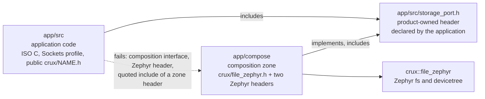

# The composition zone

Status: a rule of the boundary check, in place before any code uses it. Step S3 (File) is the
first user. The zone directory `app/compose/` does not exist yet, and the check skips a tree that
is absent.

## Why a zone

Crux publishes the File root binding as a composition interface, `<crux/file_zephyr.h>` with the
CMake target `crux::file_zephyr` (crux-pilot PR 346, `docs/file-composition-interface.md` in that
repository). It names a provider on purpose and it is for the code that also mounts the file
system. Application code stays on `<crux/file.h>`. A boundary that lets `app/src` include the
interface would let the application name a provider, and a boundary without any way to include it
would leave File unusable. So the include is allowed in one directory and nowhere else.

The application declares the port header and calls it. The zone implements it. The link joins them;
no include does. The port header lives in `app/src`, so the rules of `app/src` scan it, and it cannot
carry a Zephyr or composition include back into the application.

## The rules

| Tree | ISO C | Sockets profile | Public `<crux/NAME.h>` | `<crux/file_zephyr.h>` | Zephyr headers | Own tree | Other trees |
|---|---|---|---|---|---|---|---|
| `app/src` (unchanged) | yes | yes | yes | no | none | yes | `workload/include` |
| `workload` (unchanged) | yes | no | no | no | none | yes | none |
| `app/compose` (new) | yes | no | yes | yes | the allow-list below, nothing else | yes | header files (`.h`) of `app/src` (the port header) |

The zone fails on a Crux private or port header (`file_native.h`, a nested `<crux/ports/...>` path),
on a Zephyr header that is not on the list, on any vendor or third-party header (`fsl_*.h`, `ff.h`,
`lfs.h`), on the Sockets profile and other POSIX headers, and on a quoted include that does not
resolve inside the zone, or to a `.h` file of `app/src`. The rules restrict what the zone writes. A header of `app/src` that the zone includes is scanned under the `app/src` rules, so a Sockets profile header or a `workload` header that it includes reaches the zone indirectly. The scan forms are the same as for `app/src`: every file
whatever its suffix, `#include`, `#include_next` and `#import`, continued lines, CRLF, digraph and
trigraph, comments removed, and a macro operand is a violation.

Without `--crux-root` any `<crux/NAME.h>` passes the shape test, as it does for `app/src`, and the
composition interface is denied outside the zone by name; with it (CI always passes it), a
`<crux/NAME.h>` that is not a header Crux publishes fails, including `<crux/file_native.h>`.
Against a `crux-pilot` checkout, `<crux/file_zephyr.h>` must be a header that Crux
publishes under `components/*/ports/*/include/crux/`, and any header found there is a composition
interface that `app/src` and the workload cannot include, whether or not this file names it.

## The allow-list of Zephyr headers

`COMPOSITION_ZEPHYR_HEADERS` in `scripts/check_boundary.py` is the whole list. There are no
wildcards. A header is on it only if mounting a file system and binding it needs it.

| Header | Why the zone needs it |
|---|---|
| `zephyr/fs/fs.h` | The mount API: `struct fs_mount_t`, `fs_mount`, `fs_unmount`, `fs_mkfs`, `fs_mkdir`, and `FS_FSTAB_DECLARE_ENTRY` and `FS_FSTAB_ENTRY`, which take a mount described in the devicetree as a `zephyr,fstab,...` node. Mounting is the one thing Crux does not do for a product. |
| `zephyr/devicetree.h` | `DT_NODELABEL` and the other node-identifier macros that name the fstab node and read its `mount-point` and `disk-name`. `zephyr/fs/fs.h` does not include it (at the pinned Zephyr, `fs.h` includes only `sys/types.h`, `zephyr/sys/dlist.h` and `zephyr/fs/fs_interface.h`), yet its `FS_FSTAB_*` macros expand `DT_*` macros. The zone must include this header itself. |

Left off on purpose, and why:

| Header | Why it is not on the list |
|---|---|
| `zephyr/storage/disk_access.h` | `disk_access_init` only tells a missing card from a failed mount. `fs_mount` reports both, and a product that must tell them apart can ask for the header in a reviewed change. |
| `ff.h` | The FatFs library header. Every reference composition in Crux includes it to declare a `FATFS` object. A mount that the devicetree describes as `zephyr,fstab,fatfs` makes Zephyr declare that object, so the zone does not need the header. Whether that route works for the S3 composition is a question of step S3, which records its answer in its own findings note. |
| `zephyr/kernel.h`, `zephyr/sys/printk.h`, `zephyr/logging/log.h` | The composition returns a result code. The application logs and schedules through Crux. |
| `zephyr/fs/littlefs.h`, `zephyr/fs/fs_sys.h` | Provider and file system specifics that S3 does not select. |
| `zephyr/drivers/*`, `zephyr/net/*`, vendor `fsl_*.h` | Not part of mounting a file system. A driver or network detail in the zone would be a second product layer, not a composition. |

A change to the list is a change of `scripts/check_boundary.py`, of
`tests/tooling/test_boundary.py` (`test_the_allow_list_is_the_reviewed_set` pins the set) and of this
page, in one reviewed pull request.

## What the zone does not cover

- The CMake side. The check reads includes only and does not see include paths from CMake. The zone
  is built as its own library that links `crux::file_zephyr`, so the application target gets no
  include path from it; `tests/tooling/test_boundary.py` keeps checking that `app/CMakeLists.txt`
  adds none. This arrives with the first code in the zone.
- Whether a mount works. The check does not run anything.
