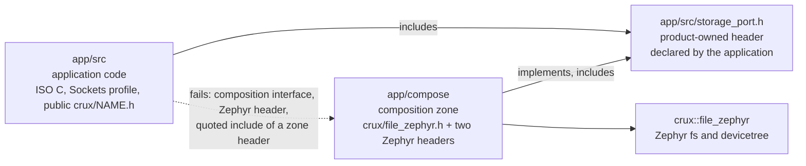
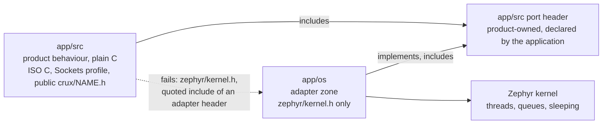

# The composition zone

Status: a rule of the boundary check. Step S3 (File) is its first user: `app/compose/storage_mount.c`
implements the port `app/src/storage_port.h`. The check skips a tree that is absent, so an image
without the zone has no zone to check.

## Why a zone

Crux publishes the File root binding as a composition interface, `<crux/file_zephyr.h>` with the
CMake target `crux::file_zephyr` (crux-pilot PR 346, `docs/file-composition-interface.md` in that
repository). It names a provider on purpose and it is for the code that also mounts the file
system. Application code stays on `<crux/file.h>`. A boundary that lets `app/src` include the
interface would let the application name a provider, and a boundary without any way to include it
would leave File unusable. So the include is allowed in one directory and nowhere else.

The application declares the port header and calls it. The zone implements it. The link joins them;
no include does. The port header lives in `app/src`, so the rules of `app/src` scan it, and it cannot
carry a Zephyr or composition include back into the application.

## The rules

| Tree | ISO C | Sockets profile | Public `<crux/NAME.h>` | `<crux/file_zephyr.h>` | Zephyr headers | Own tree | Other trees |
|---|---|---|---|---|---|---|---|
| `app/src` (unchanged) | yes | yes | yes | no | none | yes | `workload/include` |
| `workload` (unchanged) | yes | no | no | no | none | yes | none |
| `app/compose` | yes | no | yes | yes | the allow-list below, nothing else | yes | header files (`.h`) of `app/src` (the port header) |
| `app/os` (the adapter zone, new) | yes | no | yes | no | `zephyr/kernel.h`, nothing else | yes | header files (`.h`) of `app/src` (the port header) |

The zone fails on a Crux private or port header (`file_native.h`, a nested `<crux/ports/...>` path),
on a Zephyr header that is not on the list, on any vendor or third-party header (`fsl_*.h`, `ff.h`,
`lfs.h`), on the Sockets profile and other POSIX headers, and on a quoted include that does not
resolve inside the zone, or to a `.h` file of `app/src`. The rules restrict what the zone writes. A header of `app/src` that the zone includes is scanned under the `app/src` rules, so a Sockets profile header or a `workload` header that it includes reaches the zone indirectly. The scan forms are the same as for `app/src`: every file
whatever its suffix, `#include`, `#include_next` and `#import`, continued lines, CRLF, digraph and
trigraph, comments removed, and a macro operand is a violation.

Without `--crux-root` any `<crux/NAME.h>` passes the shape test, as it does for `app/src`, and the
composition interface is denied outside the zone by name; with it (CI always passes it), a
`<crux/NAME.h>` that is not a header Crux publishes fails, including `<crux/file_native.h>`.
Against a `crux-pilot` checkout, `<crux/file_zephyr.h>` must be a header that Crux
publishes under `components/*/ports/*/include/crux/`, and any header found there is a composition
interface that `app/src` and the workload cannot include, whether or not this file names it.

## The allow-list of Zephyr headers

`COMPOSITION_ZEPHYR_HEADERS` in `scripts/check_boundary.py` is the whole list. There are no
wildcards. A header is on it only if mounting a file system and binding it needs it.

| Header | Why the zone needs it |
|---|---|
| `zephyr/fs/fs.h` | The mount API: `struct fs_mount_t`, `fs_mount`, `fs_unmount`, `fs_mkfs`, `fs_mkdir`, and `FS_FSTAB_DECLARE_ENTRY` and `FS_FSTAB_ENTRY`, which take a mount described in the devicetree as a `zephyr,fstab,...` node. Mounting is the one thing Crux does not do for a product. |
| `zephyr/devicetree.h` | `DT_NODELABEL` and the other node-identifier macros that name the fstab node and read its `mount-point` and `disk-name`. `zephyr/fs/fs.h` does not include it (at the pinned Zephyr, `fs.h` includes only `sys/types.h`, `zephyr/sys/dlist.h` and `zephyr/fs/fs_interface.h`), yet its `FS_FSTAB_*` macros expand `DT_*` macros. The zone must include this header itself. |

Left off on purpose, and why:

| Header | Why it is not on the list |
|---|---|
| `zephyr/storage/disk_access.h` | `disk_access_init` only tells a missing card from a failed mount. `fs_mount` reports both, and a product that must tell them apart can ask for the header in a reviewed change. |
| `ff.h` | The FatFs library header. Every reference composition in Crux includes it to declare a `FATFS` object. A mount that the devicetree describes as `zephyr,fstab,fatfs` makes Zephyr declare that object, so the zone does not need the header. Whether that route works for the S3 composition is a question of step S3, which records its answer in its own findings note. |
| `zephyr/kernel.h`, `zephyr/sys/printk.h`, `zephyr/logging/log.h` | The composition returns a result code. The application logs through Crux Logging and runs its threads through the adapter zone `app/os`. `zephyr/kernel.h` is allowed in the adapter zone `app/os` and stays off this list, see [The adapter zone](#the-adapter-zone). |
| `zephyr/fs/littlefs.h`, `zephyr/fs/fs_sys.h` | Provider and file system specifics that S3 does not select. |
| `zephyr/drivers/*`, `zephyr/net/*`, vendor `fsl_*.h` | Not part of mounting a file system. A driver or network detail in the zone would be a second product layer, not a composition. |

A change to the list is a change of `scripts/check_boundary.py`, of
`tests/tooling/test_boundary.py` (`test_the_allow_list_is_the_reviewed_set` pins the set) and of this
page, in one reviewed pull request.

## The adapter zone

`app/os` is a second zone, for the OS facilities of the product: threads, queues and sleeping.
Crux offers these through `<crux/thread.h>`, `<crux/queue.h>` and their relatives, but a product
adapter that needs them uses Zephyr directly, and that use has one place to live. The reason is
that OS facilities use Zephyr directly in product adapters, while product behaviour stays plain C in
`app/src`. The application declares a small product-owned port header in `app/src`, calls it, and
the adapter in `app/os` implements it with Zephyr kernel calls. The link joins them; no include does.

The adapter zone may include ISO C headers, public `<crux/NAME.h>` headers, its own tree, header
files (`.h`) of `app/src` and exactly one Zephyr header, `zephyr/kernel.h`
(`OS_ADAPTER_ZEPHYR_HEADERS` in `scripts/check_boundary.py`, no wildcard). It fails on the Sockets
profile and other POSIX headers, on `<crux/file_zephyr.h>` and any other composition interface, on
every other Zephyr header (`zephyr/sys/printk.h`, `zephyr/logging/log.h`, a driver header, a
network header), on a vendor or third-party header, and on a quoted include that does not resolve
inside the zone or to a `.h` file of `app/src`. The scan forms and the indirect reach through an
`app/src` header are the same as for the composition zone.

`app/src`, `app/compose` and `workload` keep failing on `zephyr/kernel.h`, and a quoted include of an
`app/os` header fails in all three, as a quoted include of a composition zone header does.

Why `zephyr/kernel.h` is not on the composition zone's list: that zone exists to mount a file system
and bind it to Crux, and `COMPOSITION_ZEPHYR_HEADERS` names only what that needs. The kernel header
is the entry point to every kernel facility. If the composition zone could include it, a mount
routine could grow thread and queue code that belongs in the adapter zone, and the composition zone
would stop being a narrow composition. The two zones stay separate, each with an exact list, and a
change to either list is a reviewed change of `scripts/check_boundary.py`, of
`tests/tooling/test_boundary.py` (`test_the_adapter_allow_list_is_the_reviewed_set` pins the adapter
set) and of this page, in one pull request.

The same limit applies as for the composition zone: the check reads includes only, so the adapter
zone adds no include path to the application target. The tree `app/os` holds one source,
`workload_os_zephyr.c`, that its `CMakeLists.txt` adds to the application target. It is not a library
of its own: as a static library of its own it left the references to the kernel's message queue
unresolved in the CI link of the S1 and S3 images. `tests/tooling/test_os_adapter.py` checks that the zone adds no include path
and no library, and that the application target links neither a zone library nor Crux Thread nor Crux
Queue.

### The frozen Crux headers

`app/src` and `app/os` also fail on `<crux/thread.h>`, `<crux/sync.h>`, `<crux/queue.h>` and
`<crux/serial.h>` (`FROZEN_CRUX_HEADERS` in `scripts/check_boundary.py`), although they are public
headers, so the statements above about public `<crux/NAME.h>` headers hold for every other name. The
product uses Zephyr directly for threads and queues, and the rule keeps a later change from bringing
the Crux contracts back. The rule is a field of the `Rule` of each of the two trees. It does not apply
to `workload`, which has no Crux header at all, and it does not change `app/compose`. Adding or
removing a name is a reviewed change of the script, of `tests/tooling/test_boundary.py` and of this
page.

## What the zones do not cover

- The CMake side. The check reads includes only and does not see include paths from CMake. The
  composition zone is built as its own library (`app/compose/CMakeLists.txt`) that links `crux::file_zephyr`
  privately, so the application target gets no include path from it. `tests/tooling/test_boundary.py`
  keeps checking that `app/CMakeLists.txt` adds none, and `tests/tooling/test_s3.py` checks that
  only the composition zone's library links the composition interface and that the zone adds no
  include path.
- Whether a mount works. The check does not run anything.
