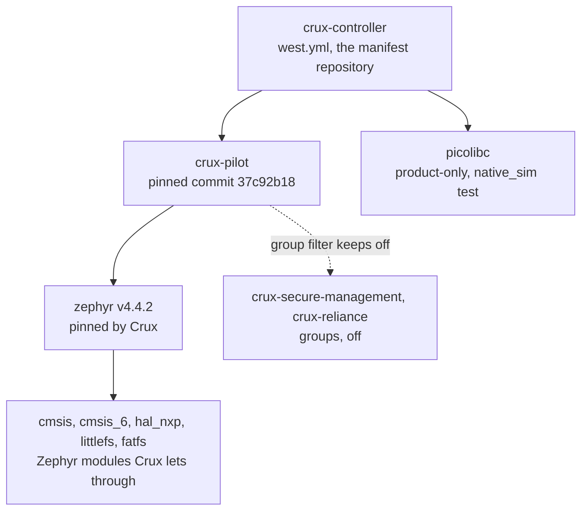

# Dependencies

The west manifest `west.yml` is the one place that names what this repository fetches. This page says
what each project is, why it is there and under which licence its project states it is distributed.
It is a reading aid, not a licence review: the licence text in each project and the SPDX files of the
release dry run are the record.

## Routes

| Route | Meaning | Check |
|---|---|---|
| Pinned via the Crux contract | The project is named in the Crux manifest at the pinned `crux-pilot` revision, or in the Zephyr manifest that Crux pins. The revision is the one Crux states. | `west crux-pins` prints `CONTRACT` for `crux-pilot` and `OK` for each of these; a revision that differs without a stated reason prints `MISMATCH` and fails CI. |
| Product-only | The project is named in this repository's `west.yml` and in no Crux manifest. | Its pin is a comment-explained revision in `west.yml`. |

## Projects

| Project | Revision | Route | Why it is here | Licence as the project states it |
|---|---|---|---|---|
| `crux-pilot` | `37c92b18b44b7dfb95c2109f036f23d00f05cb4c` (a commit, no Crux tag exists) | The platform under evaluation, pinned in `west.yml`; its manifest is imported | The Crux components and the composition interface `<crux/file_zephyr.h>` | Apache-2.0 |
| `zephyr` | `dccb09599635bdff17633fa7e9dab014b91dce90` (v4.4.2) | Pinned via the Crux contract | The RTOS the image is built on | Apache-2.0 |
| `cmsis` | `512cc7e895e8491696b61f7ba8066b4a182569b8` | Pinned via the Crux contract | Arm Cortex-M core headers that Zephyr's Cortex-M support uses | Apache-2.0 |
| `cmsis_6` | `30a859f44ef8ab4dc8f84b03ed586fd16ccf9d74` | Pinned via the Crux contract | Arm core headers of the newer CMSIS interface, which Zephyr's manifest also names | Apache-2.0 |
| `hal_nxp` | `7554bc0f6f6c284972eba7b2c17b16fbb9cc0ad0` | Pinned via the Crux contract | Drivers for the NXP RT1060 and its peripherals | BSD-3-Clause (its content register names `LICENSE.BSD-3`) |
| `littlefs` | `8f5ca347843363882619d8f96c00d8dbd88a8e79` | Pinned via the Crux contract | A file system module that Zephyr's manifest names and that the Crux allow-list lets through | BSD-3-Clause |
| `fatfs` | `f4ead3bf4a6dab3a07d7b5f5315795c073db568d` | Pinned via the Crux contract | The FAT file system of the File composition on microSD | A permissive source licence of its own (FatFs, ChaN), stated in the header of `ff.c` |
| `picolibc` | `01254932e8e81085817ed61fd858648584ffe37c` | Product-only | An embedded C library for the `native_sim` scenario of step S2. The native C library of `native_sim` would bypass Zephyr's socket providers, and the Crux manifest does not import this module. Target builds use the toolchain's Picolibc, not this project. | Mixed: its `COPYING.picolibc` lists BSD-3-Clause for the project and other terms for some files. Read that file for the exact set. |

The revision of `picolibc` is the one in Zephyr's own manifest at the pinned Zephyr release, which is
why `west crux-pins` reports it as `OK`.

## Groups that stay off

The Crux manifest defines two optional groups and filters both out. This repository does not enable
them, and CI would show a change in `west crux-pins` and in the lock.

| Group | What it would fetch | Why it stays off |
|---|---|---|
| `crux-secure-management` | wolfSSL, wolfSSH and wolfPSA, which are available under GPL or commercial terms, and the Mbed TLS modules that go with them | Left off by decision: those terms are not the Apache-2.0 terms of this repository |
| `crux-reliance` | The Reliance Edge file system | Source under GPLv2, left off by the same decision |

## Changing a pin

A pin changes in its own pull request, with a reason in the commit message. A project that Crux pins
follows Crux: move the `crux-pilot` revision, then run `west crux-pins`. A product-only project needs a
comment in `west.yml` that says why it is there and where its revision comes from. The scheduled build
against `crux-pilot` main (`.github/workflows/scheduled-main.yml`) shows ahead of time when a Crux pin
moves.
