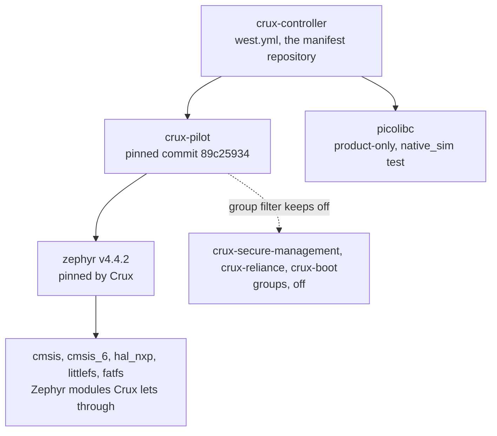

# Dependencies

The west manifest `west.yml` is the one place that names what this repository fetches. This page says
what each project is, why it is there and under which licence its project states it is distributed.
It is a reading aid, not a licence review: the licence text in each project and the SPDX files of the
release dry run are the record.

## Routes

| Route | Meaning | Check |
|---|---|---|
| Pinned via the Crux contract | The project is named in the Crux manifest at the pinned `crux-pilot` revision, or in the Zephyr manifest that Crux pins. The revision is the one Crux states. | `west crux-pins` prints `CONTRACT` for `crux-pilot` and `OK` for each of these; a revision that differs without a stated reason prints `MISMATCH` and fails CI. |
| Product-only | The project is named in this repository's `west.yml` and in no Crux manifest. | Its pin is a comment-explained revision in `west.yml`. |
| The platform itself | `crux-pilot`, the project under evaluation. Its commit is chosen by this repository and imported with its manifest. | `west crux-pins` prints `CONTRACT crux-pilot` for it. |

## Projects

| Project | Revision | Route | Why it is here | Licence as the project states it |
|---|---|---|---|---|
| `crux-pilot` | `89c25934ce5837896aad73cb5beab73dc75dcb50` (a commit, no Crux tag exists) | The platform itself: pinned in `west.yml`, its manifest is imported | The Crux components, the composition interface `<crux/file_zephyr.h>` and the public management headers, which step S6 uses in `app/compose/management_start.c`. At this pin the Mbed TLS modules of the optional group are at the revisions of Zephyr's v4.4-branch (Mbed TLS 4.1.1 plus 8 commits, TF-PSA-Crypto 1.1.1 plus 24 commits), which only the S6 job and the S6 Budget row fetch, in their own runner | Apache-2.0 |
| `zephyr` | `dccb09599635bdff17633fa7e9dab014b91dce90` (v4.4.2) | Pinned via the Crux contract | The RTOS the image is built on | Apache-2.0 |
| `cmsis` | `512cc7e895e8491696b61f7ba8066b4a182569b8` | Pinned via the Crux contract | Arm Cortex-M core headers that Zephyr's Cortex-M support uses | Apache-2.0 |
| `cmsis_6` | `30a859f44ef8ab4dc8f84b03ed586fd16ccf9d74` | Pinned via the Crux contract | Arm core headers of the newer CMSIS interface, which Zephyr's manifest also names | Apache-2.0 |
| `hal_nxp` | `7554bc0f6f6c284972eba7b2c17b16fbb9cc0ad0` | Pinned via the Crux contract | Drivers for the NXP RT1060 and its peripherals | BSD-3-Clause (its content register names `LICENSE.BSD-3`) |
| `littlefs` | `8f5ca347843363882619d8f96c00d8dbd88a8e79` | Pinned via the Crux contract | A file system module that Zephyr's manifest names and that the Crux allow-list lets through | BSD-3-Clause |
| `fatfs` | `f4ead3bf4a6dab3a07d7b5f5315795c073db568d` | Pinned via the Crux contract | The FAT file system of the File composition on microSD | A permissive source licence of its own (FatFs, ChaN), stated in the header of `ff.c` |
| `picolibc` | `01254932e8e81085817ed61fd858648584ffe37c` | Product-only | An embedded C library for the `native_sim` scenario of step S2. The native C library of `native_sim` would bypass Zephyr's socket providers, and the Crux manifest does not import this module. Target builds use the toolchain's Picolibc, not this project. | Mixed: its `COPYING.picolibc` lists BSD-3-Clause for the project and other terms for some files. Read that file for the exact set. |

The revision of `picolibc` is the one in Zephyr's own manifest at the pinned Zephyr release, which is
why `west crux-pins` reports it as `OK`.

## Groups that stay off

The Crux manifest defines three optional groups and filters all of them out. This repository keeps them off in
`west.yml`, and CI would show a change in `west crux-pins` and in the lock.

| Group | What it would fetch | Why it stays off |
|---|---|---|
| `crux-secure-management` | With the narrowed import below, the Mbed TLS modules only. In the Crux manifest the group also holds wolfSSL, wolfSSH and wolfPSA, which are available under GPL or commercial terms | Off in `west.yml`, because the wolf projects are not under the Apache-2.0 terms of this repository and stay out by the name blocklist. Step S6 needs the Mbed TLS modules, so the `S6 build` job and the S6 `Budget` row switch the group on in their own runner, after `scripts/check_mbed_only.py` has checked the resolved project list |
| `crux-reliance` | The Reliance Edge file system | Source under GPLv2, left off by the same decision |
| `crux-boot` | MCUboot (`mcuboot`), Apache-2.0 | Crux filters it out only to keep an ordinary workspace's fetch small; this repository has no boot step and does not enable it |

The Crux manifest puts the Mbed TLS modules (`mbedtls`, `tf-psa-crypto`) in `crux-secure-management`, the
same group as the GPL stacks (`wolfssl`, `wolfssh`, `wolfpsa`), so enabling the group alone would activate
all five. `west.yml` therefore imports Crux with `name-blocklist: [wolfssl, wolfssh, wolfpsa]`. West drops
those three projects from the resolved manifest, and `west config manifest.group-filter --
+crux-secure-management` would then activate the Mbed pair and nothing else (`crux-reliance` stays off). The
default jobs do not enable the group. `scripts/check_mbed_only.py` reads `west list --all -f '{name}
{active}'` and fails if a wolf project is listed at all, if Reliance Edge is active, if the Mbed pair is
active in the default workspace, or if it is not active with the group on. In the group-on state it also
compares with the default listing: the projects that become active must be exactly the Mbed pair, so a
project that the group would activate beyond the Mbed pair fails the check. The `West pins` job runs it in
both states and runs a negative control (the import without the blocklist, group on) that must fail.

The proof is at the project-list level, and two CI jobs add the fetch. Every job but two runs `west update` on
the default workspace with the group off. The `S6 build` job and the `Budget` row of S6 switch the group on in their
own runner, only after this check has passed on the project list, and then run `west update` and assert that no
wolf project is in the workspace and that both Mbed modules are. That enabling the group would clone only the Mbed
pair rests on west cloning only active projects, and a `west update` with the group on was not run before the S6
job existed: the first CI run of that job was the first fetch with the group on, and
`docs/findings/s6-https-management.md` records its result at `bb3ffefd`. The build with the group on is the S6 build. A blocklist is used and not an allowlist because
an allowlist drops Zephyr and everything it imports if `zephyr` is left out of it, while a blocklist leaves
the rest of the import alone; the cost is that it names what is known today, so when a pin moves, read the groups of the new Crux
manifest, which the delta check also helps to catch.

At the pin of 16 November 2026 the Crux manifest differs from the previous pin only in the revisions of `mbedtls` and
`tf-psa-crypto` (and in the comment above them). The three optional groups and the projects in them are the same, so the
narrowed import and the checks above did not need a change. The two revisions are not those of Zephyr's own manifest at
v4.4.2 but those of Zephyr's v4.4-branch after that release (Mbed TLS 4.1.1 plus 8 commits, TF-PSA-Crypto 1.1.1 plus 24 commits); that is Crux's choice
and is reviewed in `docs/dependency-review-mbed-tls-4.1.1.md` of `crux-pilot`. Only the S6 job and the S6 Budget row fetch them.

## Changing a pin

A pin changes in its own pull request, with a reason in the commit message. A project that Crux pins
follows Crux: move the `crux-pilot` revision, then run `west crux-pins`. A product-only project needs a
comment in `west.yml` that says why it is there and where its revision comes from. The scheduled build
against `crux-pilot` main (`.github/workflows/scheduled-main.yml`) shows ahead of time when a Crux pin
moves.
