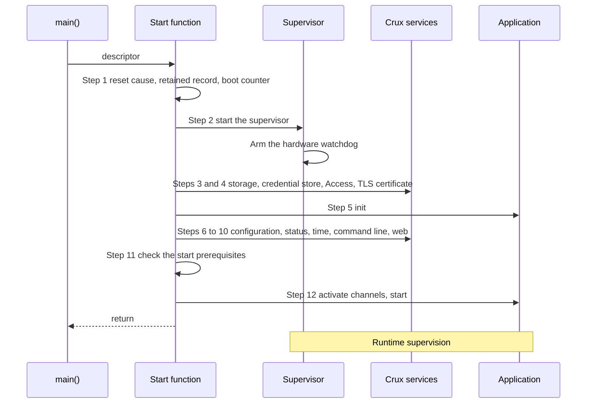

# Controller framework specification

This page specifies the controller framework: its requirements, application interface, operating model, recovery, build options, application template, verification and decisions.
The [overview](controller-framework.md) explains what the framework is, who does what and how a product joins it.
The [platform gaps](controller-framework-platform-gaps.md) hold the Crux and Zephyr constraints C1 to C19 and the Crux interface behind each service.
The [threat model](controller-framework-threat-model.md) holds the assets, interfaces, threats and Annex I applicability.
The page changes no source code; the [architecture](../architecture.md) and the [capabilities](../capabilities.md) describe the current images.

## 1. Scope and conventions

These pages read Crux at `62ed69f1` ("the pin"), which pins Zephyr v4.4.2, and Crux `main` at `05a50475`, which pins Zephyr v4.5.0.
The [`west.yml`](../../west.yml) of this repository's `main` pins `05a50475`; the pages keep `62ed69f1` as the pin until the gaps are checked again against `05a50475` ([platform gaps](controller-framework-platform-gaps.md)).
A Crux fact holds at the pin unless it carries one of these status words:

| Status word | Meaning |
|---|---|
| Resolved (revision) | The Crux change is at the pin since that Crux revision; the gap keeps its entry and number for the references to it |
| Crux `main` | Holds on Crux `main`, not at the pin |
| Planned in Crux | Crux has decided the change; it is on neither the pin nor `main` |
| Crux change needed | The framework needs the change; Crux has not decided it |
| Deferred by Crux | Crux has decided to postpone the change |

A Crux change carries its Crux issue number where Crux has one.
Each rule carries one label:

| Label | Meaning |
|---|---|
| Established mechanism | A documented mechanism of Zephyr, west or Crux, used as its documentation describes or recommends |
| Decision (Dn) | A choice of this framework among valid options; [section 9](#9-decision-register) holds decision Dn |
| Platform constraint or interim | Forced by Crux or Zephyr at the pin, or a state accepted until a planned or needed platform change exists; the [platform gaps](controller-framework-platform-gaps.md) name the change |
| Reference configuration | Values for the RT1060-EVKB reference board, which a product tunes |
| Product decision | A choice that the framework leaves to each product |

A heading's label applies to every rule under it that carries no label of its own.
Where a decision lets a product choose differently, the text says so.
Requirements use the indicative mood throughout instead of the "shall" of ISO/IEC/IEEE 29148 (not read), and each traces to verifiable criteria.
Each security, vulnerability handling and quality requirement carries a practice label in [section 6.4](#64-practice-basis), and each rule of the application template carries a practice label or its decision in [section 7.5](#75-application-template-d20); each versioning rule in [section 7.6](#76-versioning-d21) carries a practice label or is a decision (D21):

| Practice label | Meaning |
|---|---|
| Standard | Required or recommended by a standard, regulation or upstream project for this kind of product |
| Documented but optional | A mechanism that upstream documents and leaves to the integrator |
| Project-specific workaround | A choice of these pages that fills a gap of a tool or platform |

A practice label rests only on a source whose text was read for these pages.
These labels mark the other sources and statements:

| Source label | Meaning |
|---|---|
| not read | A source cited by name or number whose text was not read |
| unofficial text | Text of the EU Cyber Resilience Act, Regulation (EU) 2024/2847, read from an unofficial reproduction, not checked against the Official Journal |
| assumption | A statement of fact that no read source or check confirms |

[Section 10](#10-terms) defines the terms of these pages; the [glossary](../glossary.md) defines the others.

## 2. Requirements

The criteria are in [section 8.4](#84-criteria).

| # | Functional requirement | Criteria |
|---|---|---|
| F1 | The framework composes the Crux services of the [service mapping](controller-framework-platform-gaps.md#service-mapping) and starts them in a defined order from one start function. | 1, 6 |
| F2 | The base image runs every framework service with no application. | 1, 2, 3, 15 |
| F3 | An application joins only through the interface of section 3, and the framework imposes no execution model on it. | 4, 5, 8, 14, 20, 21, 22, PR6 |
| F4 | Device management offers HTTPS web management and a serial command line, and SSH in builds that carry its licensed stack. | 26 |
| F5 | The framework and the application register configuration parameters and status items, which device management shows. | 4 |
| F6 | The product selects the build options of section 7.1 with Kconfig. | 27 |
| F7 | The repository holds an application template that a product team copies to start a product repository; the template holds no framework logic, and its copy imports the framework as a module at a pinned revision (section 7.5). | 47, 48, 49 |

| # | Reliability requirement | Criteria |
|---|---|---|
| R1 | The hardware watchdog supervises the controller from startup step 2 of the start function on, through startup and runtime (section 4). | 6, 7, 9, 19, 20, 21, PR1 |
| R2 | A hang ends in a reset, after which the next boot reports the reset cause as far as the hardware reports it and a detailed fault record only when one could be written before the reset, while a failure that is not a hang degrades the failing service, and the controller when the service is required, and is reported. | 7, 8, 9, 16, 18, PR1 |
| R3 | Repeated fault resets lead to safe mode, a recovery-oriented service set from which an operator can recover the controller, and a fault in safe mode's own services is recovered by the boot loader or the product's recovery path (section 5.2). | 10, 11, 17 |
| R4 | The product declares start prerequisites, which the framework checks before every application start, and runtime dependencies, which the framework reports while the application runs (section 4.7). | 6, 10, 23 |
| R5 | In product builds, the application does not start when the hardware watchdog cannot be armed. | 10, 19 |
| R6 | Every startup step of a normal boot has a measured duration; steps 3 to 12 have a software deadline, and steps 1 and 2 have none, because the supervisor that enforces the deadlines starts in step 2, so they are bounded by their content (section 4.1), and first-boot key generation belongs to device preparation. | 31, PR4 |
| R7 | Configuration that the framework or the application saves survives a reset and a power cut, and the application data cannot fill the space of the settings file and the credential store (section 5.4). | 12, 24, PR1, PR2 |

| # | Security requirement | Criteria |
|---|---|---|
| S1 | No default password exists, and the first account is created over a trusted path (IEC 62443-4-2 CR 1.5 (not read); ETSI EN 303 645 provision 5.1 (not read)). | 28 |
| S2 | A factory reset needs an authorised operator or a physical presence that the product defines, and no unauthenticated serial command erases the device. | 29, PR4 |
| S3 | The items of section 6.2 are decided before the Product Ready milestone. | PR5 |
| S4 | Every web route and serial command needs an Access login, except the login, its sign-in assets and first-account setup (section 6.2). | 34 |
| S5 | Failed logins on every interface are delayed and recorded as security events (section 6.2). | 43 |
| S6 | A product build refuses the development and test options and has the stack hardening options (section 6.2). | 38 |
| S7 | Web management uses at least TLS 1.2, only forward-secret cipher suites with authenticated encryption, and a stated key type (section 6.2). | 39 |
| S8 | A factory reset removes credentials, configuration, application data and persisted security events, keeps the device identity, and uses the erase method that the product records (section 5.3). | 42, PR4 |
| S9 | The product records how the credential store's confidentiality and device binding are protected (section 6.2). | PR5 |
| U1 | The update path refuses an image whose security counter is below the running image's (section 6.1). | PR7 |
| L1 | The framework records the security events of section 6.2, and a product option turns their persistence off. | 44 |
| A1 | Connection, session, request size and request rate limits are build options with defaults, and overload degrades device management without affecting supervision (section 6.2). | 45 |
| M1 | The threat model states the data that the framework holds and the outbound traffic of the base image. | 46 |

| # | Vulnerability handling and quality requirement | Criteria |
|---|---|---|
| V1 | Every nightly and release build of the base image and of the product integration image produces an SPDX 2.3 SBOM of the application, Zephyr and every module, kept with the internal release record (section 6.3). | 35 |
| V2 | The SBOM is matched against a public vulnerability database nightly and at release, and a release needs a triage record for each match and fails while a match has the status affected with no fix, or under investigation (section 6.3). | 36 |
| V3 | The repository states a coordinated vulnerability disclosure policy, an advisory template and a Security section in its release notes (section 6.3). | 40 |
| V4 | The release manifest is signed and comes with a build provenance attestation (section 6.3). | PR8 |
| H1 | The [threat model](controller-framework-threat-model.md) covers each delivery stage, and products extend it. | 37 |
| H2 | A product security documentation template covers the user information that the framework affects (section 6.3). | PR9 |
| Q1 | CI reports host-test coverage, analyses the Zephyr sources, fuzzes the portable parsers and scans for secrets (section 6.3). | 41 |

[Section 6.5](#65-cra-annex-i-traceability) traces these requirements to Annex I of the EU Cyber Resilience Act; these pages claim compliance with no standard or regulation.

| # | Portability requirement | Criteria |
|---|---|---|
| P1 | Nothing in the framework or the interface names a board or SoC, and per-board values live in board files (section 7.2). | 30 |
| P2 | The framework core (states, supervision policy, boot counter, application contract) is portable C with host tests, and OS-specific code lives in the adapter and composition zones (section 7.3). | 10, 13 |
| P3 | Linux functions are a later delivery stage, coordinated with Crux, in which the framework runs natively on Linux through Crux's Linux providers and not through `native_sim` (section 7.3). | A later specification |

## 3. Application interface

The application interface holds only what the framework owns (D1).
Its names are open, decided at implementation.

### 3.1 Descriptor

The product's `main()` passes the descriptor to the start function.
Each entry is specified by the results it guarantees and the time it may take; how the application reaches them, including threads or work items of its own, is the application's choice.

- `init(ctx)` is mandatory and returns within its step deadline.
  - On success, every channel requirement, status item and parameter table that the application needs is registered, and none is registered later in the boot.
  - It may read its data root within the deadline; it does not depend on configuration, time, web management or the command line, which start after it.
  - On failure, nothing that `init` started is still running.
- `start(ctx)` is mandatory and returns within its step deadline.
  - On success, the threads that feed the activated channels run and feed within their reload periods.
  - On failure, every thread that `start` created has ended before it returns.
- `stop(ctx, reason)` is mandatory and returns within its deadline; the reason is an operator stop, a planned reset or an application fault.
  - On success, every thread of the application has ended, so the framework can release its channels.
  - An error return or a missed deadline is a hang (section 4.8).
- `safe_state(ctx)` is mandatory, puts outputs into the product's defined safe state and never blocks.

### 3.2 Context

The framework gives through `ctx` what it owns:

- registration of task watchdog channel requirements, and the handle that feeds each channel, with the lifecycle of section 4.4;
- registration of status items, which the framework adds to the status service;
- registration of a parameter table, which the framework adds to the configuration service;
- the assigned application data root of Crux File;
- read-only controller state and service health;
- a call that reports an application fault, which the framework handles on its own thread (section 4.8).

The application calls Crux's public APIs directly for logging, time, sockets, file access under its data root and configuration reads, and Zephyr directly for threads and synchronisation.
The framework does not wrap them, following the repository rule against pass-through wrappers.

### 3.3 Call order and concurrency

| Rule | Detail |
|---|---|
| One caller | The framework calls `init`, `start` and `stop` from one framework thread, in that order, never concurrently with each other |
| Once | `init` runs once per boot; `start` runs once per transition to running; `stop` runs only in the running state |
| `safe_state` callers | The framework thread, after `stop` succeeded (an operator stop, a planned reset or a reported application fault) and after a failed `init`, activation or `start`; the supervisor, on a deadline overrun, a `stop` that returns an error or a channel expiry, when the application has been initialised (section 4.8) |
| `safe_state` and running threads | When the framework thread calls it, no application thread runs, because `stop` succeeded or no thread was started, so no application thread writes outputs after it; when the supervisor calls it, application threads may still run and overwrite outputs until the reset |
| `safe_state` constraints | It may run concurrently with the application's threads, so it is idempotent, takes no lock, allocates nothing and logs nothing |
| Partial `init` failure | The framework calls `safe_state`, releases the registrations (requirements dropped, status items and parameters marked unavailable), enters fault and calls neither `start` nor `stop` |
| Partial `start` failure | When activation or `start` fails, the framework calls `safe_state`, deletes the channels it activated, releases the registrations and enters fault; threads that `start` created are the application's to end before it returns its error |
| Reported application fault | The framework calls `stop` with the reason application fault and its deadline, then `safe_state`, then deletes the active channels and releases the registrations, and enters fault (section 4.8) |
| Thread clean-up | The framework never aborts an application thread; `stop` ends them, and the framework then releases their channels (section 4.4); a `stop` that returns an error or passes its deadline is a hang (section 4.8) |
| Second start function call | Refused, as is a descriptor without a mandatory entry |
| Framework boundaries | The application may not block framework threads, take framework locks or call device management |

Safe state is best effort.
The framework calls `safe_state` in the cases above, but not from the fatal error handler and not after a CPU lockup.
Once a reset is decided, the time until it is at most the watchdog timeout T; in a build without an armed watchdog, the software reset request has no hard bound, because it needs the supervisor thread to run (section 4.3).
During and across a reset, outputs keep a safe state only through the board's hardware default, which the product designs and documents.
IEC 61508-4 defines "safe state" for functional safety; these pages use the word in that sense and claim no safety integrity.

### 3.4 Stability

- The interface starts at the lowest stability tier, because no consumer exists to confirm its shape.
- It is validated against a first real runtime consumer (a product's control software or a third-party application runtime, not the fixture application or the application template) before its tier is raised.
- This repository defines no stability tiers; the tiers are open, decided at implementation, modelled on Crux ADR-0001 Decision 4.
- A framework-owned periodic task that calls an application entry point is not part of the first version; if a consumer needs one, it can be added later as an optional helper on top of this interface.

## 4. Operating model

This section defines the startup steps, the supervision periods, runtime supervision, the channel lifecycle, the application and controller states, service health and the reactions to faults.
[Section 5](#5-recovery-storage-and-device-preparation) holds the mechanisms of recovery.

### 4.1 Startup steps

The product's `main()`, or the base image's, calls the start function once; the start function runs these steps in order, logs each step's name and result, and returns.

| # | Step | On failure |
|---|---|---|
| 1 | Read the Crux monotonic clock; read the reset cause once, keep the copy and clear the flags ([C2](controller-framework-platform-gaps.md#c2-one-reset-cause-owner)); read and check the retained record; update the boot counter and decide normal boot or safe mode (section 5.2). | A missing clock stops startup; otherwise log, continue without the copy, and count a bad record as empty. |
| 2 | Start the supervisor thread, which arms the hardware watchdog with the one timeout T ([C3](controller-framework-platform-gaps.md#c3-one-watchdog-activation-per-boot)) and supervises the startup steps. | The watchdog is "not armed"; startup continues, and the application does not start unless the build allows it (D14). |
| 3 | Mount the volume once with the keep policy and bind the application data root and the credential store roots. | Storage failed, and step 4 fails with it. |
| 4 | Start security events, the realtime clock, the credential store and Access, then start the TLS certificate module, which checks that the device identity exists; at the pin it cannot check it yet (interim state of section 5.5). | Access failed; device management that needs accounts stays off (section 5.3). A missing device identity on a prepared volume sets safe mode for this boot, unless the build has the TLS identity option (section 5.5); in the interim state of section 5.5, no identity result sets safe mode, and `CRUX_TLS_CERTIFICATE_ERR_KEY_MISMATCH` keeps web management off. |
| 5 | Unless in safe mode or with no application: call the application's `init`, which registers the application's requirements (section 3.1). | Application fault, with the clean-up of a partial `init` (section 3.3). |
| 6 | Start the configuration service with the framework and application parameter tables. | Configuration failed. |
| 7 | Start the status service with the copy from step 1 and the framework and application items. | Status failed. |
| 8 | Start time synchronisation, outside safe mode. | Time stays unsynchronised. |
| 9 | Register the framework's command tables with `crux_cli_init()` and start the configured command line transports; `crux_cli_serial_start()` refuses a registry that is not ready (`components/cli/ports/zephyr/include/crux/cli_zephyr.h:36-40`). | Command line failed. |
| 10 | Register the TLS key and certificate written by device preparation, from the TLS certificate module, then start sessions, web management and the listener. | Web management failed; without a device identity, web management stays off (step 4). |
| 11 | Check the start prerequisites (section 4.7). | A start prerequisite is not healthy: the application is held, and the controller is degraded. |
| 12 | Unless in safe mode, with an application fault, with a start prerequisite that is not healthy, without an armed watchdog in a build that refuses it, or with no application: activate the application's registered channels and call the application's `start` (section 4.4). | Application fault, with the clean-up of a partial start (section 3.3). |

Startup watchdog rules (established mechanism for the parts that Crux and Zephyr provide; D4 for the step deadlines):

- The hardware watchdog is armed in step 2, before the first step that touches a medium or the network, so a hang in steps 3 to 12 ends in a reset.
- Step 1 only reads and writes registers and retained RAM, touches no storage medium or network, and is bounded.
- Each step from 3 on has a software deadline (Kconfig, reference values from board measurement); the deadlines of steps 5 and 12 bound `init` and `start`.
- While the current step is within its deadline, the supervisor feeds the watchdog at a period shorter than T.
- When a step passes its deadline, the supervisor first latches the fault and stops feeding, then writes the retained record with the step name, best effort, and the watchdog resets the device; in a build without an armed watchdog, the supervisor requests a software reset instead (section 4.3).
- The supervisor thread has a higher priority than the thread that runs the start function, so a long step cannot starve it (section 7.4).
- Zephyr's default main thread priority (`CONFIG_MAIN_THREAD_PRIORITY`, 0) is above the supervisor, so the base image and each product set it into the startup band.
- T is one value for the whole boot (C3): it covers the supervisor's feed period plus a scheduling margin, inside the provider's supported range; the step deadlines are independent of T.
- Comparable practice: MCUboot's Zephyr port feeds the watchdog during long boot loader operations (`CONFIG_BOOT_WATCHDOG_FEED`).

Key generation is part of device preparation (D11), so a normal boot has no long step.
Only a development or reference build with the TLS identity option generates a missing key and certificate in step 4, with its own deadline set from a measurement on the board for the key type; the status service then reports that the certificate was made at boot.
Interim (platform constraint or interim): Crux makes a missing key and certificate in step 4 of every build (section 5.5), so the step 4 deadline covers key generation in every build until Crux's setting that requires an existing identity is at the pin.

### 4.2 Supervision periods (D4)

| Period | From | Until | What the supervisor feeds by |
|---|---|---|---|
| Before framework startup | Reset | The start function | Outside R1: boot ROM, boot loader and kernel initialisation; the watchdog policy from the boot loader to the application is coordinated with Crux's secure boot work (D7) |
| Not armed | The start function | Step 2 arms the hardware watchdog | Nothing; step 1 only reads and writes registers and retained RAM and touches no storage medium or network |
| Startup supervision | Step 2 | `start` returns, or step 12 decides not to call `start` | Each startup step within its deadline (section 4.1), and every active channel |
| Runtime supervision | The end of startup supervision | A reset | Every active channel has made progress and none has expired |
| Feeding stopped | A step passes its deadline, `stop` returns an error or passes its deadline, or a channel expires | The hardware watchdog resets the device | Nothing |

When step 2 cannot arm the watchdog, Crux System reports it as unavailable or faulted, the status service shows "not armed", and no period above applies; the application then starts only in a build that allows it (D14); in any build, the supervisor then ends a hang of the framework's own steps or channels with a software reset (section 4.3).

### 4.3 Runtime supervision

The pattern is Crux's documented one for supervising several activities (Crux `main`, `docs/superpowers/specs/2026-10-24-system-health-design.md`, section "Supervising several activities"; at the pin, the System build already refuses the option it forbids).

| Rule | What the framework does | Label |
|---|---|---|
| One supervisor | One supervisor thread holds the single `crux_watchdog_t` token from `crux_watchdog_start()` and calls `crux_watchdog_feed()` only while every supervised activity has made progress | Established mechanism (Crux System contract) |
| Task watchdog without hardware | `task_wdt_init(NULL)`; one channel per supervised thread, with the lifecycle of section 4.4; each channel callback only records the expiry and the channel identifier; the supervisor stops feeding when it sees one | Established mechanism (Zephyr task watchdog; Crux pattern) |
| No hardware fallback | `CONFIG_TASK_WDT_HW_FALLBACK=n`; the Crux System build stops when it is set (`components/system/ports/zephyr/CMakeLists.txt:19-20`) | Platform constraint or interim |
| No callback-less channel | A channel without a callback resets through `sys_reboot(SYS_REBOOT_COLD)`, which latches a software reset cause and loses the watchdog evidence; every channel has a callback | Established mechanism |
| What is supervised | The framework's threads (supervisor inputs, time synchronisation, storage worker, reboot thread of section 5.1) and each application thread that registers a channel (section 3.2) | D4 |
| Crux service threads | At the pin, the Crux service threads that the framework starts (console, web workers, network settings worker, security event drain) are not fed from inside, and their health is read indirectly as in the next row; with Crux's progress hook (Crux `main`, [C8](controller-framework-platform-gaps.md#c8-crux-service-threads-and-supervision)), each started Crux service thread has a channel that the framework feeds from the hook | Platform constraint or interim |
| Indirect health | Zephyr's threads (HTTP server, network RX and TX, deferred log processing), which no Crux hook covers, are not fed from inside; their health is read from link state, network buffer counters, log drop counters and a periodic local probe | Platform constraint or interim |
| Watchdog not armed | When the watchdog is not armed, the supervisor ends a deadline overrun, a `stop` that returns an error or a channel expiry by writing the retained record, calling `safe_state` when the application has been initialised, and requesting a software reset with `crux_system_reset()` (Crux `components/system/include/crux/system.h:90-97`); on `native_sim`, the simulated watchdog counts as an armed watchdog, and the supervisor stops feeding as on a board ([C11](controller-framework-platform-gaps.md#c11-simulated-watchdog-on-native_sim)); a product build holds the application in that case (D14), so the software reset covers only the framework's own steps and channels; a build that allows operation without a hardware watchdog (development, bench and `native_sim` builds) also runs the application, and a hang of the supervisor itself is not detected, which is why a product build refuses that option | D14 |
| Policy | Degrade and report for a failure that is not a hang (SNTP rounds fail, a save fails, the link is down); reset for a hang (a channel expires, a deadline passes, `stop` returns an error, a fatal error); the reactions are in section 4.8 | D4 |
| Retained record | Once it has latched the fault and stopped feeding, the supervisor writes the failing channel or step, the uptime and the reason into a retained RAM record with a checksum (Zephyr retention subsystem over `retained_mem`), best effort before the reset; the latch comes first, so a slow write or `safe_state` cannot delay the reset beyond T | Established mechanism (Zephyr retention); D4 for the order |
| Fatal path record | The fatal error handler writes a minimal record; the fatal path and code in interrupt context must not block, so the fatal path writes the record without a mutex (with `CONFIG_RETENTION_MUTEXES`, `retention_write` takes one), by a mechanism that is open, decided at implementation | Established mechanism (Zephyr retention) |
| Record use | The next boot reads the record once; placement and validity rules are in section 5.1 | D4 |
| Reporting | The status service shows the controller state, the application state, each service's health, the reset cause, the boot counter, the last-fault record and the watchdog state; liveness from outside is ping, link state and a light status endpoint | D4 |

Rationale: a per-thread restart is a process-manager pattern that Zephyr threads do not support.
`k_thread_abort` leaves locks and sockets behind, Crux Access cannot reopen after an unusable store ([C9](controller-framework-platform-gaps.md#c9-access-and-an-unusable-store)), and the watchdog has one activation per boot (C3), so a hang resets the device (D4).

### 4.4 Task watchdog channel lifecycle (established mechanism for the Zephyr calls; D1 for the rules)

A **channel requirement** is a name and a reload period that `init` registers through `ctx`; an **active channel** is a Zephyr task watchdog channel that `task_wdt_add()` returned.

| Step | Rule |
|---|---|
| Register (`init`) | The framework records the requirement and creates no Zephyr channel. A requirement with a reload period of zero, a name already registered, or one more than the free capacity is refused, and `init` sees the error. |
| Capacity | `CONFIG_TASK_WDT_CHANNELS` (Zephyr default 5, range 2 to 100) bounds the framework's own channels and the application's requirements together; the framework reserves its own channels, including one per started Crux service thread once Crux's progress hook is used (C8), and the product raises the value when its application needs more. The framework keeps a fixed table and has no resource manager. |
| Activate (step 12, and each operator start) | The framework calls `task_wdt_add()` for every requirement immediately before it calls `start`. `task_wdt_add()` feeds the new channel at once, so timing starts at activation, and each application thread feeds its channel within the reload period from then on. |
| Partial activation | When `task_wdt_add()` fails for one requirement, the framework does not call `start`, calls `safe_state`, deletes the channels it activated in this step with `task_wdt_delete()`, releases the registrations, and the application enters fault. |
| Feed | An application thread feeds its own channel through the handle that its registration returned in `ctx`, because the Zephyr channel identifier may change at each activation; the supervisor feeds the hardware watchdog only while no channel has expired. |
| Release (operator stop, planned reset) | After `stop` succeeds, every application thread has ended (section 3.1), and the framework calls `safe_state` and deletes every active application channel. The requirements stay registered for a later operator start. |
| Release (application fault) | After `stop` succeeds for a reported fault, or after a failed activation or `start`, the framework calls `safe_state`, deletes every active application channel and releases the registrations, because a fault leaves only through a reset. |
| Re-activate (operator start) | The framework checks the start prerequisites, activates the registered requirements again and calls `start`; `init` does not run again in the same boot. |
| Expire | The channel callback records the channel identifier; the supervisor first latches the fault and stops feeding, then writes the retained record and calls `safe_state` when the application has been initialised, both best effort; in a build without an armed watchdog, it requests a software reset (section 4.3). |
| After an expiry | Zephyr's task watchdog re-arms its timer only on the next feed or add of a channel, so the callback can repeat; recording is idempotent, the framework does not depend on further callbacks, and it neither feeds, deletes nor reuses the expired channel before the reset. |

The framework's own channels follow the same rules, activated in the step that starts the supervised thread.

### 4.5 Application lifecycle and state (D1)

The states compare with the nRF Connect SDK CAF module states and the systemd unit states.

| State | Entered when | Leaves to |
|---|---|---|
| Absent | No descriptor (the base image) | — |
| Not initialised | A descriptor, before step 5 | Initialised when `init` succeeds; fault when it fails; held when the boot is in safe mode |
| Initialised | `init` succeeded | Running when `start` succeeds; fault when activation or `start` fails; held when step 12 decides not to call `start` |
| Held | The framework decided not to start the application: safe mode, a start prerequisite that is not healthy, or a watchdog that is not armed in a build that refuses it | Running on an operator start when the reason was a start prerequisite and every start prerequisite is healthy; otherwise only a reset |
| Running | `start` succeeded | Stopped when an operator stop's or a planned reset's `stop` succeeds; fault when the application reports a fault and its `stop` succeeds |
| Stopped | An operator stop, or a planned reset, after `stop` succeeded | Running on an operator start, outside safe mode, when every start prerequisite is healthy |
| Fault | `init`, activation or `start` failed, or the application reported a fault and `stop` succeeded (section 3.3) | Only a reset |

A hang (a channel expiry, or a `stop` that returns an error or passes its deadline) does not end in a reported fault state: the device resets (D4).

### 4.6 Controller state (D4)

The states follow the common embedded usage of "degraded mode" and "recovery mode".

| State | Meaning |
|---|---|
| Starting | From the start function until startup supervision ends |
| Operational | A normal boot after startup supervision in which every required service is healthy, and the hardware watchdog is armed or its absence is allowed by the build; the controller then provides its defined functions whatever the application state is, so an operator stop or an application fault leaves it operational and is reported as the application state |
| Degraded | A normal boot after startup supervision in which at least one required service is degraded or failed, or the watchdog is not armed in a build that refuses it; device management runs where its services allow |
| Recovery | A boot in safe mode (section 5.2), entered when the boot counter reaches N or when a prepared device has no device identity (section 5.5); it lasts until the next reset |

A service that is not required reports its own health, and its failure does not change the controller state.
Three conditions build on the controller state and stay separate:

- **Controller operational**: the state above.
- **Successful boot**: the condition that clears the boot counter (section 5.2).
- **Healthy image**: the health verdict that leads to the confirmation of a test image (section 6.1).

### 4.7 Service health and required services

Each framework service has one health value: **healthy**, **degraded** (running with a reported failure), **failed** (start failed or stopped), or **absent** (left out at build time).

| Service | Healthy | Degraded | Failed |
|---|---|---|---|
| Network | Link up and an address assigned (static or a DHCP lease) | Link down, or no address, after the interface came up | The interface did not come up |
| Storage | Volume mounted and roots bound | A write or save answers an error, or a size limit is reached (section 5.4) | Mount or bind failed |
| Access | Credential store usable | — | Store unusable (C9) or start failed |
| Configuration | Service started with its tables; an image without a save provider reports "not persistent" as a status item (section 5.4) | The last save failed | Start failed |
| Status | Service started | — | Start failed |
| Time | Wall time synchronised and younger than the stale age | Not yet synchronised, or stale | Synchronisation could not start |
| Web management | Listener accepts TLS connections | — | Start failed, or no device identity |
| Command line | Every configured transport started | Some configured transports started | No transport started |

Reachability of a remote peer is not part of any service's health, because it depends on the network outside the device; an application that needs it reports it as its own status item.

The product's required services are of two kinds:

- **Start prerequisites**: the framework checks them in step 11 and before every operator start, and holds the application while one of them is not healthy; by default there are none, and the product selects them explicitly (section 7.1).
- **Runtime dependencies**: the framework reports a change of their health through the status service and the read-only service health in `ctx`; the application decides its response, and the framework neither stops nor restarts the application because of it.

### 4.8 Faults and reactions (D4)

| Event | Framework reaction | `safe_state` | Afterwards |
|---|---|---|---|
| Operator stop | Calls `stop`, then `safe_state`, then deletes the application's channels | After `stop` succeeds | Application stopped; controller state unchanged |
| `init`, activation or `start` fails | Calls `safe_state`, then deletes the activated channels and releases the registrations | Yes, with no application thread running (section 3.3) | Application fault; controller state unchanged |
| Recoverable runtime application fault: the running application reports a fault through `ctx` | Calls `stop` with the reason application fault and its deadline; once every application thread has ended, calls `safe_state`, then deletes the channels and releases the registrations | After `stop` succeeds | Application fault; controller state unchanged |
| A service fails without a hang | Degrade and report; a start prerequisite holds the application before a start; a runtime dependency is reported to the application | No | Controller degraded when the service is required |
| A startup step, `init`, `start` or `stop` passes its deadline, `stop` returns an error, or a channel expires | Latches the fault and stops feeding, then writes the retained record, best effort; in a build without an armed watchdog, requests a software reset (section 4.3) | When the application has been initialised, from the supervisor, best effort, while application threads may still run (section 3.3) | Reset by the hardware watchdog, or the software reset; a fault reset for the boot counter |
| Fatal error (`k_sys_fatal_error_handler`) | Calls no application entry; writes a minimal retained record when the retained region is usable, and resets | No | A fault reset for the boot counter |
| CPU lockup, or a handler that cannot run | Nothing runs; the unfed hardware watchdog resets the device | No | Reset cause as the SoC reports it; no record |
| N consecutive fault resets | Safe mode (section 5.2) | — | Controller in recovery |
| A hang or fatal error in safe mode's own services | The same reset; safe mode cannot escape a fault in its own services | — | Safe mode repeats; the final recovery is the boot loader or the product's recovery path (section 5.2) |

Outputs keep a safe state during and across a reset only through the board's hardware design (section 3.3).

## 5. Recovery, storage and device preparation

### 5.1 Retained region and reset classification (D4)

- **Retained region**: the boot counter and the last-fault record share one retained region with a prefix and a checksum (Zephyr retention subsystem).
  By default it sits in on-chip RAM that neither the boot ROM nor Zephyr's startup initialises, named by the board overlay; external SDRAM is not assumed to retain data, because the boot ROM initialises the SDRAM controller again at every boot.
- **Fault reset**: any one of these conditions makes a reset a fault reset, and Crux reports zero, one or several latched cause bits (`crux_reset_cause_t`):
  - the captured cause includes WATCHDOG, or a valid record names a deadline, a channel expiry or a fatal error;
  - without a valid operator reset marker, a SOFTWARE reset, or a reset whose captured cause includes CPU_LOCKUP.
- **CPU_LOCKUP with SOFTWARE**: treated as a SOFTWARE reset, because some SoCs report both from one status bit; on the RT1060-EVKB one SRC status bit serves lockup and SYSRESETREQ, and Zephyr's `drivers/hwinfo/hwinfo_mcux_src.c` reports it as both.
- **Not a fault reset**: the counter keeps its value for
  - a reset with a valid operator reset marker, unless WATCHDOG is latched or a valid record names a deadline, a channel expiry or a fatal error;
  - a PIN reset or a DEBUG reset that meets no fault reset condition.
- **Operator reset marker**: the framework writes it before its own operator resets (safe-mode exit and factory reset) and before a reset that an operator requests through Crux Reboot.
  For Crux Reboot, the framework starts no Crux reboot worker; its own reboot thread calls `crux_reboot_work_once()`, which carries out an accepted request on the calling thread: the delay, the wait for events and saves, the second policy check, then the reset ([C14](controller-framework-platform-gaps.md#c14-operator-reset-marker-and-crux-reboot)).
  The framework states its Crux Reboot policy as a callback, because Crux calls no callback with the always-allow policy.
  The callback writes the marker only when it allows the restart on the reboot thread, because that call is the last step before the reset; when it allows a request on any other thread, it writes no marker.
  When `crux_reboot_work_once()` returns, no reset happened, so the reboot thread clears a marker that the call left.
  The reboot thread feeds its channel before and after each call, and the channel's reload period is longer than the bound of one call: Crux Reboot's lock wait, delay and settle wait (1 s, 1 s and 15 s at their defaults), plus the time of its polls, the policy call and its event, with a margin.
  Practice label: documented but optional (Crux `components/reboot/include/crux/reboot.h`: a composition with no worker thread calls `crux_reboot_work_once()` itself).
- **Power cycle**: a captured POR cause, or a region whose prefix or checksum is invalid, means that the region did not survive: the counter starts at zero and no record is reported, whatever other cause bits are latched.
  On the RT1062 a POR cause is expected never to be captured and a power-on to read as PIN, which the board check of section 5.6 shows, so detection of a power cycle there relies on the invalid-region rule.
- **Interrupted write**: the record and counter are written with their checksum last; a write that a reset interrupts fails the checksum on the next boot and counts as an empty region, while the captured reset cause still decides whether the reset was a fault reset.
- **Stale record**: each record carries a sequence number; the next boot reads it once, passes it to the status service and marks it consumed, so a later reset does not count or report it again.
- **Image identity**: the region stores an identifier of the image that wrote it; a boot whose image differs, after an update or after the boot loader reverted an image, clears the counter and reports the previous image's last record.

### 5.2 Boot counter and safe mode (D4)

- **Boot counter**: counts consecutive fault resets and saturates at its maximum instead of wrapping.
- **Safe mode entry**: after N consecutive fault resets (Kconfig, default 3) the next boot enters safe mode; a prepared device without its device identity also boots in safe mode (section 5.5).
- **Safe-mode service set**: a recovery-oriented service set of network, storage, credential store, Access, configuration service (which web management needs), status, web management when the device identity exists, the serial command line and logging, plus the reset cause and last-fault record; no application, no time synchronisation and no optional service.
- **Successful boot**: the controller is operational and the application state is neither fault nor held, both without interruption for the stable period (Kconfig); the period starts when both conditions hold and starts again when either ends, so the counter does not clear while the application is in fault or held.
- **Counter reset**: a successful boot clears the counter, an authorised operator command clears it, or a different image boots; a fault reset after the counter cleared counts from one.
- **Safe-mode exit**: an authorised operator command clears the counter and resets into a normal boot; a different image also boots normally.
- **Fault resets in safe mode**: safe mode cannot escape a hang or fatal error in its own services; the device resets, the counter stays saturated, and safe mode repeats.
  A test image that is not confirmed is reverted by the boot loader at that reset (section 6.1); for a confirmed image, the final recovery is the boot loader's or the product's recovery path, such as a new image through the programming interface, decided with Crux's secure boot work (D7).

Comparable mechanisms: U-Boot's boot count limit (`CONFIG_BOOTCOUNT_LIMIT`, `bootlimit`, `altbootcmd`) switches to an alternative boot command after a set number of failed boots, and Zephyr's retention subsystem offers a boot mode that survives a warm reset.

### 5.3 Storage or Access failure and factory reset (D15)

- **Storage or Access failure**: device management that needs accounts stays off; the controller is degraded when storage or Access is a required service (section 4.7), or in recovery, and the serial log and the status service (where it runs) show the cause.
  Access cannot reopen in the same boot (C9), so a replaced medium takes effect after a reset; recovery is device preparation again, or a factory reset by a physical-presence input if the product defines one.
- **Factory reset** (S8): a command that needs a session with `access.manage` removes the files of the application data root, the persisted security events and the settings file, then erases the credentials (accounts) through Crux's credential store erase (Crux `main`), resets, and returns to first-account provisioning ([C9](controller-framework-platform-gaps.md#c9-access-and-an-unusable-store)).
  The erase comes last, because it reopens first-account setup and leaves the store unusable until the reset; a power cut before the erase leaves the accounts in place, and one during the erase can leave a valid slot whose accounts come back, so the operator repeats the reset until the erase returns `CRUX_CREDENTIAL_OK` (Crux `main` `credential_store_zephyr.h`; which copy of the accounts survives: not read).
  Practice label: documented but optional (Crux `main` `docs/management-in-a-product.md`, "Factory reset": the `access.manage` command, the settings file removed before `crux_credential_erase()`, and a repeat after an interrupted erase).
  It keeps the device identity, because only device preparation makes it and operators know the device by its certificate fingerprint (section 6.2); Crux's erase removes the TLS key and certificate as well, which C9 records.
  Removing a file frees its blocks on LittleFS and on an SD card without erasing them (assumption), so the erase method (file removal, block erase or discard, or erasure of an encryption key) is a product decision recorded at product readiness (PR4).
  A product may add a physical-presence input, such as a button held at boot; no unauthenticated serial command erases the device.

### 5.4 Storage and configuration

| Item | Rule | Label |
|---|---|---|
| Reference board medium | The whole microSD card is one LittleFS volume over the card's block device (`FS_LITTLEFS_BLK_DEV`) | Reference configuration (D3) |
| Product medium | A product chooses its medium (for example eMMC or NOR flash) and its Crux File provider; the framework names neither | D3 |
| Credentials on removable media | Whether the credential store may sit on a removable card is a product security decision | Product decision |
| One mount, never format | The composition mounts the volume once with the keep policy and binds the roots; no service mounts on its own; the framework never formats, so a blank or foreign medium does not mount and its data stays untouched | D11 |
| Configuration saving | Crux's Settings File provider for any power-cut-safe file system (`CRUX_CONFIGURATION_SETTINGS_FILE_ANY_FS`) on the LittleFS volume of Crux's LittleFS File provider (`CRUX_FILE_LITTLEFS_BLK_DEV`, Crux `main`, [C4](controller-framework-platform-gaps.md#c4-configuration-saving-needs-a-power-cut-safe-file-system)) | Established mechanism |

For each product medium, these rules hold:

- **File system full**: a save or a file write answers an error, the status service shows it, and the application data root has a size limit so that it cannot fill the credential store and settings.
  The framework owns the rule and the product sets the limit; Crux File has no size limit per root, so the limit needs a Crux change, which is planned in Crux ([C15](controller-framework-platform-gaps.md#c15-size-limit-of-the-application-data-root)).
- **Power-cut integrity**: the settings file and the credential store survive a cut at any point, shown by a power-cut test on the medium.
- **Configuration compatibility after an update**: the parameter table carries a version; a new image gives new parameters their defaults, keeps stored values whose key and type match, and reports discarded values; a deliberate downgrade is a product decision.
  The framework owns these rules; the platform mechanism is Crux Configuration, whose record carries the parameter's type and schema version and whose load gives the default for a record that does not match (`DEFAULT_REJECTED`, Crux `docs/configuration-contract.md`), so a parameter whose schema version changes also takes its default, and the rules need no Crux change.
- **Configuration compatibility after a rollback**: when the boot loader reverts an image, the earlier image reads values that the reverted image may have saved with the same rules, keeps values whose key and type match, gives defaults where they do not, reports them, and leaves keys it does not know in place, because the Settings File backend's compression keeps the last line of every name, known or not (Zephyr v4.4.0 `subsys/settings/src/settings_file.c:224`, established mechanism; Crux's corrected copy not read); so a parameter keeps its type for as long as its key exists, and a changed type takes a new key.

LittleFS is copy-on-write: a rename replaces a file atomically, so a power cut leaves the old or the new file.
Its guarantee covers the file system, not the medium's own controller during a power cut, so a power-cut test on the board is the evidence for a medium.
A PC cannot mount the card without a LittleFS tool; files leave the device through device management.
FatFs stays a selectable Crux File provider for other products, and a build with commercially licensed Reliance Edge may select it behind the same Crux File and Configuration interfaces.

### 5.5 Device preparation (D11)

- A preparation image or a host tool (littlefs-python, littlefs-fuse) writes the volume and its layout, and the device makes and stores its TLS key and certificate (its device identity) during preparation.
- A normal boot makes no key, except in a development or reference build with the TLS identity option (section 7.1).
- In any other build, a prepared volume without a device identity puts the boot into safe mode, the status service and the serial log report the missing identity, and the recovery is device preparation again.
- These two rules need a Crux setting that makes the TLS certificate start refuse a missing key or certificate and write nothing to the credential store, which is planned in Crux ([C9](controller-framework-platform-gaps.md#c9-access-and-an-unusable-store)).
- The framework starts the TLS certificate module in step 4, right after the credential store, so that a refusal sets safe mode before the application's `init` in step 5 (section 4.1); project-specific workaround (Crux `tls_certificate_start.h`: the start runs once the credential store has started and before any TLS listener).
- Crux at the pin and on Crux `main`: `crux_tls_certificate_start()` makes a missing TLS key and a self-signed certificate, stores them and returns `CRUX_TLS_CERTIFICATE_GENERATED`, and no public Crux interface reads the credential store records before that call.
- Interim state (platform constraint or interim): step 4 cannot check the device identity, and Crux makes a missing key and certificate there in every build.
  When the start returns `CRUX_TLS_CERTIFICATE_GENERATED` in a build without the TLS identity option, the status service and the serial log report that the certificate was made at boot, and the boot does not enter safe mode.
  The next boot finds the stored key and certificate, and clients see a new certificate fingerprint (section 6.2).
  A stored certificate without its key ends in `CRUX_TLS_CERTIFICATE_ERR_KEY_MISMATCH` after Crux makes a new key, so no certificate is active and web management stays off until an operator installs or regenerates a certificate (Crux `components/tls_certificate/src/tls_certificate.c`); like a generated identity, it does not set safe mode (section 5.2).
  Practice label: project-specific workaround (Crux `components/tls_certificate/include/crux/tls_certificate_start.h`).

### 5.6 Board facts

Whether the reset cause reads WATCHDOG after a WDOG1 reset, whether the retained region survives that reset and a pin reset, whether a software reset reads CPU_LOCKUP together with SOFTWARE, with and without the marker, and whether a power cycle, which reads as PIN, leaves the region invalid are board facts of the RT1060-EVKB.
A board check early in delivery stage 2 shows them, in a run that needs its own board authorisation (section 8.2).

## 6. Update and security items

### 6.1 Update (D7)

The partition layout, image format, signing and the confirmation call come from Crux's secure boot work; the framework defines none of them.
MCUboot reverts a test image that is not confirmed only when the device next resets (MCUboot test and revert); a test image that keeps running unconfirmed is not reverted.

- **Health verdict** (framework): a test image is healthy when, during its trial, all of these hold, not uptime alone:
  - the controller is operational;
  - every start prerequisite is healthy and every device management service that the build includes has started;
  - the application, when present, has been running for the stable period; an application that an operator stopped does not meet this condition until it has run again for the stable period;
  - the configuration loaded with a compatible version (section 5.4).
- **No reset history condition**: the verdict looks at the current boot only, because MCUboot reverts an unconfirmed test image at its first reset, so a test image that resets for any reason is reverted before a verdict can confirm it.
- **Confirmation** (update component): when the verdict is healthy, the update component confirms the image through Crux's image state contract ([C10](controller-framework-platform-gaps.md#c10-image-state)).
- **Trial deadline** (update component, on the framework's verdict): when the verdict is not healthy by the trial deadline (Kconfig, counted on the monotonic clock from the start of the boot), the update component requests a planned reset, and the boot loader reverts the image at that reset; the configuration rules after a rollback are in section 5.4.
  This planned reset carries no operator reset marker, so it counts as a fault reset, which has no effect because the reverted image clears the counter (section 5.1).
- **Anti-rollback** (U1): the update component refuses to request a test boot of an image whose security counter is below the running image's, and the boot loader refuses such an image through MCUboot's downgrade prevention with a security counter, which MCUboot leaves optional and off by default.
  The counter's storage comes from Crux's secure boot work ([C16](controller-framework-platform-gaps.md#c16-security-counter)), and the release manifest carries the counter (`security_counter` in `release/release-manifest.schema.json`).
- **Update transport** (D17): open, decided with Crux's secure boot work at product readiness.

The verdict needs no particular device management service: a build without web management is confirmed on the same conditions.

### 6.2 Security items

The [Access controls at the pin](controller-framework-platform-gaps.md#access-controls-at-the-pin) hold the Crux facts that these rules rely on.

| Item | Rule | Kind | Label |
|---|---|---|---|
| First trusted enrolment of the self-signed certificate | Device preparation records the certificate fingerprint (on a label or in the preparation record), and the serial command line shows it, so the operator checks it at the first connection instead of trusting on first use (RFC 7435); a product may install a certificate from its own CA instead | Mandatory | D11 |
| Authentication on every interface (S4) | Every web route has an access class other than `@public`, except the login, its attempt result and static sign-in assets, and Crux Web enforces it before the handler runs; every serial command needs an Access login, except the login and first-account setup | Mandatory | Established mechanism (Crux web and console contracts) |
| Failed logins (S5) | Crux Access delays further logins per source and per name after the free attempts and records each failure and delay as a security event; the framework keeps Crux's values unless the product sets its own, and adds no account lockout | Mandatory | Established mechanism (Crux Access contract) |
| Production configuration (S6) | A product build refuses the development and test options of criterion 38 and has stack canaries and, where the SoC supports it, hardware stack protection | Mandatory | Established mechanism (Zephyr Kconfig) |
| TLS policy (S7) | At least TLS 1.2, and only ECDHE or TLS 1.3 suites with authenticated encryption; at the pin the Crux web listener asks for TLS 1.3 alone with `TLS_AES_128_GCM_SHA256`, and the reference configuration's device key is ECDSA P-256; a product states its key type | Mandatory | Established mechanism (Crux web contract) |
| Security event list (L1) | Login, logout and session expiry, account and role changes, configuration changes, factory reset, update request and confirmation, safe-mode entry and a step of the wall time; Crux emits the Access, configuration, credential and reboot events, and the framework declares its own identifiers for the rest | Mandatory | Established mechanism (Crux security event contract) |
| Audit persistence | With persistence on (section 7.1), the product chooses when events reach storage (for example at once for authentication failures and account changes, batched for others), weighing loss at a power cut against medium wear; persisted events have a size limit and rotate at it, both set by the product, so that they cannot fill the volume (section 5.4); persistence needs a Crux reader ([C17](controller-framework-platform-gaps.md#c17-security-event-persistence)); timestamps come from unauthenticated SNTP ([threat model](controller-framework-threat-model.md#4-threats), threat 10) | Product choice | Product decision (D16) |
| Network limits (A1) | Connections, backlog, sessions, request body and request deadline are build options with Crux's and Zephyr's defaults; a request rate limit needs a Crux change ([C18](controller-framework-platform-gaps.md#c18-request-rate-limit)); device management runs in a lower priority band than the supervisor (section 7.4), so overload does not starve supervision | Mandatory | Established mechanism (Zephyr HTTP server; Crux Web and Access bounds) |
| Credential store at rest (S9) | The Crux store detects tampering and refuses a medium from another device, but it is not confidential against a person who holds the medium and the chip ID, and a blanked store reads empty and reopens first-account setup ([C19](controller-framework-platform-gaps.md#c19-credential-store-at-rest)); the product records its protection, for example a hardware-bound key or physical protection, and a non-removable medium limits removal but gives no confidentiality | Mandatory product record | Product decision |
| Serial command line and debug port in production | The product chooses whether the console is composed in production, for provisioning only, or always, and records the lockdown of the debug port in its security documentation (H2); a product with no console in production records its trusted first-account path (device preparation or a physical-presence input) under PR5; physical access to the ports is part of the trust model | Product choice | Product decision (D16) |
| Factory reset authority | Section 5.3 | Mandatory | D15 |
| HTTPS file transfer | Confined to the application data root, with limits on file size, total size, concurrent transfers and file names; it needs Crux's web adapter for the File service (Crux issue #188) | Mandatory when the product offers file transfer | D10 |

### 6.3 Vulnerability handling and release evidence

The repository supplies the mechanisms and templates; publishing, commitments and sign-off are organisational duties (section 6.6).
The framework reuses a Crux mechanism for the SBOM, matching or signing where Crux provides one, and owns only its configuration and evidence for its images (D10).

- **SBOM** (V1): the release dry run builds the `net` image at the pin (`scripts/ci/checks.toml`), which leaves out Mbed TLS, web management and Access, so it moves to the base image, and the product integration job adds its own SBOM.
  At the pin, `west spdx` (Zephyr v4.4.2, `scripts/west_commands/zspdx/`) writes tag-value SPDX 2.2 or 2.3 in the documents `app`, `zephyr`, `build` and `modules-deps`.
  A package gets a supplier only from a CPE external reference: the writer takes the supplier, the package name and the version from the fields of the CPE (`zspdx/writer.py:78-85`).
  Zephyr gets a CPE only from an exact `vX.Y.Z` tag (`zspdx/walker.py:292-306` and `390-411`), and a purl only from a `git@` or `http(s)://` URL.
  Without such a tag, a Zephyr package takes the Zephyr revision as its version and has no CPE (`zspdx/writer.py:110-113`; `zspdx/walker.py:413-414`).
  A module's source package takes the module's revision as its version and has a download location when the module has a URL.
  A module gets an identifier, on its `-deps` package, only when its `zephyr/module.yml` declares `security: external-references`, so such a package has a supplier only when a CPE is among those references.
  So the release step fills, from a table in this repository, the supplier of each package without a CPE, and adds the missing identifiers, before the completeness check of criterion 35.
  How the SBOM is retained with the internal release record is an open decision, because no workflow of this repository uploads an artefact.
- **Vulnerability matching** (V2): the tool is open, decided at implementation; a package without a CPE or purl is reported, not skipped; each match gets a triage record with a VEX status before a release, and the release check fails on a match with the status affected and no fix, or the status under investigation, while the nightly run only reports.
- **Disclosure policy** (V3): the policy states the scope, the private reporting channel, the target times for acknowledgement and fix, coordinated disclosure, advisory and CVE publication, and the supported versions; the target times are values that the repository's maintainers set.
  This repository gives no support period; a product supplies its own (H2, D19).
- **Release integrity** (V4): the signing and attestation tools are open, decided at implementation; the custody of the signing key is an organisational duty.
- **Threat model** (H1): the [threat model](controller-framework-threat-model.md) is updated at the end of each delivery stage, and its section 6 says what a product adds.
- **Product security documentation** (H2): secure commissioning, the update procedure and the update default, decommissioning and data removal, the support period, and the lockdown of the console and the debug port.
- **Quality gates** (Q1): the coverage threshold is set by project policy; clang-tidy covers only the host-built sources of this repository, whose `scripts/analyze_host.py` prints the sources that it does not analyse; the fuzz and secret-scan tools are open, decided at implementation.

| Deliverable | Requirement | Delivery stage |
|---|---|---|
| [Threat model](controller-framework-threat-model.md) | H1, M1 | 1, updated in each stage |
| Disclosure policy text in `SECURITY.md` | V3 | Any |
| Security advisory template | V3 | Any |
| Security section of the release notes | V3 | Any |
| Product threat model template | H1 | 5 |
| Product security documentation template | H2 | 5 |

### 6.4 Practice basis

A practice label covers the purpose of the requirement; a tool or mechanism that a row names is the choice of these pages unless the source names it.

| Requirement | Practice | Source read for these pages | Source not read |
|---|---|---|---|
| S1 | Standard | CRA Annex I Part I (2)(b) and (2)(d) (unofficial text), as mapped in section 6.5 | IEC 62443-4-2 CR 1.5; ETSI EN 303 645 provision 5.1 |
| S2 | Standard | CRA Annex I Part I (2)(d) (unofficial text), as mapped in section 6.5 | IEC 62443-4-2 CR 4.2 |
| S3 | Project-specific workaround | This page's choice that the section 6.2 items are decided by criterion PR5 (section 8.4); no external source | — |
| S4 | Standard | Secondary mapping of IEC 62443-4-2 CR 1.1 (CIP Security Requirements); CRA Annex I Part I (2)(d) (unofficial text); Crux `components/web/include/crux/web.h` | IEC 62443-4-2 text |
| S5 | Standard | CRA Annex I Part I (2)(d), protection from unauthorised access and its reporting (unofficial text); Crux `docs/access-contract.md` (delay and events) | IEC 62443-4-2 CR 1.11; ETSI EN 303 645 provision 5.1-5 |
| S6 | Documented but optional | Zephyr `kernel/Kconfig` (`STACK_CANARIES`), `arch/Kconfig` (`HW_STACK_PROTECTION`); CRA Annex I Part I (2)(k) (unofficial text) | — |
| S7 | Standard | RFC 9325, sections 3.1.1 (TLS 1.2 or later), 4.1 (forward secrecy) and 4.2 (AEAD suites recommended); CRA Annex I Part I (2)(e) (unofficial text); Crux `components/web/ports/zephyr/web_http_server.c` | RFC 8446 |
| S8 | Standard | CRA Annex I Part I (2)(b) and (2)(m) (unofficial text); littlefs design notes (copy-on-write) | — |
| S9 | Project-specific workaround | Crux `docs/credential-store.md` (limits) | — |
| U1 | Documented but optional | Crux `main` `docs/evidence/boot-update/stage1-pinned-source-findings.md` (B13); MCUboot design; CRA Annex I Part I (2)(c) (unofficial text) | — |
| L1 | Standard | CRA Annex I Part I (2)(l) (unofficial text); Crux `components/security_event/include/crux/security_event.h` | IEC 62443-4-2 CR 2.8 |
| A1 | Standard | CRA Annex I Part I (2)(h) (unofficial text); Crux `web.h` and `docs/access-contract.md` (bounds) | ETSI EN 303 645 provision 5.9 |
| M1 | Standard | CRA Annex I Part I (2)(g) and (2)(i) (unofficial text) | — |
| V1 | Standard | CRA Annex I Part II (1) (unofficial text); Zephyr v4.4.2 `scripts/west_commands/zspdx/`; Crux `docs/product-composition.md` (SBOM) | NTIA minimum elements |
| V1 supplier table | Project-specific workaround | Zephyr v4.4.2 `zspdx/writer.py` sets a supplier only from a CPE external reference | — |
| V2 | Standard | CRA Annex I Part I (2)(a) and Part II (1) and (2) (unofficial text) | NIST SP 800-218 RV.1; VEX status values |
| V3 | Standard | CRA Annex I Part II (4) to (6) (unofficial text); GitHub private vulnerability reporting, as `SECURITY.md` uses it | ISO/IEC 29147 |
| V4 | Documented but optional | GitHub documentation, artifact attestations (signed build provenance that the consumer verifies); CRA Annex I Part II (7) (unofficial text) | — |
| H1 | Standard | CRA Article 13(2) to (4) (unofficial text) | IEC 62443-4-1 SR-2; STRIDE |
| H2 | Standard | CRA Annex II (unofficial text) | — |
| Q1 | Documented but optional | Zephyr documentation, test coverage; LLVM libFuzzer documentation; GitHub documentation, secret scanning; CRA Annex I Part II (3) (unofficial text) | IEC 62443-4-1 SVV-3; NIST SP 800-218 |
| D17 | Documented but optional | MCUboot design | — |
| D18, D19 | Standard, with legal confirmation | CRA Article 13 (unofficial text) | CRA Article 24 |

### 6.5 CRA Annex I traceability

The framework is documented as a component that products integrate, and it is designed to the product-level requirements of Annex I so that a product can meet them (D18); whether the framework itself carries obligations needs legal confirmation.
The point texts are unofficial text of Regulation (EU) 2024/2847, not checked against the Official Journal.
Holder: Framework (requirements and criteria of these pages), Product (a product decision or record), Organisational (section 6.6), or GAP (no requirement).

| Point | Requirements (criteria) | Holder |
|---|---|---|
| Part I (1) risk-based design | H1 (37) | Framework; sign-off Organisational |
| Part I (2)(a) no known exploitable vulnerabilities | V1, V2 (35, 36) | Framework |
| Part I (2)(b) secure by default, reset to the original state | S1, S6, S7, S8 (28, 38, 39, 42) | Framework |
| Part I (2)(c) security updates, automatic by default with an opt-out | D7, U1 (25, PR3, PR7) | Framework; the update default and its reason Product |
| Part I (2)(d) protection from unauthorised access, reporting | S1, S2, S4, S5, L1 (28, 29, 34, 43, 44) | Framework |
| Part I (2)(e) confidentiality at rest and in transit | S7 (39); S9 (PR5) | Framework; at rest Product |
| Part I (2)(f) integrity, reporting corruption | Retained record checksum (18), configuration type and schema check (section 5.4), U1, V4 (PR7, PR8); image signature from Crux's secure boot work (D7) | Framework, Crux |
| Part I (2)(g) data minimisation | M1 (46) | Framework |
| Part I (2)(h) availability, resilience to denial of service | R1 to R3, A1 (45) | Framework |
| Part I (2)(i) impact on other networks | M1 (46) | Framework |
| Part I (2)(j) limit attack surfaces | S6 (38), service removal (section 7.1), D16; debug port H2 (PR9) | Framework, Product |
| Part I (2)(k) reduce the impact of an incident | S6 (38) | Framework; GAP: no memory partition between application and framework (section 7.4) |
| Part I (2)(l) record internal activity, with an opt-out | L1 (44) | Framework; opt-out Product |
| Part I (2)(m) remove all data and settings | S8 (42, PR4) | Framework; erase method Product |
| Part II (1) identify components, SBOM | V1 (35) | Framework; retention Organisational |
| Part II (2) remediate without delay, separate security updates | V2, V3 (36, 40) | Framework; separate security releases Organisational |
| Part II (3) regular security tests and reviews | Q1 (41), criteria 34 and 38 to 45, independent review (CONTRIBUTING) | Framework |
| Part II (4) disclose fixed vulnerabilities | V3 (40) | Framework (template); publishing Organisational |
| Part II (5) coordinated vulnerability disclosure policy | V3 (40) | Framework (text); commitment Organisational |
| Part II (6) contact for reporting | V3 (40) | Framework (text); Organisational |
| Part II (7) secure distribution of updates | D7, U1, V4 (PR3, PR7, PR8) | Framework, Crux |
| Part II (8) security updates without delay and free of charge | — | Organisational |

### 6.6 Organisational duties

These duties belong to the manufacturer, the organisation that places the end product on the market; this repository lists them and implements none.
The article texts are unofficial text of the same regulation, not checked against the Official Journal.

| Duty | Source | Duty holder | Input from this repository |
|---|---|---|---|
| Report actively exploited vulnerabilities and severe incidents (early warning, notification, final report) | Article 14; applies from 11 September 2026 (Commission CRA page) | Incident response function | Advisory template (V3), SBOM (V1) |
| Sign off the risk assessment and keep it in the technical documentation | Article 13(2) to (4) | Product security | Threat model (H1) |
| Due diligence on integrated components, and reporting their vulnerabilities to their maintainers | Article 13(5) and (6) | Product security | SBOM and matching (V1, V2) |
| Set the support period and keep each security update available | Article 13(8) and (9) | Product management | Support-period field (H2, D19) |
| Technical documentation, conformity assessment, EU declaration of conformity, CE marking and their retention | Article 13(12) to (14) | Compliance | SBOM, threat model, test evidence |
| Identification, contact, single point of contact and user information | Article 13(15) to (18); Annex II | Product management | Product security documentation template (H2) |
| Disseminate security updates without delay and free of charge, separate from functionality updates where feasible | Annex I Part II (2) and (8) | Product management | Security section of the release notes (V3) |
| Product class | Annexes III and IV (not read) | Legal and compliance | — |
| The CRA role of this repository | D18 | Legal | Section 6.5 |
| Custody of the release signing key | V4 | Release management | Signed manifest (V4) |

## 7. Build options, boards, source zones, priority bands and the application template

### 7.1 Build options

The product sets each option with Kconfig, and each value is a product decision; the symbol names are open, decided at implementation.
The last column names the decision or constraint that defines the option.

| Option | Values | Default | Rule | Defined by |
|---|---|---|---|---|
| Command line transport | serial, SSH, both | serial | SSH only with Crux's Wolf TLS profile, which needs a commercial or GPL-3.0-or-later licence, and only when Crux offers Access on the Wolf profile and an SSH composition interface | D6, [C7](controller-framework-platform-gaps.md#c7-ssh-and-tls-profiles) |
| HTTPS TLS profile | Crux Mbed profile, Crux Wolf profile | Mbed | One profile per image; the Wolf value needs Crux Access on the Wolf profile | C7 |
| Console and logging UART | separate, shared | separate | Shared only with Crux's shared console mode (Crux `main`) | D5, [C6](controller-framework-platform-gaps.md#c6-console-and-logging-uart) |
| Start prerequisites | Any of network, storage, Access, configuration, time, web management, command line | none | Checked before every application start (section 4.7); the product selects them explicitly; a start prerequisite on a service that the build leaves out fails the build; the reference configuration selects network, storage, Access and configuration | D4 |
| Runtime dependencies | The same set | the start prerequisites | Reported while the application runs; the application responds (section 4.7) | D4 |
| Start without a watchdog | allowed, refused | refused | Allowed only by an explicit option in development, bench and `native_sim` builds, in which a hang ends in a software reset (section 4.3); a product build refuses it | D14 |
| Safe-mode threshold N | 1 to a small maximum | 3 | Section 5.2 | D4 |
| Stable period | seconds | open, decided at implementation | Clears the boot counter (section 5.2) | D4 |
| Startup step deadlines | milliseconds per step, including `init`, `start` and `stop` | from board measurement | Section 4.1 | Reference configuration |
| Image trial deadline | seconds | open, decided at implementation | Section 6.1 | D7 |
| TLS identity at boot | off, on | off | On only in development and reference builds; a product build refuses it (section 5.5) | D11 |
| Leave out a device management service | per service | all built | Least functionality | IEC 62443-4-2 CR 7.7 (not read), as direction |
| Security event persistence | on, off | on | Off keeps the events in the RAM ring and the log (section 6.2) | L1, D16 |
| Network limits | connections, backlog, sessions, request body, request deadline, request rate | Crux and Zephyr defaults | Overload degrades device management only; the rate limit needs [C18](controller-framework-platform-gaps.md#c18-request-rate-limit) | A1 |

### 7.2 Boards and variants

| Rule | Mechanism | Label |
|---|---|---|
| Per-board values live in board files | `app/boards/<board>.conf`, merged with `prj.conf` when `CONF_FILE` is unset, and `app/boards/<board>.overlay`, in the base image and in each product | Established mechanism (Zephyr application development) |
| Variants are fragments | `EXTRA_CONF_FILE`, `EXTRA_DTC_OVERLAY_FILE`, `FILE_SUFFIX` with fallback | Established mechanism |
| Roles by devicetree | Aliases `crux-serial0` (console) and `crux-watchdog0` (watchdog), `chosen` `zephyr,log-uart` (logging), node label `controller_storage` (storage) | Established mechanism |
| No board name in sources | Nothing in the framework module, the base image's sources or the application interface names a board or SoC (requirement P1) | D9 |
| Snippets only for cross-cutting settings | Debug and the RAM disk CI form; never per-board values | Established mechanism (Zephyr snippets) |
| Generic Kconfig dependencies | `CRUX_CONTROLLER_FILE` depends on `CRUX_FILE_FATFS_RT1060` (`app/Kconfig:43` on `main`); it changes to a generic "Crux File provider present" symbol or a `DT_HAS_*_ENABLED` test when Crux offers one | Platform constraint or interim |
| Board as a build input | `scripts/build-board.sh` builds the RT1060-EVKB only; the board target becomes an input, and builds go to `build/<board folder>/<configuration>` (requirement P1) | D9 |

Adding a board takes, in this order: the board's `.conf` and `.overlay`, the aliases and `chosen` nodes, the partition layout from the secure boot work, a CI row, and the smallest build configuration as its first passing build.
A second board is outside the current scope (D9), and the SoC gates of [C12](controller-framework-platform-gaps.md#c12-soc-gates) apply.

All RAM of the reference board configuration (`mimxrt1060_evk@B/mimxrt1062/qspi`) is the 32 MB SDRAM; the on-chip regions are unused, except the retained region (section 5.1), which the board overlay places in on-chip RAM.
The per-configuration sizes are in the roadmap, [Static size per configuration](../roadmap.md#static-size-per-configuration).
The 25 percent free margin of `budgets/limits.json` is a budget of the reference board; a product sets its own budget for its board.

| Variant | Why | Mechanism |
|---|---|---|
| Base image | The framework with no application | The base image's `prj.conf` plus one fragment, with the board files |
| RAM disk form | CI runners and benches without a medium; never saves configuration | One snippet |
| Debug form | Stack and thread analysis | `FILE_SUFFIX=debug` or one snippet |
| Per board | Different nodes and drivers | The board's own `.conf` and `.overlay` only |

The fixture application is a test, not an image or variant: it has no board build and no `Budget` row; a product starts from the application template of section 7.5.

### 7.3 Source zones and OS neutrality

This section serves requirements P1 and P2.
The split follows the ports-and-adapters pattern (A. Cockburn, "Hexagonal architecture"): the portable core defines its ports, and the adapter and composition zones implement them for Zephyr.
`scripts/check_boundary.py` on `main` checks only the trees in its `RULES` (lines 160-240: `app/src`, `workload`, `app/compose`, `app/os`, `include/`, `framework/src`, `framework/compose`, `framework/os`); `check()` (line 388) scans those trees, and `uncovered_sources()` (line 432) fails a source under `MODULE_TREES` (line 133) that no rule covers.
A framework source outside the checked trees would escape the check, so every source of the module, the base image, the fixture application and the application template must lie in a checked tree.

| Tree | Holds | May include |
|---|---|---|
| `include/` | The application interface header that a product includes | ISO C and public `<crux/NAME.h>` headers |
| `framework/src` (portable core) | States, supervision policy, boot counter, safe mode, retained record format, startup step table, time synchronisation and management policy, and the port headers | The rules of `framework/src` on `main`: no Zephyr header, no Sockets profile, no workload |
| `framework/compose` (composition zone) | Storage mount, management start, command line start | The rules of `app/compose` on `main`, including `<crux/cli_zephyr.h>` |
| `framework/os` (adapter zone) | Supervisor thread, task watchdog, retained record access, fatal error handler, SNTP adapter | The rules of `app/os` on `main` |
| `app/` (base image) | `main()` | ISO C and the header of `include/` (the target; on `main`, the `app/src` rule is broader) |
| `tests/` fixture application | The contract test application (section 8.1) | ISO C, the header of `include/`, public `<crux/NAME.h>` headers and the Zephyr headers that its threads need |
| Application template (section 7.5) | `main()` and the template's tests | For `main()`, the rules of `app/`; the rules for the template's tests are open |

- On `main`, the trees `include/`, `framework/src`, `framework/compose` and `framework/os` each have one rule in `RULES`; `tests/` and the application template have none yet. A source file of the module that no rule covers fails the check.
- Each new header is a separate reviewed boundary change under CONTRIBUTING "The boundary", with its reason in [composition-zone.md](../composition-zone.md) and a case in `tests/tooling/test_boundary.py`.
- Not on `main` (proposed, each a reviewed boundary change): `zephyr/fs/littlefs.h` for the composition zone, for the LittleFS mount, because Crux's LittleFS File provider mounts nothing by itself (Crux `main`, `zephyr/Kconfig:461-486`); and for the adapter zone `zephyr/task_wdt/task_wdt.h`, `zephyr/retention/retention.h` (the framework uses the retention API, not the `retained_mem` driver header), `zephyr/fatal.h`, and `zephyr/device.h` and `zephyr/devicetree.h`, which find the retained region.

The portable core runs in host tests with fake ports, and the Zephyr adapter and composition zones are the only OS-specific code.
The portable core, the separated OS-specific zones and the host tests hold in every delivery stage, and the framework adds no abstraction for Linux before it has a Linux function to serve.
Linux functions (P3, delivery stage 6) need Linux providers for the Crux components that have Zephyr providers only ([C13](controller-framework-platform-gaps.md#c13-linux-providers)), which Crux designs when its first Linux product is defined (Crux ADR-0003 R5).

### 7.4 Priority bands (reference configuration)

Zephyr priorities, where a lower number is a higher priority; a product tunes the values for its deadlines, jitter, network load and priority inversion.

| Band | Priority | Threads |
|---|---|---|
| Application | 3 to 6 | Threads the application creates |
| Supervisor | 7 | The health supervisor |
| Startup | 8 | The thread that runs the start function |
| Framework services | 9 to 10 | Time synchronisation, storage worker, status updates |
| Device management | 11 to 13 | Crux web session and management workers, the console, the network settings worker, the security event drain, the framework's reboot thread (section 5.1) |
| Zephyr threads | as Zephyr sets them | HTTP server (lowest preemptive), network RX and TX, deferred log processing (14) |

- Crux's service workers default to priority 6 at the pin (`zephyr/Kconfig:85-135`: security event drain, reboot worker, network settings worker, web session worker, web management worker and console), inside the application band, so the framework sets the Kconfig priority of each worker that it starts into the device management band; it starts no Crux reboot worker (section 5.1).
- The supervisor sits below the application band, so an application thread that holds the CPU starves the supervisor and ends in a reset.
- The supervisor sits above the startup thread and device management, so a long step, a TLS handshake or key generation cannot starve it.
- Zephyr mutexes apply priority inheritance and semaphores do not, so a shared resource between bands uses a mutex.
- Verification checks the bands against the priorities of Zephyr's network threads and measures jitter under network and TLS load on the board (section 8.1).
- A Zephyr userspace or MPU partition for the application is later work.

### 7.5 Application template (D20)

The application template is a folder of this repository that a product team copies once to start a product repository.
The framework stays a Zephyr module that the copy imports with west at a pinned revision, so framework fixes reach a product when it moves its pin.
The template is delivered in delivery stage 4, because it needs the application interface of delivery stage 3.
Its builds are CI checks, not images that this repository releases.

| Rule | Content | Practice label or decision, and source read |
|---|---|---|
| Contents | `main()`, which passes a descriptor to the start function; `prj.conf` with the framework's Kconfig symbol; board files for `native_sim` and the reference board; a `west.yml` that imports Crux and the framework at pinned revisions; and tests as a starting point for the product's own tests | Standard: Zephyr "Application Development" recommends starting from the `example-application` workspace application, which has the same parts |
| No framework logic | The template holds no framework source and reaches the framework only through the header of `include/`, the start function (section 3), the Kconfig symbol and the build options (section 7.1) | Decision (D20); no external source read |
| Framework at a pinned revision | The copy's `west.yml` names the framework at a full commit or a tag, as in the [overview](controller-framework.md#how-a-product-joins) | Standard: west "Workspaces", topology T2, in which the application's manifest names everything that it builds with; the tagged versions of `example-application` pin the matching Zephyr tag in its `west.yml` |
| Built from the same commit | A manifest cannot name the commit that holds it, so CI copies the folder into a new workspace and writes the commit under test as the framework revision, as `tests/product_integration/run.sh` does for its fixture product | Project-specific workaround: the comment of Crux's `templates/product/west.yml` at `05a50475` says that a template cannot name the Crux commit that holds it, so it follows `main`, and its README tells a copy to pin a SHA once |
| What a copy does not receive | A copy has no Git link to this repository, so later changes to the template folder never reach it; only the framework module reaches it, when the product moves its framework pin | Decision (D20); GitHub template repositories behave the same way: a repository made from one starts with one commit and an unrelated history, with no pull request or merge between them (GitHub "Creating a repository from a template") |
| Version compatibility | A copy starts at the framework revision that it was copied from, at which the template and the framework come from one commit; afterwards the copy depends on the framework only through the items of the "No framework logic" row, whose changes follow the stability tiers of section 3.4 | Decision (D20); no external source read |
| Relation to Crux `templates/product` | The same shape: a T2 manifest repository with `app/` and per-board `app/boards/<board>.conf` and `.overlay`, copied once and then pinned (Crux `templates/product/README.md` at `05a50475`); the application template adds the framework import and the descriptor | Decision (D20); the shape follows the Crux README read at `05a50475` |

Open points, decided at implementation unless stated:

- The folder path, the file names and the documented joining steps.
- Whether the copy's `west.yml` names Crux itself, as the overview's manifest does, or takes Crux through the framework's manifest import, as the fixture product of `tests/product_integration` does.
- The stability tiers of section 3.4, on which the version compatibility rule relies.
- The CI tier of the template builds (every pull request or nightly), and whether the reference-board build gets a `Budget` row.
- Whether the template replaces the fixture product of `tests/product_integration` or both stay.
- Whether the template's `prj.conf` is a product build configuration under criteria 19 and 38 or a development one.
- Whether the template also carries the other parts of Crux's `templates/product` (the domain zone and its include check, the driver kit, the style checks, the release record and the contribution guide) or links them.
- How a framework change that needs a change in existing copies is announced to products, and whether a copy records the framework revision that it was copied from.

### 7.6 Versioning (D21)

This section tells the release owner and product teams which version a product names and how a version is tagged.
Each rule is labelled with its basis.

- The framework uses Semantic Versioning 2.0.0 and starts at 0.y.z, where anything may change at any time. *Standard*: semver.org, rule 4.
- The public interface is declared: the public headers, the Kconfig symbols and what the application template relies on. *Standard* for the requirement (semver.org, rule 1); Decision (D21) for the list.
- An image takes its version from the application's Zephyr `VERSION` file. The file belongs to the application and is separate from the framework version. *Documented but optional* for the file (Zephyr "Application version management": an application may keep a `VERSION` file); the separation is Decision (D21).
- A product pins the framework by commit SHA; the tag is the readable name. *Standard* for the SHA pin: the west manifest documentation says a branch gives no reproducible result and a SHA does. The tag as the readable name is Decision (D21).
- Each version has a CHANGELOG entry that states the compatibility changes, the upgrade steps and the verified Crux and Zephyr revisions. Decision (D21).
- The first tag is 0.1.0, after delivery stage 4 (the application interface and the application template). Decision (D21).
- 1.0.0 is tagged only when the public interface is declared stable and verified on a board. The meaning of 1.0.0 is *standard* (semver.org, rule 5); the board gate is Decision (D21).
- Every tag needs the repository owner's approval. Decision (D21).

Decided by the owner (2026-11-27): `main` carries the next planned version with the pre-release suffix `dev`, as Crux does (ADR-0008 in the Crux repository), for example `0.1.0-dev`. No tag or release follows from this. Semantic Versioning allows a hyphenated pre-release identifier (rule 9) and does not define `dev`, so the suffix is Decision (D21). Where the number is kept is decided at implementation, in a separate pull request.
Open: how a Zephyr module states its version. No source on this point has been read yet; the Zephyr pages read cover applications only.

## 8. Verification

### 8.1 Layers (D8)

| Layer | What it shows | Where |
|---|---|---|
| Crux component tests | Crux behaviour | Crux's CI |
| Framework unit | The portable core: the states and lifecycles of section 4, policies, boot counter and retained record rules, startup step table, health verdict and trial deadline | Host tests, every pull request |
| Framework integration | Composition, startup order, startup and runtime supervision, safe mode, the application contract through the fixture application, the scenarios of section 8.4 | `native_sim`, every pull request |
| Reference image | The base image builds for the board within its budget and runs on `native_sim`, with image-level regression tests | CI, every pull request |
| Application template | A copy of the template, with the framework at the commit under test, builds for `native_sim` and the reference board, runs on `native_sim`, and its joining steps work (section 7.5) | CI; the tier is open (section 7.5) |
| Product integration | An independent west workspace imports the framework as a product would (T2), builds and runs on `native_sim` | The nightly tier of a tiered CI as Crux documents it (Crux at the pin, `docs/ci.md`, "Use in a product repository") |
| Release and quality gates | SBOM, vulnerability matching, coverage, fuzzing and secret scan (section 6.3) | CI: every pull request, the nightly tier and the release dry run |
| Hardware | The board facts of section 5.6 (early in delivery stage 2); power cut on the medium, timing and jitter of application threads, TLS sessions under application load, output state during a reset | The board, in approved runs only |

- The image keeps essential system-level regression tests even where Crux tests the component: an HTTPS login, the TLS-only listener and the start order in the base image.
- The `native_sim` scenarios keep code of this repository and those image-level checks; a case that only repeats Crux behaviour in detail is dropped.
- The host tests stay and gain the portable core.
- The smallest build (`app/prj.conf` alone) is the build configuration `minimal` on `main`, and it stays the first build a new board must pass (D13).
- The board builds of `workload`, `net`, `file`, `system`, `sntp` and `management` are replaced by the base image.
- `budgets/limits.json` gains a row for the base image; its `_comment` makes a change there a reviewed change.

### 8.2 Delivery stages

| Stage | Content | Ends with |
|---|---|---|
| 1. Foundation | The Zephyr module, the repository role (D12), service composition, the base image, the boundary check of section 7.3 and the consumer integration job; it shows that a product imports the module and that the base services compose | Criteria 1 to 3, 13, 26, 28 to 30, 37 and 39, the part of criterion 14 with no descriptor, and the stage 1 parts of criteria 34, 35 and 38 |
| 2. Reliability | First, the board check of section 5.6; then the startup and runtime watchdog, the channel lifecycle, the supervisor, boot counter, safe mode, retained record and diagnostics | Criteria 7, 10, 11, 16 to 18, the base image parts of criteria 6 and 19, and the stage 2 parts of criteria 35, 36, 38 and 41 |
| 3. Application integration | The application contract of sections 3 and 4, shown through the fixture application | Criteria 4, 5, 8, 9, 20 to 23, the application parts of criteria 6, 14 and 19, and the stage 3 parts of criteria 34 and 41 |
| 4. Framework completion | Persistence on LittleFS, the interim states of section 8.5 and the application template of section 7.5 | Criteria 12 and 24 on LittleFS, criteria 25, 32, 33, 42 to 44 and 46 to 49, the stage 4 parts of criteria 35, 36 and 41, and the end of every interim state that section 8.5 does not accept for Framework Complete |
| 5. Product readiness | Per product: secure boot and update, factory reset, hardware validation, security hardening, release integrity, product security documentation, and validation of the application interface with a first real runtime consumer | PR1 to PR9 and criteria 31 and 45 |
| 6. Linux functions (later) | A Linux adapter over Crux's Linux providers, coordinated with Crux | A later specification |

The application interface exists from delivery stage 3 on, so a criterion part that names the application is checked with the fixture application from that stage, and the earlier part of criteria 6, 14 and 19 runs with no descriptor.
Criterion 15 holds in every delivery stage.
Criterion 37 is checked again at the end of each delivery stage, and criterion 40 depends on no delivery stage and belongs to the Framework MVP.
Criterion 27 is checked in each delivery stage for the options of section 7.1 that the stage adds.
Later items:

| Item | Rule |
|---|---|
| Configuration backup and restore | Through device management, once configuration saving exists (IEC 62443-4-2 CR 7.3 and 7.4, as direction) |
| Applying changed network settings | Crux's network settings service has a no-op apply port only; the framework implements the apply port, and saving needs the save provider |
| Core dump and log persistence | Zephyr core dump to a partition and log persistence need a partition decision; the retained last-fault record covers the reset evidence |
| Stack high-water reporting | Part of the diagnostics of delivery stage 2, shown in the status service |
| Turning services on and off at runtime | Through configuration, once configuration saving exists; build-time removal is in section 7.1 |
| Integration guide | A page that explains how a product joins the framework, links the application template (section 7.5) as the starting point and the fixture application under `tests/` as the contract test; no example image |

### 8.3 Milestones

| Milestone | Reached when | Interim states |
|---|---|---|
| Framework MVP | Delivery stages 1 to 3 end: criteria 1 to 11, 13 to 23, 26 to 30, 34 and 37 to 40, the stage 1 to 3 parts of criteria 35, 36 and 41, with criterion 27 for the options that these stages add | Every interim state of section 8.5 is accepted |
| Framework Complete | Delivery stage 4 ends: every mandatory function and platform dependency, including persistence on LittleFS; criteria 1 to 30, 32 to 44 and 46 to 49 | Only the interim states that section 8.5 accepts for Framework Complete |
| Product Ready | Delivery stage 5 ends, per product on its board: PR1 to PR9 and criteria 31 and 45 | None of section 8.5 for the functions the product uses, except those that section 8.5 accepts for Product Ready |

### 8.4 Criteria

Framework MVP:

| # | Requirement | Criterion |
|---|---|---|
| 1 | F1, F2 | The base image enables every service of the [service mapping](controller-framework-platform-gaps.md#service-mapping) that its TLS profile allows (C7), with no application, and the framework's Kconfig has no exclusion between services beyond those of the TLS profile. |
| 2 | F2 | The RT1060-EVKB build of the base image passes in CI with `-DCRUX_REQUIRE_VERIFIED_ZEPHYR=ON`, and its `Budget` row keeps at least 25 percent free in every region; the 25 percent is a budget of the reference board (section 7.2). |
| 3 | F2 | The base image builds and runs on `native_sim` in CI. |
| 4 | F3, F5 | A fixture application under `tests/`, with its own `main()`, `prj.conf` and descriptor, builds for `native_sim` in CI with this repository as a Zephyr module (`EXTRA_ZEPHYR_MODULES`) and runs: the log shows `init`, `start` and `stop` in order, a thread that the application created with Zephyr, a registered and activated watchdog channel, a status item and a parameter in device management, and a file under its data root. |
| 5 | F3 | A second call of the start function, and a descriptor without a mandatory entry, are refused; a host or `native_sim` test checks both. |
| 6 | F1, R1, R4 | A `native_sim` scenario of the start order. Base image part (delivery stage 2): the reset cause is read once, the status service receives the captured copy, the flags are cleared after the capture, the watchdog is armed before the storage mount, and startup supervision ends in step 12 with no application. Application part (delivery stage 3): with the fixture application and a selected start prerequisite, the start prerequisites are checked, the application starts last, and startup supervision ends when `start` returns. |
| 7 | R1, R2 | A `native_sim` scenario with an injected startup step that passes its deadline: the supervisor stops feeding, the retained record names the step, and the simulated watchdog restarts the image (reset cause SOFTWARE, [C11](controller-framework-platform-gaps.md#c11-simulated-watchdog-on-native_sim)); with the simulated watchdog left out and the start-without-watchdog option on, the supervisor writes the record and requests a software reset (section 4.3). |
| 8 | F3, R2 | A `native_sim` scenario with an injected `init` failure after a registration: the application reports fault, `safe_state` ran, the registration is released, the controller state is unchanged, and device management answers; and one in which the running application reports a fault: `stop` runs with the reason application fault, then `safe_state`, the channels and registrations are released, the application is in fault, and the controller state is unchanged; a `stop` that returns an error restarts the image. |
| 9 | R1, R2 | A `native_sim` scenario with an injected stall of a registered application thread: the channel expiry is recorded, `safe_state` ran, the supervisor stops feeding, and the simulated watchdog restarts the image. |
| 10 | R3, R4, R5, P2 | Host tests of the portable core: N consecutive fault resets enter safe mode; a successful boot, the operator command and a different image clear the counter, the counter does not clear while the application is in fault or held, and a fault reset after a clear counts from one; the retained region's checksum rejects a damaged region; the state transitions of section 4; a start prerequisite that is not healthy holds the application; a watchdog that does not arm holds the application in a product build and not with the explicit option. |
| 11 | R3 | A `native_sim` scenario of safe mode: the recovery-oriented service set runs, the application is not initialised, device management answers, and the exit command leads to a normal boot. |
| 13 | P2 | `scripts/check_boundary.py` checks every source tree of section 7.3; a source that no rule covers fails the check; the portable core has no Zephyr include; each new allow-list entry is a separate reviewed change. |
| 14 | F3 | The product integration job of section 8.1 imports the framework into an independent west workspace, builds and runs on `native_sim` in the nightly tier; in delivery stage 1 the product's `main()` calls the start function with no descriptor, and from delivery stage 3 on it passes a descriptor with the four entries. |
| 15 | F2 | The repository holds no control algorithm; the architecture, capabilities and roadmap pages describe the framework and the base image; no page claims a board run until one is approved and recorded. |
| 16 | R2 | Fatal-error reset: a `native_sim` scenario with an injected fatal error in a framework thread shows that the handler calls no application entry, writes the minimal record and restarts the image; host tests show that the next boot counts it as a fault reset. |
| 17 | R3 | Framework fault in safe mode: a `native_sim` scenario that boots in safe mode and stalls a safe-mode service thread shows that the supervisor stops feeding and the image restarts; host tests show that the counter stays saturated and the next boot is again in safe mode. |
| 18 | R2 | Host tests of the reset rules of section 5.1: several latched cause bits, POR together with other bits, a SOFTWARE reset with and without the operator reset marker, CPU_LOCKUP together with SOFTWARE, with and without the marker, a consumed record, an interrupted write, counter saturation, and a different image identifier after an update and after a rollback; and the marker rule for Crux Reboot: the policy callback writes the marker only when it allows a check on the framework's reboot thread, an allowed check on another thread and a refusal write none, the reboot thread clears a marker when `crux_reboot_work_once()` returns, and the composition states a callback policy and starts no Crux reboot worker ([C14](controller-framework-platform-gaps.md#c14-operator-reset-marker-and-crux-reboot)). |
| 19 | R1, R5 | Production watchdog configuration: a build test shows that a product build has `CONFIG_TASK_WDT_HW_FALLBACK=n`, a callback on every channel, neither the start-without-watchdog option nor the TLS identity option, and a timeout T inside the provider's range; a `native_sim` scenario of that configuration with an unavailable watchdog shows "not armed" and a degraded controller with the base image (delivery stage 2) and holds the fixture application (delivery stage 3). |
| 20 | F3, R1 | Start timeout: a `native_sim` scenario in which `start` passes its deadline: the supervisor stops feeding, the record names the step, `safe_state` ran, and the image restarts. |
| 21 | F3, R1 | Operator stop and restart: a `native_sim` scenario in which an operator stop calls `stop`, then `safe_state`, and releases the application's channels while the controller stays operational; an operator start checks the start prerequisites, activates the channels again without calling `init`, and calls `start`; a `stop` that passes its deadline restarts the image. |
| 22 | F3 | Partial start failure: a `native_sim` scenario in which a channel activation fails and one in which `start` returns an error: the activated channels are deleted, `safe_state` ran, the application is in fault, the controller state is unchanged, and device management answers; host tests show that a requirement beyond the channel capacity and a duplicate name are refused in `init`. |
| 23 | R4 | Required-service failure: a `native_sim` scenario in which a start prerequisite fails at boot: the application is held, the controller is degraded, and after the service recovers an operator start runs the application; and one in which a runtime dependency fails while the application runs: the change is reported through the status service and `ctx`, the application keeps running, and the controller is degraded. |
| 26 | F4 | Device management: a `native_sim` scenario of the base image answers an HTTPS login through web management and a command through the serial command line; an image with SSH is checked once Crux offers the conditions of D6. |
| 27 | F6 | Build options: a build test sets each option of section 7.1 to a value other than its default that the pinned Crux supports and builds; a value that needs a Crux change that is not at the pin (the SSH command line transport and the Wolf TLS profile, [C7](controller-framework-platform-gaps.md#c7-ssh-and-tls-profiles); the shared console and logging UART, [C6](controller-framework-platform-gaps.md#c6-console-and-logging-uart)) fails the build with a clear message, as does a value that the rule column refuses (the TLS identity option in a product build, a start prerequisite on a service that the build leaves out); each option is checked in the delivery stage that adds it. |
| 28 | S1 | First account: a `native_sim` scenario shows that a new image has no account and accepts no login, that first-account setup over the serial command line creates the first account, and that setup is refused after that first save. |
| 29 | S2 | No unauthenticated erase: a `native_sim` scenario shows that, before and after the first account exists, no serial command without an Access login erases credentials or configuration. |
| 30 | P1 | No board name: a check fails when a C source or header of the framework module, the base image or the application interface names a board or an SoC; board files are outside the check, and board names in Kconfig and CMake stay under [C12](controller-framework-platform-gaps.md#c12-soc-gates) until a second board enters the scope (D9). |
| 34 | S4 | Authentication on every interface: a `native_sim` scenario sends every registered serial command without an Access login, and each one except the login and first-account setup is refused (delivery stage 1); it sends a request without a session to every route of the generated web route table, and each route whose access class is not `@public` answers 401, while the `@public` routes are only the login, its attempt result and static sign-in assets (delivery stage 3); a session without the permission that a route's access class or a command names is refused (the delivery stage of that route or command). |
| 35 | V1 | SBOM: the release dry run builds the base image and runs `west spdx` on it (delivery stage 1); a checker fails on a package without a name, a version, a supplier, a unique identifier (purl or CPE) where one exists, or a relationship to the image; the nightly tier produces the SBOM of the base image and of the product integration image with the same checker (delivery stage 2); the SBOM is kept with the internal release record, and the release manifest records the hash of each SPDX file (delivery stage 4). |
| 36 | V2 | Known vulnerabilities: a nightly job matches the SBOM against a public vulnerability database and reports each match and each package without an identifier (delivery stage 2); the release check fails when a match has no triage record with a VEX status, or the status affected with no fix, or the status under investigation (delivery stage 4). |
| 37 | H1 | Threat model: the [threat model](controller-framework-threat-model.md) lists the assets, interfaces, threats and Annex I applicability of the base image, and at the end of each delivery stage it covers the interfaces that the stage adds. |
| 38 | S6 | Production configuration: a build test shows that a product build refuses `CONFIG_CRUX_DEVELOPMENT_IMAGE`, `CONFIG_SHELL`, `CONFIG_CRUX_WEB_PLAIN_HTTP_FOR_TESTS`, `CONFIG_TEST_RANDOM_GENERATOR`, `CONFIG_FAKE_ENTROPY_NATIVE_SIM` and the debug snippet (delivery stage 1), and that it has `CONFIG_STACK_CANARIES` and, where the SoC supports it, `CONFIG_HW_STACK_PROTECTION` (delivery stage 2); criterion 19 holds the watchdog part. |
| 39 | S7 | TLS policy: a build test reads the resolved configuration of the base image and fails when a protocol below TLS 1.2, or a cipher suite other than an ECDHE or TLS 1.3 suite with authenticated encryption, is enabled; the reference configuration states the key type of the device identity. |
| 40 | V3 | Disclosure policy: `SECURITY.md` states the items of section 6.3, an advisory template exists, and the release notes have a Security section. |
| 41 | Q1 | Quality gates: host-test coverage is reported against the threshold of project policy, and a secret scan runs on every pull request (delivery stage 2); clang-tidy also analyses the Zephyr sources from the `native_sim` compile database (delivery stage 3); host fuzz targets for the retained-record decode and the parameter-table parse run in the nightly tier (delivery stage 4). |

Framework Complete adds:

| # | Requirement | Criterion |
|---|---|---|
| 12 | R7 | A `native_sim` scenario saves a parameter on LittleFS, restarts on a file-backed disk and reads it back. |
| 24 | R7 | Storage full: a `native_sim` scenario on LittleFS in which the application data root reaches its size limit: a file write answers an error, a parameter save and a credential save still succeed, and the status service shows storage degraded. |
| 25 | D7 | Unconfirmed image timeout: host tests of the health verdict and the trial deadline with a fake image state port: a verdict that is not healthy by the deadline requests a planned reset, a healthy verdict leads to confirmation, an application that an operator stopped keeps the verdict not healthy, and a build without web management is confirmed on the same conditions. |
| 32 | F1, R7 | Settings File sources: a build test of an image with configuration saving lists the sources that the build compiles for the Settings File backend and fails when one is under Crux's `tests/` path ([C5](controller-framework-platform-gaps.md#c5-settings-file-sources-under-a-crux-tests-path)). |
| 33 | R1, R2 | Crux service thread supervision: the framework registers one Crux progress function, each started Crux service thread has its own task watchdog channel fed from it, and a `native_sim` scenario in which one started Crux service thread stops reporting shows the expiry recorded, the supervisor stops feeding, and the image restarts; host tests show that a thread that is not started has no active channel ([C8](controller-framework-platform-gaps.md#c8-crux-service-threads-and-supervision)). |
| 42 | S8 | Factory reset scope: a `native_sim` scenario on LittleFS runs a factory reset and shows that the accounts, the settings file, the files of the application data root and the persisted security events are gone and that first-account setup is open after the reset; a power cut injected before the credential erase leaves the accounts in place, and the repeated reset completes, and a session without `access.manage` is refused; keeping the device identity belongs to PR4, and while the C9 interim states apply, the scenario shows that the boot after the reset reports a certificate made at boot and does not enter safe mode ([C9](controller-framework-platform-gaps.md#c9-access-and-an-unusable-store)). |
| 43 | S5 | Failed logins: a `native_sim` scenario sends wrong passwords through web management and the serial command line; after the free attempts, a further attempt is answered "retry later" without verification, and the security events `access.login_failed` and `access.delayed` are recorded. |
| 44 | L1 | Security events: a `native_sim` scenario performs each action of the event list of section 6.2 and finds its event; with persistence on, the events survive a reset and the oldest rotate out at the size limit; with persistence off, no event is written to storage. |
| 46 | M1 | Data and traffic inventory: the threat model lists every data item that the framework stores and every outbound connection of the base image, and a `native_sim` capture of the base image shows no outbound traffic outside that list. |
| 47 | F7 | Template build: CI copies the application template into a new west workspace with the framework at the commit under test; the copy builds and runs on `native_sim`, and its log shows `init` and `start` of the template's descriptor; the copy also builds for the reference board with `-DCRUX_REQUIRE_VERIFIED_ZEPHYR=ON`. |
| 48 | F7 | No framework logic: the boundary check of section 7.3 covers the template folder; a check fails when a template source includes a header from the framework's source trees or a Crux composition interface (`<crux/NAME_zephyr.h>`), or when the template's build files add a source from outside the template folder. |
| 49 | F7 | Joining steps: a test copies the template folder to a new directory and follows the joining steps that the template documents, with local repositories in place of the remotes; it checks that `west update` resolves the framework at the full commit that the steps pin, and that no file of the copy holds an absolute path or a relative path that leaves the copy. |

Product Ready adds, per product on its board:

| # | Requirement | Criterion |
|---|---|---|
| PR1 | R1, R2, R7 | Hardware tests: a reset by the board's hardware watchdog reads the reset cause WATCHDOG and advances the boot counter; the retained region survives that reset and a pin reset and does not survive a power cycle; power cuts on the product medium keep the settings file and the credential store; application thread timing and jitter meet the product's deadlines under TLS sessions and network load; outputs hold their safe state during a reset. |
| PR2 | R7 | Configuration persists on the product medium, and the compatibility rules of section 5.4 hold across an update and a rollback, including a key unknown to the older image that survives its re-save. |
| PR3 | D7 | Secure boot and update with the health-gated confirmation and the trial deadline of section 6.1, including the revert of an unconfirmed image at the reset after the deadline. |
| PR4 | S2, S8, R6 | Factory reset with the authority, scope and erase method of sections 5.3 and 5.5, keeping the device identity, on the product medium; and a boot of a prepared volume without the device identity in a product build enters safe mode, reports the missing identity and stores no key (section 5.5). |
| PR5 | S3, S9 | The mandatory security items of section 6.2 are implemented, the product records its choice for each product choice item and each mandatory product record, and its threat model extension states the residual risk of its S9 record. |
| PR6 | F3 | Product integration with the product's own application, which is also the first real runtime consumer that validates the application interface before its stability tier is raised (section 3.4). |
| PR7 | U1 | Anti-rollback: host tests with a fake image state port show that the update component refuses to request a test boot of an image whose security counter is below the running image's; on the board, the boot loader refuses such an image, and after the boot loader reverts a trial image with a higher counter, the earlier image still boots ([C16](controller-framework-platform-gaps.md#c16-security-counter)). |
| PR8 | V4 | Release integrity: the release manifest, which carries the SBOM hashes of criterion 35, is signed, a build provenance attestation is produced, and a verification step checks both before the release record is kept. |
| PR9 | H2 | Product security documentation: the product fills the template of section 6.3 and its extension of the threat model, including the support period and the update default. |
| 31 | R6 | Startup duration: on the product's board, each startup step of a normal boot is measured; steps 3 to 12 stay within their deadlines, which are set from that measurement, and the measured durations of steps 1 and 2 are reported. |
| 45 | A1 | Overload: a `native_sim` scenario exceeds the connection, session, request body and request rate limits; the excess is refused, device management answers again when the load ends, and no channel expires and no reset occurs. |

### 8.5 Interim states

Each interim state is accepted until its Crux change is at the pin; the [platform gaps](controller-framework-platform-gaps.md) describe each state and its replacement criterion.

| Interim state | Gap | Accepted for Framework Complete |
|---|---|---|
| FatFs serves files and the credential store, with no configuration save | C4 | No |
| The product build reaches Crux's `tests/` for the Settings File sources | [C5](controller-framework-platform-gaps.md#c5-settings-file-sources-under-a-crux-tests-path) | No |
| Crux service threads are supervised indirectly | C8 | No |
| The application data root has no size limit | [C15](controller-framework-platform-gaps.md#c15-size-limit-of-the-application-data-root) | No |
| The serial console uses a second UART | C6 | Yes; the shared UART is a build option |
| No SSH and no Wolf profile | C7 | Yes; both are build options |
| Factory reset only by device preparation (the C9 erase is not at the pin) | C9 | No; criterion 42 needs the erase |
| A factory reset also removes the device identity (no identity-keeping erase) | C9 | Yes; keeping the device identity belongs to Product Ready (PR4) |
| Crux makes a missing device identity at boot (no setting that requires an existing identity) | C9 | Yes; refusing a missing identity belongs to Product Ready (PR4) |
| The images are prepared for MCUboot, with no health-gated confirmation | C10 | Yes; confirmation on the board belongs to Product Ready |
| Security events reach the log only | [C17](controller-framework-platform-gaps.md#c17-security-event-persistence) | No |
| Web management has no request rate limit | [C18](controller-framework-platform-gaps.md#c18-request-rate-limit) | Yes; criterion 45 belongs to Product Ready (project-specific workaround; no external source) |
| Nothing enforces the image security counter | [C16](controller-framework-platform-gaps.md#c16-security-counter) | Yes; anti-rollback belongs to Product Ready |

## 9. Decision register

D1 to D21 are decided, except D9, which is deferred, D16, which is a product decision whose direction is decided and whose details each product settles at product readiness, and D17, which is open.

| # | Decision | State | Chosen | Not chosen | Source |
|---|---|---|---|---|---|
| D1 | Application interface | Decided | A descriptor that the product's `main()` passes to the start function, with only framework-owned items and no framework-owned execution model; the framework runs no execution thread for the application; entries specified by guaranteed results within bounded time; channels registered in `init` and activated at `start`; the lowest stability tier until a first real runtime consumer validates it; no framework-owned periodic task in the first version (sections 3 and 4.4) | Registration of the descriptor in a linker section (`STRUCT_SECTION_ITERABLE`), with a Kconfig choice of the application | Zephyr modules and iterable sections; Zephyr task watchdog; Crux ADR-0003 R2 (product code uses the OS natively); repository rule against pass-through wrappers |
| D2 | How a product consumes the framework | Decided | A workspace application whose repository is the west manifest repository (T2), which owns `app/`, `main()`, `prj.conf` and its board files and imports Crux and the framework; the framework is a Zephyr module (`zephyr/module.yml`) that one Kconfig symbol turns on (established mechanism) | Importing the whole of this repository as the application, which takes `main()`, `prj.conf` and board files from the product; copying this repository, which forks the framework in every product | Zephyr application types, west T2 topology and "Modules"; nRF Connect SDK workspace applications (`ncs-example-application`) and `CONFIG_CAF`; Crux `templates/product` |
| D3 | Medium and file system | Decided | LittleFS on the whole microSD card, for the reference board only; products choose their medium and provider (section 5.4) | LittleFS on a QSPI NOR partition; Reliance Edge under a commercial licence | C4 |
| D4 | Response to a hang | Decided | A device reset with boot counter and safe mode, safe mode after N consecutive fault resets (Kconfig, default 3); `safe_state` on a channel expiry when possible, never from the fatal error handler, which writes a minimal record and resets; a CPU lockup left to the hardware watchdog (sections 4 and 5) | Stop the application and keep the framework running: a hung Zephyr thread cannot be removed safely (section 4.3), and safe mode after N resets reaches a held application with management running | Zephyr task watchdog and fatal error handling; Crux System contract; U-Boot boot count limit |
| D5 | Console UART | Decided | Both as a build option, separate by default; shared needs Crux's shared console mode (Crux `main`, C6) | — | Zephyr shell log backend; Crux Logging binding and console contract |
| D6 | SSH command line and SFTP | Decided | A command line transport option that allows SSH only with the Wolf profile under a commercial or GPL-3.0-or-later licence, Crux Access on the Wolf profile (Crux change needed) and Crux's deferred SSH composition interface | An SSH server on Mbed TLS, because it means writing a security-critical protocol implementation | Licences of wolfSSL and wolfSSH ([dependencies](../dependencies.md)); C7 |
| D7 | Firmware update | Decided | Partition layout, image format and confirmation from Crux's secure boot work; the framework gives the health verdict, the update component confirms or requests a reset at the trial deadline, and the boot loader reverts an unconfirmed image at that reset; the watchdog policy from the boot loader to the application and the final recovery path are decided with the same work (sections 4.2, 5.2 and 6.1) | A framework-owned update design | MCUboot test, confirm and revert |
| D8 | Verification | Decided | The layers of section 8.1; this repository builds one image, the base image, and a test-only fixture application under `tests/` exercises the interface; the application template's builds are CI checks, not images (section 7.5) | Keep every per-capability scenario and board build | Zephyr's split of applications, samples and tests |
| D9 | Second board | Deferred | The framework stays board-neutral (section 7.2) | — | C12 |
| D10 | Crux gaps | Decided | Crux changes in the priority order of the [platform gaps](controller-framework-platform-gaps.md): they are platform gaps | Workarounds in this repository | — |
| D11 | Device preparation | Decided | A preparation image or host tool writes the volume, and the TLS key and certificate are made during preparation; a normal boot never formats a medium and makes a key only in a development or reference build with an explicit option; a prepared device without its identity boots in safe mode (section 5.5) | The image formats an empty medium and makes the key at first boot: formatting destroys data, a removable medium may hold someone else's data, and a long first-boot step weakens startup supervision | Crux File providers refuse auto-format |
| D12 | Repository role | Decided, done on `main` | The role sentence of CONTRIBUTING and the glossary entry "Product" (Crux's sense) state a controller framework module with a base image that products import; the repository is not a product and also checks Crux as a real downstream consumer; with D2 | Keep "reference consumer firmware" | CONTRIBUTING role section; [glossary](../glossary.md) |
| D13 | Names | Decided | "Controller framework" for the module and "base image" for the one image, with no example image; Crux is the platform, and the documents reserve "the reference controller" for Crux's sample; the build configuration of `app/prj.conf` alone is `minimal` on `main`, and `base` is the base image (`app/conf/base.conf`) | Names with "platform" or "reference controller" | `tests/tooling/test_docs.py` |
| D14 | Application start without a hardware watchdog | Decided | In product builds the application does not start; development, bench and `native_sim` builds may allow it by an explicit build option, and in them a hang ends in a software reset (section 4.3) | Start the application and report "watchdog not armed" | Crux System reports an unavailable watchdog as not supported |
| D15 | Recovery and factory reset authority | Decided | Factory reset by an authorised operator through Crux's credential store erase (Crux `main`, C9), with an optional product-defined physical-presence input, and device preparation as the recovery when Access is unusable; it erases credentials, configuration, application data and persisted security events and keeps the device identity (section 5.3) | An unauthenticated serial wipe | IEC 62443-4-2 CR 4.2 (not read), as direction |
| D16 | Serial command line in production and audit persistence | Product decision | Direction in section 6.2; each product settles the details at product readiness | — | IEC 62443-4-2 CR 2.8 to 2.11 and CR 7.7 (not read), as direction |
| D17 | Update transport | Open | Decided with Crux's secure boot work at product readiness (section 6.1) | — | MCUboot design; C10 |
| D18 | Role under the EU Cyber Resilience Act | Decided, legal confirmation needed | A component that products integrate, designed to the product-level requirements of Annex I; organisational duties are listed with their holder and not implemented (sections 6.5 and 6.6) | This repository as a product placed on the market | Regulation (EU) 2024/2847, unofficial text |
| D19 | Support period | Decided | A field that each product supplies (H2); this repository fixes none | A support period fixed by this repository | Regulation (EU) 2024/2847 Article 13(8), unofficial text |
| D20 | Application template | Decided | A folder of this repository that a product team copies once (`main()`, configuration, board files, west manifest and tests), with no framework logic; the copy imports the framework as a module at a pinned revision; CI builds the template from the same commit as the framework; delivered in delivery stage 4, after the application interface (section 7.5) | The fixture application as the only code reference, so that each product writes the same starting files by hand; a separate template repository, whose builds would not run from the framework's commit | Zephyr "Application Development" and `example-application`; west "Workspaces" (T2); GitHub template repositories; Crux `templates/product` |
| D21 | Framework versioning | Decided | Semantic Versioning 2.0.0 from 0.y.z; the public interface is declared; products pin the framework by commit SHA, with the tag as its readable name; a CHANGELOG entry per version; first tag 0.1.0 after delivery stage 4; 1.0.0 only when the interface is declared stable and verified on a board; every tag needs the repository owner's approval; an image takes its version from the application's `VERSION` file, separate from the framework version; `main` carries the next version with the suffix `-dev` (section 7.6) | A version per product copy; pinning by branch, which the west manifest documentation says is not reproducible | Semantic Versioning 2.0.0; Zephyr "Application version management"; west manifest ("revision") |

## 10. Terms

| Term | Meaning here | Source |
|---|---|---|
| Controller framework | The Zephyr module of this repository: composition of the Crux services, health supervision and the application interface | These pages |
| Base image | The image of this repository: the framework with no application | These pages |
| Product | A firmware repository outside this repository that is built on Crux and the framework; the [glossary](../glossary.md) on `main` says this repository is not a product | Crux product composition guide |
| Application | Product code that joins the framework: the product's control software or a third-party application runtime | These pages |
| Third-party application runtime | Software from another vendor that runs user programs with its own scheduling and execution model | Common usage |
| Fixture application | A test-only application under `tests/` that exercises the interface in a contract test | Common test usage |
| Application template | A folder of this repository that a product team copies once to start a product repository; the copy imports the framework at a pinned revision and receives no later change of the folder (section 7.5) | Zephyr "Application Development" (`example-application`); GitHub template repositories |
| Framework version | The version of the controller framework under Semantic Versioning, 0.y.z until its public interface is stable (section 7.6) | Semantic Versioning 2.0.0 |
| Descriptor | The one structure an application defines, with its entry points, passed to the framework's start function | These pages |
| Startup step, step deadline | One of the twelve steps of the start function (section 4.1); the software time limit of one step | These pages |
| Supervision period | One of the periods of section 4.2, which say what the supervisor feeds the hardware watchdog by | These pages |
| Delivery stage | One of the six stages of work of section 8.2 | These pages |
| Supervisor | The one thread that holds the watchdog token and feeds only while every activity progresses | Crux System health design |
| Channel requirement, active channel | A channel that `init` registers without creating it; a Zephyr task watchdog channel that the framework added at `start` | These pages |
| Controller state | Starting, operational, degraded or recovery (section 4.6) | These pages; common embedded usage |
| Application state | Absent, not initialised, initialised, held, running, stopped or fault (section 4.5) | nRF Connect SDK CAF module states; systemd unit states |
| Service health | Healthy, degraded, failed or absent, per service (section 4.7) | Common usage |
| Start prerequisite, runtime dependency | A required service that holds the application while it is not healthy; a required service whose health the framework reports to the running application | These pages |
| Degrade and report | Keep running with a reduced function and show the condition | Common embedded usage (graceful degradation) |
| Operator | A person who uses device management after an Access login; an authorised operator holds an account that permits the action; the [glossary](../glossary.md#people-and-board-procedures) uses the word for a person at a bench | These pages |
| Operator stop, operator start | An application stop or start that an operator requests through device management | These pages |
| Operator reset | A reset that an operator requests, including the framework's resets on an operator command (safe-mode exit, factory reset); it carries the operator reset marker | These pages |
| Planned reset | A reset that software requests through Crux Reboot after the framework has called `stop` and `safe_state`; an operator reset is one, and the update component's reset at the trial deadline is one without the marker | These pages |
| Fault reset | A reset that the boot counter counts (section 5.1) | These pages |
| Boot counter, safe mode | A count of consecutive fault resets; a boot mode with a recovery-oriented service set and no application | U-Boot boot count limit; common embedded usage |
| Successful boot | A stable period in which the controller is operational and the application is neither in fault nor held; it clears the boot counter (section 5.2) | These pages |
| Health verdict, healthy image | The framework's judgement that a test image may be confirmed; a test image for which it holds (section 6.1) | These pages; MCUboot |
| Device preparation, device identity | Steps before first use that write the volume and make the device's TLS key and certificate; that key and certificate | Common manufacturing usage (provisioning) |
| Safe state | The defined output state on stop, fault or reset | IEC 61508-4 |
| Update component, trial deadline | The component from Crux's secure boot work that confirms an image through Crux's image state contract; the time after which an unconfirmed test image leads to a reset request | These pages; MCUboot |
| Priority band | A reserved range of thread priorities for one group of threads | Common RTOS usage |
| Manufacturer | The organisation that places the end product on the market and holds the organisational duties of section 6.6 | Regulation (EU) 2024/2847, unofficial text |
| Security counter | A number in a signed image that the boot loader compares with a stored minimum to refuse an older image | MCUboot (not read) |
| VEX status | A statement whether a product is affected by a known vulnerability in one of its components | Common SBOM usage (not read) |
| Coordinated vulnerability disclosure | Private reporting, fixing and then publishing a vulnerability on an agreed schedule | Common usage (not read) |

## Sources

These sources cover this page, the [overview](controller-framework.md) and the [platform gaps](controller-framework-platform-gaps.md).

- Zephyr documentation at the release that the Crux pin names, under `doc/`: "Application Development" (application types, board files, `EXTRA_CONF_FILE`, `FILE_SUFFIX`), west "Workspaces" (topologies), "Modules (External projects)", "Shell" (logger backend), "Task Watchdog" with `subsys/task_wdt/Kconfig`, "Retention System" (boot mode), "Retained Memory", "Mutexes" (priority inheritance), "Core Dump", "Settings" and snippets.
- The Zephyr `example-application` repository README (purpose, contents, tags that follow Zephyr's); nRF Connect SDK "Creating an application" (workspace application recommended, `ncs-example-application`) and "Common Application Framework overview" (module states).
- systemd documentation, `systemd.unit` and `systemctl` (unit active states).
- MCUboot design documentation (image test, confirm and revert) and its Zephyr port's `CONFIG_BOOT_WATCHDOG_FEED`.
- U-Boot documentation, "Boot Count Limit" (`CONFIG_BOOTCOUNT_LIMIT`, `bootlimit`, `altbootcmd`).
- A. Cockburn, "Hexagonal architecture" (ports and adapters).
- RFC 7435, "Opportunistic Security: Some Protection Most of the Time" (trust on first use).
- littlefs design notes: copy-on-write and power-loss resilience.
- Crux at the pin: `zephyr/Kconfig`, `zephyr/CMakeLists.txt`, `components/logging/ports/zephyr/`, `components/cli/ports/zephyr/include/crux/cli_zephyr.h`, `components/system/`, `components/access/include/crux/access.h`, `components/mgmt_status/include/crux/management_status.h`, `components/file/ports/zephyr/CMakeLists.txt`, `components/image_state/`, `components/*/ports/linux`, `docs/decisions/0001-application-boundary-and-api-stability.md` (Decision 4), `docs/decisions/0003-p9-result-services-keep-narrow-thread-sync.md` (R2, R5), `docs/management-in-a-product.md`, `tests/native/configuration_settings_littlefs`, `tests/native/file_littlefs`, `templates/product/README.md`, `docs/ci.md` ("Use in a product repository").
- Crux at the pin and on `main` at `05a50475`: `components/reboot/include/crux/reboot.h`, `components/reboot/src/reboot.c`, `components/tls_certificate/include/crux/tls_certificate_start.h`, `components/tls_certificate/src/tls_certificate.c`, `components/credential/adapter/crux_credential_adapter.h`, `components/credential/include/crux/credential_store.h`.
- Crux `main`: `docs/superpowers/specs/2026-10-24-system-health-design.md`, section "Supervising several activities".
- Crux `main` at `05a50475`: `templates/product/README.md` and `templates/product/west.yml` (copy once, then pin a SHA; the manifest follows `main`), `docs/product-composition.md` (template tests), `west.yml` (Zephyr v4.5.0), `zephyr/Kconfig` (`CRUX_FILE_LITTLEFS_BLK_DEV`, `CRUX_CONFIGURATION_SETTINGS_FILE_ANY_FS`, `CRUX_CLI_CONSOLE_UART_SHARED`), `zephyr/CMakeLists.txt`, `zephyr/settings_file.cmake`, `patches/zephyr/README.md`, `components/credential/ports/zephyr/include/crux/credential_store_zephyr.h`, `components/service_priority/ports/zephyr/include/crux/service_priority_zephyr.h`, `components/reboot/include/crux/reboot.h`, `docs/configuration-contract.md`, `docs/file-contract.md`, `docs/management-in-a-product.md`.
- Crux issues #188 and #297.
- This repository: `tests/product_integration/run.sh` and `west.yml` (commit under test written into a copy), `scripts/check_boundary.py`, `scripts/build-board.sh`, `budgets/limits.json`, `docs/dependencies.md`, `docs/glossary.md`, `docs/roadmap.md`.
- Zephyr v4.4.2: `scripts/west_commands/zspdx/` (`walker.py`, `writer.py`, `version.py`), `kernel/Kconfig`, `arch/Kconfig`, `subsys/random/Kconfig`; Zephyr v4.4.0: `subsys/settings/src/settings_file.c`.
- Crux at the pin, security: `docs/access-contract.md`, `docs/credential-store.md`, `docs/product-composition.md` (SBOM), `components/access/include/crux/access.h`, `components/access/src/access_delay.c`, `components/web/include/crux/web.h`, `components/cli/include/crux/cli.h`, `components/web/ports/zephyr/web_http_server.c`, `components/security_event/include/crux/security_event.h`, `components/security_event/src/security_event_ids.inc`, `components/image_state/include/crux/image_state.h`.
- Crux `main` at `06813519`: `docs/boot-update-investigation.md`, `docs/evidence/boot-update/stage1-pinned-source-findings.md` (B13).
- European Commission, Cyber Resilience Act policy page (dates of application).
- Regulation (EU) 2024/2847, Annex I, Annex II, Articles 13 and 14: unofficial text, not checked against the Official Journal.
- RFC 9325, "Recommendations for Secure Use of Transport Layer Security (TLS) and Datagram Transport Layer Security (DTLS)", sections 3.1.1, 4.1 and 4.2.
- GitHub documentation on artifact attestations, on secret scanning, and "Creating a template repository" and "Creating a repository from a template" (one first commit, unrelated history); LLVM documentation, "libFuzzer"; Zephyr documentation on test coverage.
- IEC 61508-4 (definition of safe state); IEC 62443-4-2 by clause number (CR 1.1, 1.5, 1.11, 2.8 to 2.11, 4.2, 7.3, 7.4, 7.7); IEC 62443-4-1 (SR-2, SVV-3); ETSI EN 303 645 (provisions 5.1 and 5.9); NIST SP 800-218; NTIA minimum elements for an SBOM; ISO/IEC/IEEE 29148; ISO/IEC 29147; RFC 8446; all not read, as direction and not as compliance claims; a secondary mapping of IEC 62443-4-2 (CIP Security Requirements) was read.
