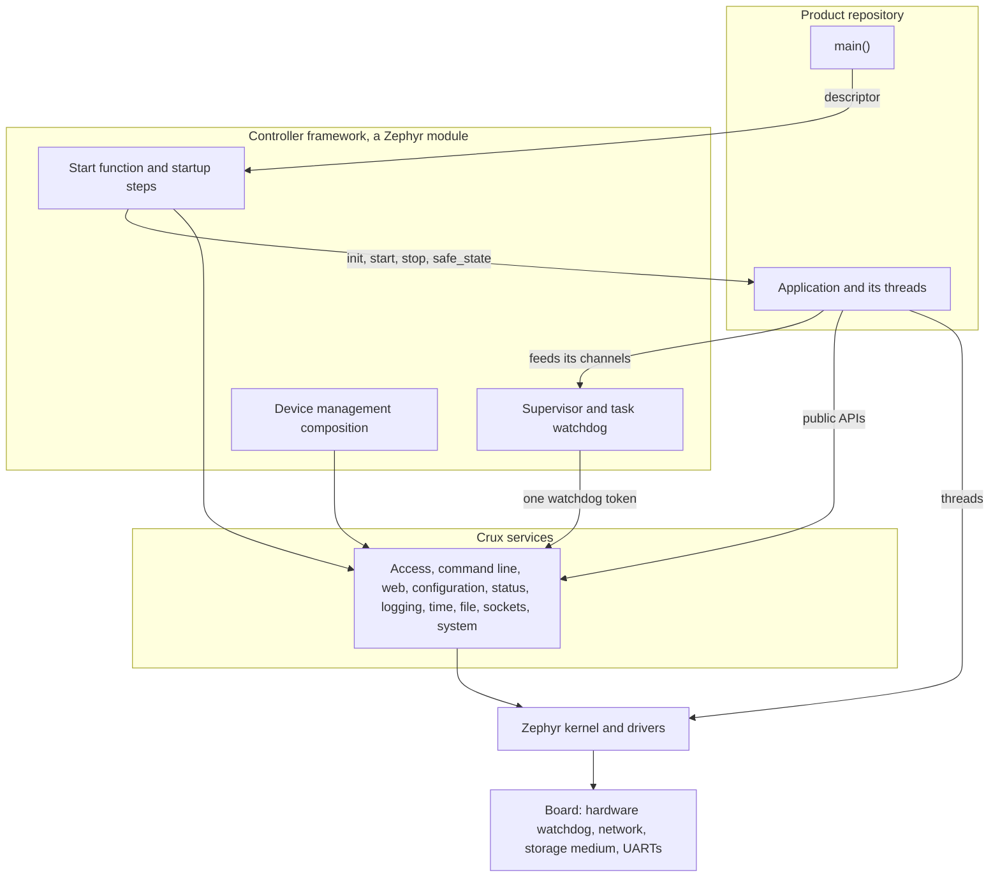
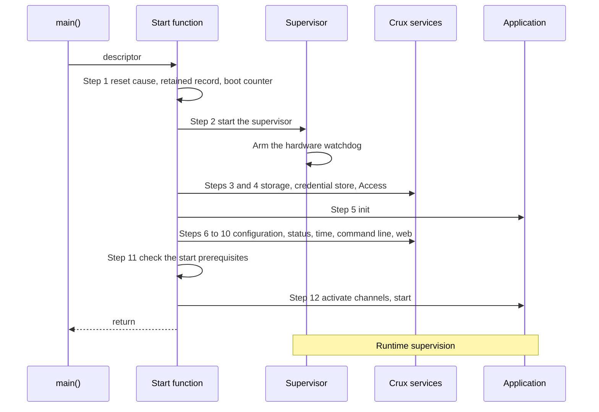
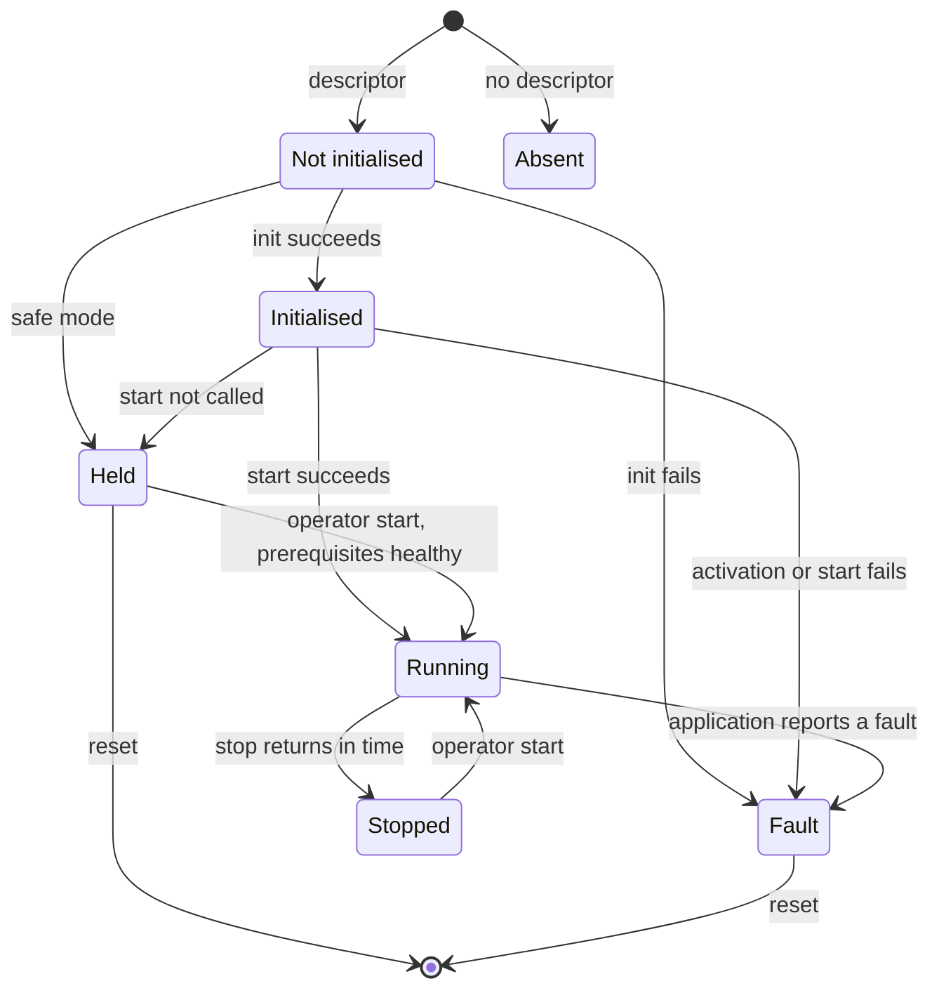
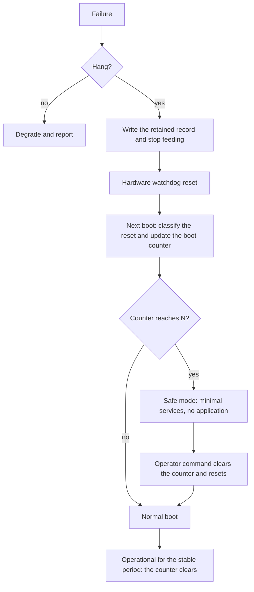

# Controller framework

The controller framework is a Zephyr module of this repository that composes the Crux services of a networked controller, supervises the controller's health and defines how an application joins it.
This page explains what it is, who does what and how a product uses it.
The [specification](controller-framework-spec.md) holds the requirements, the application interface, the operating model and the decisions, and the [platform gaps](controller-framework-platform-gaps.md) hold the Crux constraints at the pin.

## What it is

- A **product** is a firmware repository outside this repository that imports Crux and the framework and adds an application.
- An **application** is the product code that joins the framework: the product's own control software or a third-party application runtime.
- The **base image** is the one image that this repository builds: every framework service and no application.
- The framework gives the application no execution model: the application creates its own threads with Zephyr and calls Crux's public APIs directly.



## Who does what

- **Crux** is responsible for hardware and OS abstraction and for the reusable platform services: Access, command line, web, configuration, status, logging, time, file, sockets, and system (reset cause and watchdog).
  It is not responsible for the startup order of a controller, its health policy or the application contract.
- **The controller framework** is responsible for the startup and composition of the Crux services, controller health supervision (watchdog, boot counter, safe mode, diagnostics) and the application integration contract.
  It is not responsible for how an application schedules and executes its work.
- **The application or third-party application runtime** is responsible for its own scheduling and execution model: its threads, their priorities, periods and timing.
  It is not responsible for the startup of the platform services or the hardware watchdog.
- **The product** is responsible for the recovery policy choices that the framework offers (start prerequisites, runtime dependencies and the application's response to them, safe-mode threshold, watchdog policy), the output safe state and output protection during a reset with their hardware, the storage medium, device preparation and its board files.
  It is not responsible for the framework's internal policy.

## Services

| Service | Crux interface | Use in the framework | At the pin | Target |
|---|---|---|---|---|
| Web management | Crux Access, web server on the selected TLS profile (`<crux/web_zephyr.h>`), configuration and status services, a packaged page, the reboot routes (`CONFIG_CRUX_REBOOT`) | HTTPS web UI: status, parameters, accounts, reboot | Mbed TLS profile only | Also the Wolf profile ([C7](controller-framework-platform-gaps.md#c7-ssh-and-tls-profiles)) |
| Serial command line | Crux console, `crux_cli_serial_start()` in `<crux/cli_zephyr.h>` | Command line with first-account setup (`!setup`); Access closes provisioning after the first save | On a second UART ([C6](controller-framework-platform-gaps.md#c6-console-and-logging-uart)) | Separate or shared UART as a build option |
| SSH command line and SFTP | Crux SSH and Crux File service | Command line and file transfer over SSH | None (C7) | A build option with the Wolf profile and a Crux SSH composition interface |
| Health supervision | Crux System (reset cause, one hardware watchdog activation), Zephyr task watchdog | [Specification section 4](controller-framework-spec.md#4-operating-model) | Crux service threads supervised indirectly ([C8](controller-framework-platform-gaps.md#c8-crux-service-threads-and-supervision)) | Every thread supervised by progress |
| Time | Crux Time (monotonic clock, time authority), Zephyr SNTP | Wall time for logs, records and status; every timing decision uses the monotonic clock | Available | Unchanged |
| Logging | Crux Logging (UART logger) | Framework log modules; the application uses Crux Logging directly | Available | Unchanged |
| Configuration | Crux configuration service over the Crux Configuration Settings File provider | Framework and application parameters, shown in device management | Not persistent ([C4](controller-framework-platform-gaps.md#c4-configuration-saving-needs-a-power-cut-safe-file-system)) | Saved on LittleFS |
| Network | Zephyr network configuration library, Crux Netif, Crux Sockets profile | Interface up before `main()`; link state for health and status | Available | Unchanged |
| Storage | Crux File, one provider, one mount ([C1](controller-framework-platform-gaps.md#c1-one-storage-provider-per-image)) | Application data root, credential store roots, settings file | microSD FatFs provider (C4) | LittleFS on the reference board's microSD card |
| Update | Crux image state contract | Health verdict for the confirmation of a test image | Images prepared for MCUboot, no confirmation ([C10](controller-framework-platform-gaps.md#c10-image-state)) | Health-gated confirmation |

## How a product joins

A product is a workspace application whose repository is the west manifest repository (west's T2 topology), the shape that Crux's `templates/product` also uses:

```text
product/                 manifest repository
  west.yml               imports Crux and the framework
  app/
    CMakeLists.txt
    prj.conf             build options
    src/main.c           main() with the application's descriptor
    boards/<board>.conf  per-board values
    boards/<board>.overlay
```

The manifest imports both repositories at pinned commits:

```yaml
manifest:
  remotes:
    - name: crux
      url-base: https://github.com/wonny-labs
  projects:
    - name: crux-pilot          # Crux, at a pinned commit
      remote: crux
      revision: <commit>
    - name: crux-controller     # the controller framework, at a pinned commit
      remote: crux
      revision: <commit>
  self:
    path: product
```

1. `west init -l product` and `west update` fetch Zephyr, Crux and the framework into the workspace.
2. The framework is a Zephyr module, and the product turns it on with one Kconfig symbol in `prj.conf`.
3. The product's `main()` passes the application's descriptor to the framework's start function once.
4. The start function runs the startup steps, starts the application last, returns, and the supervisor keeps supervising.
5. The product sets the build options with Kconfig and keeps per-board values in its board files.



## Base image

The base image is the framework with no application: the base image's `main()` calls the start function with no descriptor, and every framework service runs.
A test-only fixture application under `tests/` exercises the application interface in a contract test and is the code reference for a product; it is not a product template.

## Application states

The framework calls the application's entries and tracks its state; a hang resets the device instead of ending in a state.



## Health and recovery

A failure that is not a hang degrades the controller and is reported; a hang stops the supervisor feeding the hardware watchdog, which resets the device.
Repeated fault resets lead to safe mode, a minimal service set from which an operator recovers the controller.


