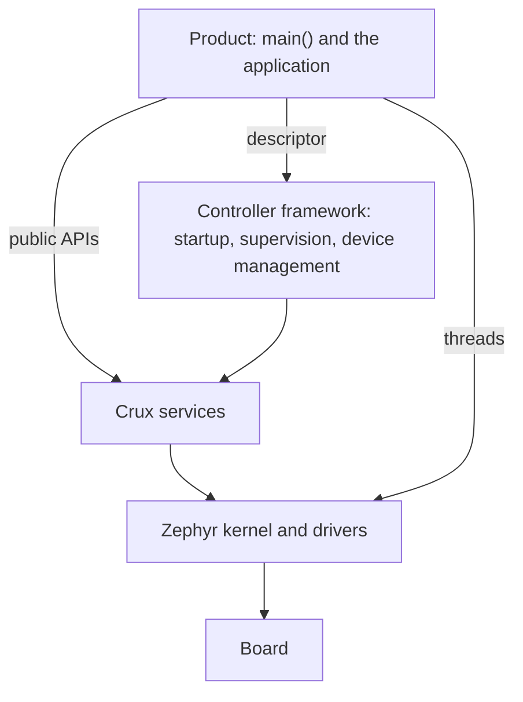
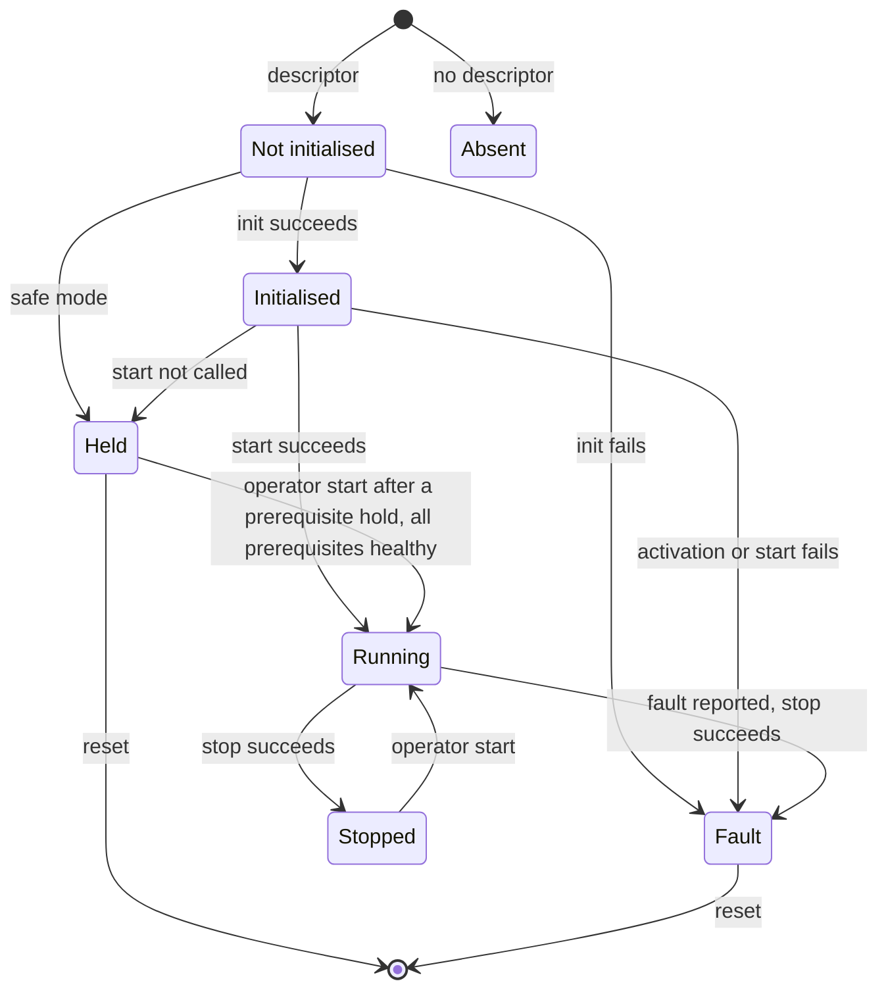
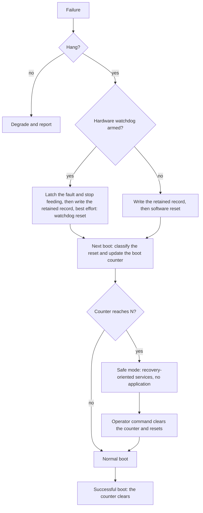

# Controller framework

A product developer who builds a networked controller on Crux gets from the controller framework a controller that starts its platform services in one defined order, offers device management, supervises its own health and recovers from faults.
The product keeps its application, the application's threads and their timing, its output safe state and its board files, and the framework imposes no execution model on the application.
The framework is a Zephyr module of this repository, which the product imports with west.
This repository is not a product: it holds the framework, and as a real downstream consumer of Crux it also shows where Crux's interfaces fall short (D12).
This page explains what the framework gives, who does what and how a product joins it.
The [specification](controller-framework-spec.md) holds the requirements, the application interface, the operating model and the decisions, and the [platform gaps](controller-framework-platform-gaps.md) hold the Crux constraints at the pin and the Crux interface of each service.
The [threat model](controller-framework-threat-model.md) holds the assets, interfaces and threats that the security requirements answer.

## What it is

- A **product** is a firmware repository outside this repository that imports Crux and the framework and adds an application.
- An **application** is the product code that joins the framework: the product's own control software or a third-party application runtime.
- The **base image** is the one image that this repository builds: every framework service and no application.
- The **application template** is a folder of this repository that a product team copies once to start a product repository: `main()`, configuration, board files, a west manifest and tests, with no framework logic ([specification section 7.5](controller-framework-spec.md#75-application-template-d20)).
- The application creates its own threads with Zephyr and calls Crux's public APIs directly.



The [startup sequence](controller-framework-spec.md#41-startup-steps) shows how the start function, the supervisor, the Crux services and the application interact.

## Who does what

- **Crux** is responsible for hardware and OS abstraction and for the reusable platform services: Access, command line, web, configuration, status, logging, time, file, sockets, and system (reset cause and watchdog).
  It is not responsible for the startup order of a controller, its health policy or the application contract.
- **The controller framework** is responsible for the startup and composition of the Crux services, controller health supervision (watchdog, boot counter, safe mode, diagnostics) and the application integration contract.
  It is not responsible for how an application schedules and executes its work.
- **The application or third-party application runtime** is responsible for its own scheduling and execution model: its threads, their priorities, periods and timing.
  It is not responsible for the startup of the platform services or the hardware watchdog.
- **The product** is responsible for the recovery policy choices that the framework offers (start prerequisites, runtime dependencies and the application's response to them, safe-mode threshold, watchdog policy), the output safe state and output protection during a reset with their hardware, the storage medium, device preparation and its board files.
  It is not responsible for the framework's internal policy.
- **The manufacturer**, the organisation that places the end product on the market, holds the organisational duties of the EU Cyber Resilience Act, such as vulnerability reporting, the risk sign-off and the support period ([specification section 6.6](controller-framework-spec.md#66-organisational-duties)).

## Capabilities

| Capability | What the product gets | Current state | Target |
|---|---|---|---|
| Device management | An HTTPS web UI for status, parameters, accounts and reboot, and a serial command line with first-account setup | Web management on Crux's Mbed TLS profile, and the serial command line on a second UART ([C6](controller-framework-platform-gaps.md#c6-console-and-logging-uart), [C7](controller-framework-platform-gaps.md#c7-ssh-and-tls-profiles)) | SSH, the Wolf TLS profile and one shared UART as build options |
| Configuration | Parameters of the framework and the application, shown and changed through device management | Not persistent at the pin ([C4](controller-framework-platform-gaps.md#c4-configuration-saving-needs-a-power-cut-safe-file-system)) | Saved on a power-cut-safe file system, LittleFS on the reference board |
| Health monitoring | Controller state, application state, service health, reset cause, last-fault record and watchdog state in the status service | Specified; Crux service threads supervised indirectly ([C8](controller-framework-platform-gaps.md#c8-crux-service-threads-and-supervision)) | Every Crux service thread supervised by its progress |
| Fault recovery | A watchdog reset on a hang, a retained fault record, a boot counter, safe mode and health-gated image confirmation | Specified; images prepared for MCUboot with no confirmation ([C10](controller-framework-platform-gaps.md#c10-image-state)) | Health-gated confirmation through Crux's image state contract |
| Application integration | A descriptor with four entries, watchdog channels, status items, parameters and a data root | Specified; delivered in delivery stage 3 | Validated by a first real runtime consumer |
| Project start | An application template to copy, whose copy imports the framework at a pinned revision | Specified; delivered in delivery stage 4, after the application interface | Built and tested in CI from the same commit as the framework |
| Platform integration | The Crux services for time, logging, network, storage, sockets and system, composed in one start order, with per-board values in board files | Specified; the reference board is the RT1060-EVKB | Further boards when one enters the scope ([C12](controller-framework-platform-gaps.md#c12-soc-gates)) |

The [service mapping](controller-framework-platform-gaps.md#service-mapping) names the Crux interface behind each capability.

## How a product joins

A product is a workspace application whose repository is the west manifest repository (west's T2 topology), the shape that Crux's `templates/product` also uses and that the application template provides:

```text
product/                 the west manifest repository
  west.yml               imports Crux and the framework at pinned commits
  app/
    CMakeLists.txt
    prj.conf             build options, including the framework's Kconfig symbol
    src/main.c           main(), which passes the application's descriptor to the start function
    boards/<board>.conf  per-board values
    boards/<board>.overlay
```

The manifest below is the reference configuration on Crux's Mbed TLS profile: it imports the Crux manifest, which brings in Zephyr, and blocks the three wolf projects.
A product on the Wolf profile needs another manifest ([C7](controller-framework-platform-gaps.md#c7-ssh-and-tls-profiles)).
`<crux-repository>` is a placeholder for the Crux repository named in this repository's [`west.yml`](../../west.yml).

```yaml
manifest:
  remotes:
    - name: crux
      url-base: https://github.com/wonny-labs
  projects:
    - name: crux                # Crux, at a pinned commit
      repo-path: <crux-repository>  # placeholder
      remote: crux
      revision: <commit>
      import:
        name-blocklist:
          - wolfssl
          - wolfssh
          - wolfpsa
    - name: crux-controller     # the controller framework, at a pinned commit
      remote: crux
      revision: <commit>
  self:
    path: product
```

Enabling configuration:

- One Kconfig symbol in `prj.conf` turns the framework module on; its name is open, decided at implementation (after delivery stage 1).
- The build options of [specification section 7.1](controller-framework-spec.md#71-build-options) select the transports, the start prerequisites, the safe-mode threshold and the deadlines.
- The board files set the devicetree roles: the aliases `crux-serial0` and `crux-watchdog0`, the `chosen` node `zephyr,log-uart` and the node label `controller_storage` ([specification section 7.2](controller-framework-spec.md#72-boards-and-variants)).

Build and run commands:

| Command | What it does | Available |
|---|---|---|
| `bash scripts/build-board.sh management` | Builds this repository's device management configuration for the RT1060-EVKB; it needs the Mbed TLS group, which the Dev Container does not switch on ([board bring-up](../board-bring-up.md)) | Now |
| `west twister -p native_sim/native/64 -T tests/native_sim` | Runs this repository's `native_sim` scenarios | Now |
| `bash scripts/build-board.sh <configuration>` | Builds the base image for the board; the configuration name is open (D13) | After delivery stage 1 |
| `west init -l product` and `west update` | Fetch Zephyr, Crux and the framework into a product workspace | After delivery stage 1 |
| `west build -b <board> app` | Builds the product image | After delivery stage 1 |
| `west build -b native_sim/native/64 app -t run` | Builds and runs the product image on `native_sim` | After delivery stage 1 |

The [tutorial](../tutorial.md) runs the Twister command through `bash scripts/dev-shell.sh`, and [board bring-up](../board-bring-up.md) runs `scripts/build-board.sh`.

Integration order:

1. Copy the application template (from delivery stage 4 on), or create the product workspace from the manifest, and turn the module on.
2. Add the board files with the devicetree roles.
3. Build the product with no descriptor: every framework service runs, as in the base image, and device management answers.
4. Add the application's descriptor and its entries (after delivery stage 3).
5. Select the start prerequisites, the runtime dependencies, the safe-mode threshold and the deadlines.
6. Prepare the device: the volume and the device identity ([specification section 5.5](controller-framework-spec.md#55-device-preparation-d11)).

From delivery stage 4 on, the application template's `main()` is the code example of the application interface; CI builds it, so it matches a tested build.

## Base image

The base image is the framework with no application: the base image's `main()` calls the start function with no descriptor, and every framework service runs.
A test-only fixture application under `tests/` exercises the application interface in a contract test; a product starts from the application template instead.

## Application states

The framework calls the application's entries and tracks its state; a hang resets the device instead of ending in a state.



## Health and recovery

A failure that is not a hang degrades the failing service, and the controller when the service is required, and is reported; a hang ends in a reset.
Repeated fault resets lead to safe mode, a recovery-oriented service set from which an operator recovers the controller.



A successful boot is a stable period in which the controller is operational and the application is neither in fault nor held ([specification section 5.2](controller-framework-spec.md#52-boot-counter-and-safe-mode-d4)).
